<!-- Contributors: Claude (Opus 5.5, Anthropic) drafted the groups, chat and public profile model, its rules, the co-organizer model and the deploy owner (#228); Franciszek Najda (decided and reviewed). -->
<!-- Contributors: Claude (Opus 5.5, Anthropic) (members get their own group in the rules table, and groups of an ended event as an open question, #295). -->
<!-- Contributors: Claude (Opus 5.5, Anthropic) (group chat messages built, refused offline rather than queued, and the messages left behind by a deleted group or account, #237; no messages from a deleted account and the Sprint 5 status, after review). -->
<!-- Contributors: Claude Opus 5.5 (attendees schema, rules and capacity question, #121; the organizers' attendee count and the association's manage event, #131). -->
<!-- Contributors: Claude (Opus 5.5, Anthropic) (deleteAccount deployed, region note, Blaze question closed, 2026-11-05). -->
<!-- Contributors: Claude (public profiles marked as built, #229; the deletion marker and the public copy kept in step, after review, #229; the interests step, #230). -->
<!-- Contributors: Claude (Opus 5.5, Anthropic) drafted the account deletion decision, its deletion/failure matrix and the related open questions (#201); Mohamed Khellaf (reviewed and revised). -->
<!-- Contributors: OpenAI Codex (verified association shell and remaining map handoff, #140; recorded the manual association review workflow, #210; marked the group roster route as built, #234). -->
<!-- Contributors: OpenAI Codex (association signup/setup routing and built/planned integration, #125). -->
<!-- Contributors: OpenAI Codex (Google authentication architecture, Firebase-managed linking clarification and review cleanup for #106; preserved contributor acknowledgments during rebase); Claude (the shared UI parts, #251; the confirmation sheet parts, #296; Find a group's ViewModel states and the detail's group card, #233). -->
<!-- Contributors: OpenAI Codex (removed obsolete Google collision UI, #107). -->
<!-- Contributors: OpenAI Codex (Google entry routing for #107). -->
<!-- Contributors: OpenAI Codex (Sprint 2 architecture, navigation, registration/reminder design and open questions, #139; documented Mapbox renderer/setup decisions and production/privacy open questions, #50); Claude (drafted this page and its diagrams from the README, the Scrum Board and the issue descriptions; association accounts without an EPFL email; Create Event design update, #44; ViewModel rule wording; Security Rules state after #35; the profile step's year question, #34; association badge from the profile, #45; synced the place-name and sign-in decisions with `CONTEXT.md`; association profiles and their rules, #126; association names, #128; open questions on shared association code, #125/#127, and their answers; the Create Event organizer row, #134; routing of association accounts and Edit details, #127; the full name's limit, #143; the map's Details open the event detail, #112; association log in, #208). -->
<!-- Contributors: Claude (Opus 5.5, Anthropic) (any team member deploys, row 18, #310). -->
<!-- Contributors: Claude (Opus 5.5, Anthropic) (the missing public profile created at app start, #291). -->
<!-- Contributors: Claude (Opus 5.5, Anthropic) (registrations deleted with their event and account, #275). -->
<!-- Contributors: Claude (Opus 5.5, Anthropic) (the QR payload parser marked as built, #337). -->
<!-- Contributors: Claude (Opus 5.5, Anthropic) drafted the friends data model, its rules design and open questions, and the review fixes for stale actions and deleted accounts (#338); Konstantinos Perdikeas (decided and reviewed). -->

How PolySocial is built, as we currently envision it. The page follows the [Android App Architecture guide](https://developer.android.com/topic/architecture/intro): a **UI layer** (Compose screens and ViewModels), a **domain layer** of pure Kotlin logic, and a **data layer** of repositories in front of Firebase, the map and geocoding services, and the device sensors.

This diagram is meant to **stay ahead of the code and drive development**. When a sprint task changes the design, update this page in the same PR. The Markdown source is versioned in the repository at `docs/Architecture-Diagram.md`, and this wiki page mirrors it.

## Contents

1. [Architecture overview](#1-architecture-overview)
2. [Navigation map](#2-navigation-map)
3. [Feature slices](#3-feature-slices)
4. [Key flows](#4-key-flows)
5. [Data model](#5-data-model)
6. [Security Rules](#6-security-rules)
7. [Design decisions](#7-design-decisions)
8. [Backlog traceability](#8-backlog-traceability)

## Legend

| Colour | Meaning |
|---|---|
| 🟩 Green | In the **Sprint 2 scope**, including its Sprint 1 foundations. Green means planned for the sprint, not necessarily implemented or merged. Names and contracts come from the linked issues. |
| 🟦 Blue | In the **Product Backlog**. Planned, and the names are proposals until an issue fixes them. |
| ⬜ Grey, dashed | **Later or undecided**. Needs a team decision or its own issue first. |
| 🟨 Yellow | **External service or device API**. |

Arrows read "uses" or "calls". A dashed arrow is a planned or optional dependency.

**Dependency rule.** Screens talk only to their ViewModel. ViewModels talk to repositories and to domain logic. Only repository implementations import Firebase, HTTP or location APIs. The map SDK is a UI component isolated in `MapboxRenderer`, which renders ViewModel state and does not query event data. The domain layer imports nothing from Android or Firebase.

## 1. Architecture overview

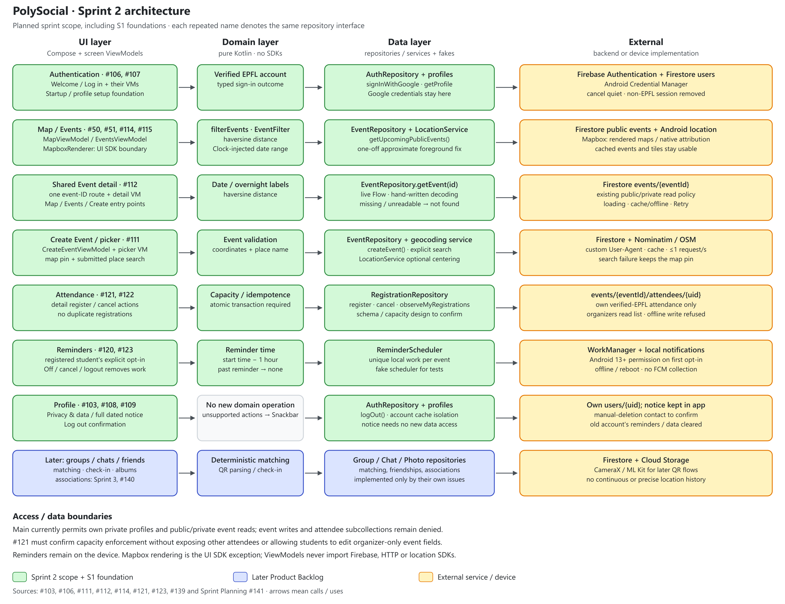

The source is [docs/images/architecture-overview.svg](images/architecture-overview.svg), a plain SVG kept next to the PNG. Both source and export are now versioned in the main repository; the wiki mirrors them. Edit it in any vector editor (or as text), then export the PNG again.

**How to read it.**
- Every screen that holds state has exactly one ViewModel. The app shell (app bar, bottom bar and `NavHost`, #41) has none: its only state is navigation, which the `NavController` owns, and a ViewModel copy of it could get out of sync. The ViewModel exposes a single immutable UI-state `StateFlow` with loading, empty, success and error variants, and receives user actions as function calls.
- Repositories are Kotlin interfaces with a Firebase (or device) implementation and a `Fake…` implementation for tests. ViewModels get them through their constructor, injected by **Hilt** (`@HiltViewModel`). Tests swap in the fakes with Hilt's test modules.
- **Offline:** Firestore offline persistence is the only cache (no Room, no custom sync). Loaded events, registered events and their schedule stay readable offline. Writes the app waits for, such as creating an event, joining a group or sending a chat message, are refused offline with a way to try again, not queued (#45, #228). Reminders are scheduled on the device. The map shows cached events on tiles the Maps SDK already cached, with **no tile prefetching**. Sign-up and log-in need a network and show a clear error without one.
- **Map provider:** Mapbox is approved (#50), replacing Google Maps. Its SDK is a UI component isolated in `MapboxRenderer`; `MapScreen` renders markers from `MapViewModel` state and never queries data itself. The public `pk.` token comes from each checkout's ignored `local.properties` through a generated string resource, with an empty-token setup state. One signup token is approved for initial development; a dedicated token with only `styles:read`/`fonts:read` is required before production. The token value never belongs in architecture documents or tracked resources. Firebase event data flows through `RepositoryMapEventSource`, adapting #49's live public-event repository without backend SDK imports in the ViewModel. Cached events remain usable, and cancellation releases the repository listener.

## 2. Navigation map

App-start routing (#32) decides between the authentication flow and the main app. The main app is a four-tab shell (#41). Each tab has its own back stack (#42) and starts in the shared loading or placeholder state (#43).

### 2.1 Signing in

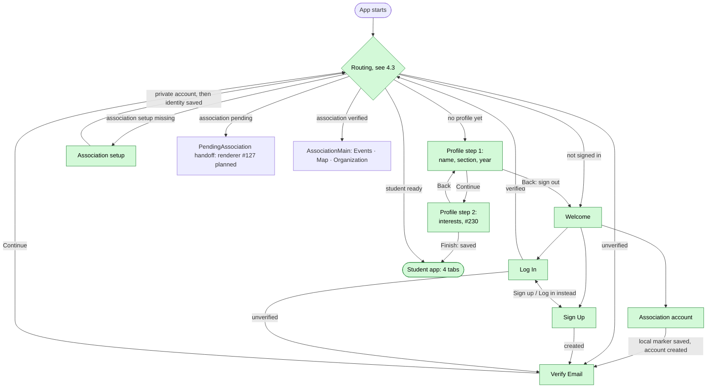

**Association onboarding (#125, implemented):** `SignUpViewModel` persists an association intent in `AssociationSignupStore` before calling `AuthRepository.signUp`. `PreferencesAssociationSignupStore` writes only an email digest and marker, off the main thread; it grants no server permissions. Student signup retains the EPFL restriction, while association signup accepts a valid email on any domain and reuses Verify Email.

`AssociationSetupScreen` forwards actions to `AssociationSetupViewModel`, which validates through the shared framework-free `associationFormErrors` and saves `users/{uid}` with `accountType = association` and an empty `displayName` before creating `associations/{uid}` through the repositories. Only the identity stores the association name. A lost-response retry updates the latest submitted values; failures retain the UID-scoped form. The client never writes the admin verification flag.

`AppStartViewModel` restores `AssociationSetup`, `PendingAssociation` or verified `AssociationMain` from the private account type and identity. Missing non-EPFL profiles resume association setup without a device-local hint; EPFL accounts need the hint to distinguish unfinished student and association setup. Once the private profile records the type, marker cleanup is housekeeping and cannot block entry. Existing profiles remain authoritative.

**Verified shell (#140, implemented):** verified associations reuse the tab graphs with Events, a query-free explanatory Map state until #133, and Organization. Chats is absent. Organization retains its own identity across Privacy navigation and reuses cache-first logout, which clears installed graphs.

**Integration still planned:** #127 supplies the pending-review renderer and editing; until it is wired, this slice's pending handoff offers logout only and does not complete #125. #133 supplies the owner-constrained Map content; #208 owns existing-association login. The first association shell merged (#247 or #261) stays and the second adapts on rebase. Membership/invite behavior is undecided, so setup keeps review-focused copy; Figma's invitation sentence needs a team update. No new setup/configuration is required.

### 2.2 Main app (one back stack per tab)

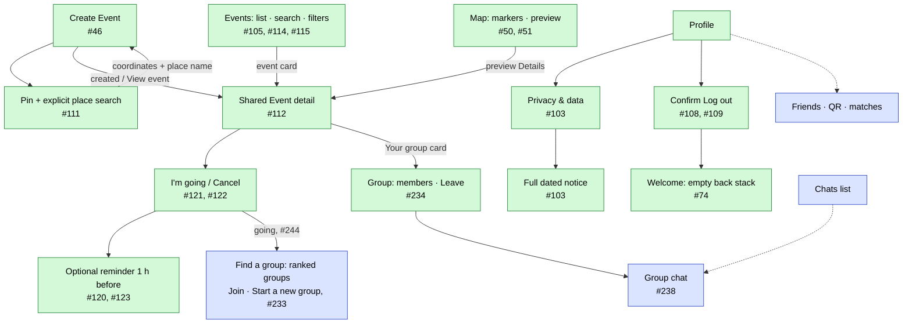

**Integration:** #112 replaces the Map detail placeholder with one shared screen and ViewModel class. Each entry tab registers its own event-ID route (the helper proposed in #157 is `Tab.eventDetailRoute`), so Events, Map and Create Event entry points return to their own tab stack without changing the selected tab. Unbuilt actions (Find a group, download data, attendance-based matching and account deletion) show a not-available Snackbar; they do not open unfinished screens. Account deletion keeps it until #207 connects the agreed flow (decision 15). Privacy's full notice works offline. Logout and account deletion must also cancel the previous account's reminders (#109, #123); #198's `SessionGuard` keeps the cached data away from the next account (decision 15).

Notes:
- **Back behaviour (#39, #42).** Back pops the current tab's stack first. At the root of the Map, Chats or Profile tab it goes to the **Events** (home) tab, and at the Events root it exits the app. This is Android's standard bottom-navigation behaviour. Switching tabs restores each tab's screen and scroll position (#38).
- **Create Event.** A "+" button on the Events and Map tabs opens it. After creating, an "Event created" confirmation offers *View event* (the new event's detail) and *Back to map*, as in the Figma (#44).
- **Event detail.** The map preview's "Details" opens the shared event detail inside the Map tab (#112), like the Events list and "View event"; the placeholder route of #50 is gone.

## 3. Feature slices

Each feature in the Sprint 2 scope, from screen to data source. The Sprint 1 foundation slices remain below; section 3.6 describes the planned Sprint 2 additions. The Product Backlog features are already drawn in the [overview](#1-architecture-overview), so they are described in text only.

- **Shared UI parts (#251).** Form and banner pieces used by several screens live once in `ui/common` (`FormParts.kt`): `FieldLabel`, `OfflineBanner`, `ErrorBanner` and `PrimaryButton` (also the location picker's "Use this location"), next to `LoadingState`, `ErrorState` and `StateButton`. Confirmation bottom sheets use `ConfirmationSheet.kt` (#296): `ConfirmationSheet` (the frame, which can't be dismissed while `locked`), `SheetIcon`, `SheetTitle` and `SheetSecondaryButton`. Reuse them instead of copying them into a screen. `Chips.kt` (#230) adds `choiceChipSurface`, the dark-or-outlined pill every choice chip draws, and the interest labels (`INTEREST_LABELS`, `interestLabel`).

### 3.1 Authentication and profile (Sprint 1)

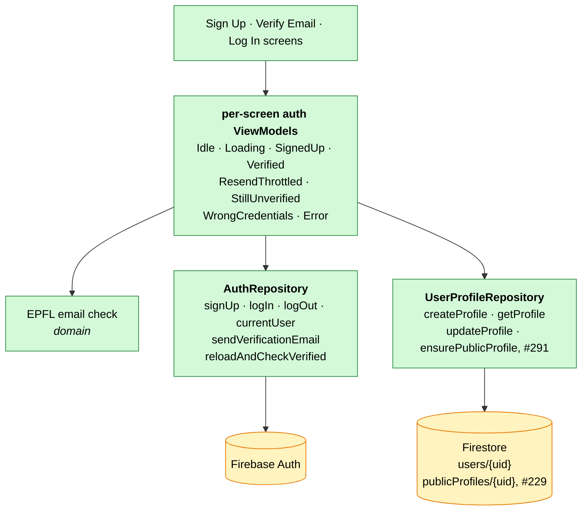

- **Result types (#30–#32).** `signUp` returns success, invalid domain, already in use or network error. `logIn` adds wrong credentials. `sendVerificationEmail` has a distinct *throttled* failure for Firebase's too-many-requests error, which the UI shows differently from a real error.
- **Profile (#34).** `UserProfile` has at least `uid`, `email` and `createdAt`. #45 adds `accountType` (`student` or `association`, default `student`) and `isAssociationVerified` (default `false`). The document ID is always the Auth UID, never a client-generated ID. The profile is created **exactly once, at the first verified entry** (Verify Email "Continue", or app-start routing finding a verified user without a profile), because the Security Rules only allow writes from verified accounts. If account creation fails, no profile is written. If the profile write fails, the user sees an error state. Fields other students may see live in a separate `publicProfiles/{uid}` document (see [5.2](#52-collections-and-key-fields)).
- **Email verification.** Every student account must have a verified `@epfl.ch` email, and the Security Rules check this whatever the sign-in method. **Associations** have no EPFL email, so they sign up with their own verified email, and they get no access beyond their own `users/{uid}` and `associations/{uid}` until a PolySocial admin verifies them (decision 11). Sprint 1 uses email/password, where Firebase marks the email unverified until the student clicks the link we send, hence the Verify Email screen. Google sign-in (#106) delivers already-verified emails, so those users skip that screen. The rules would not change.
- **Public profiles of older profiles (#291).** App start (4.3) starts `ensurePublicProfile(uid)` whenever it opens the students' app, without waiting: in one transaction it creates a missing `publicProfiles/{uid}` from the stored `users/{uid}` of a student, and never overwrites one, writes the private profile or gives an association one. A failure opens the app anyway and is retried at the next start. The rules already accept that copy on its own (no rules change).
- **Log out (#8, #32).** Logging out clears the session, and the next launch routes to Log In.

### 3.2 Map (Sprint 1)

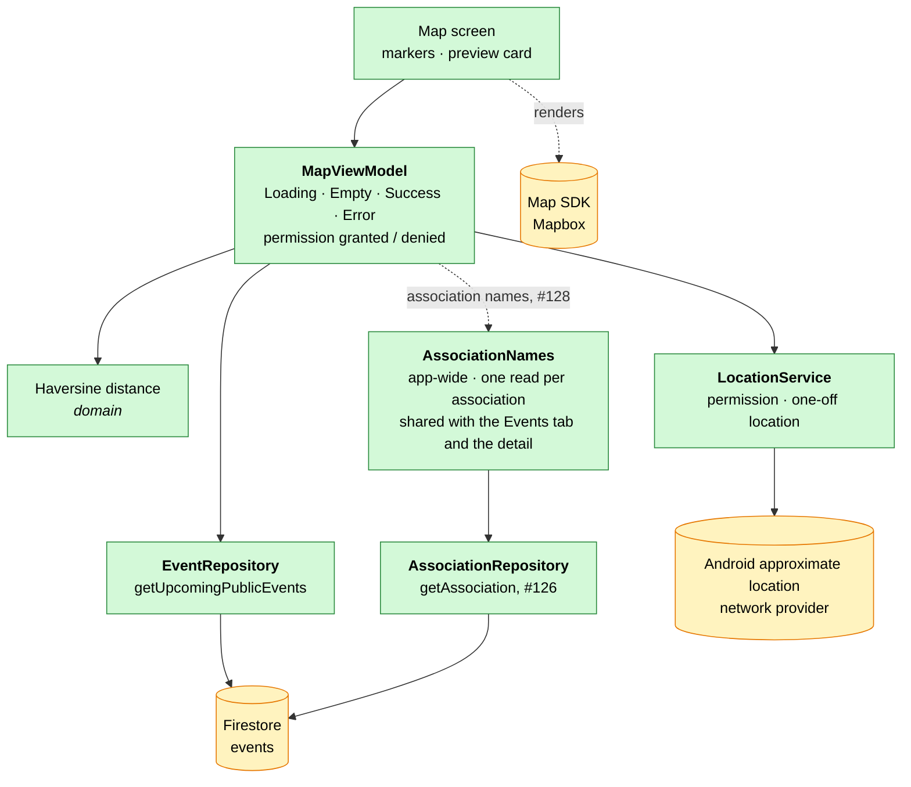

- **Map (#50, #51).** The map is centred on Lausanne. Location permission is requested once, on first entry to the Map tab. If it's denied, the map stays fully usable without distance badges. Distance is labelled *straight-line*, not walking time. Route-based distances are out of scope.
- **Association names (#128).** The map preview, the Events tab's cards and the event detail show the name of an association's event next to its Verified badge. One app-wide `AssociationNames` (`CachedAssociationNames`) reads each association once and shares it; a name that can't be read leaves the badge alone and is tried again later (fresh events from the server, opening the preview or the detail). Names belong to the signed-in account.
- **Upcoming events query (#49).** The query **must** include `isPrivate == false`. Security Rules are not filters, so a query that could return a private event is rejected as a whole. Combining equality on `isPrivate` with a range on `startTime` needs a composite index, which should be versioned in `firestore.indexes.json` next to the rules.

### 3.3 Create Event (Sprint 1)

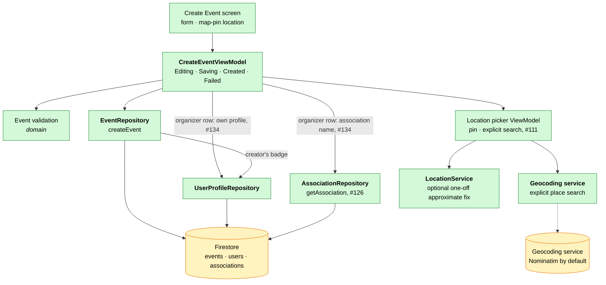

- **Event model (#45).** `id`, `title` (at most 80 characters), `description` (may be blank, at most 5000), `category` (Study, Sports, Culture, Party or Other; an unknown stored category reads as Other), `location` (lat/lng), `startTime`, `endTime` (nullable, after `startTime`), `capacity` (nullable, at least 2), `isPrivate`, `createdBy`, `organizerIds`, `allowedUids` and `isAssociationEvent`. `createdBy` is always the authenticated UID and is always in `organizerIds` and `allowedUids`. At creation the repository makes the creator the only organizer and allowed reader and sets `isAssociationEvent` from the creator's profile, ignoring the form's values. The Security Rules enforce this again (#47). An end time earlier than the start time on the form means the next day.
- **Create Event access (#46).** **Anyone can create an event** and becomes its **organizer**. An event can have one or several student organizers (`organizerIds`). Only a verified association (`accountType == "association"` and `isAssociationVerified`) publishes under its name: its events get `isAssociationEvent` and show a verified badge. An unverified association account can't create events or add members until it's verified, so the form has no access-denied state. Address search appears in the Figma task (#44), but the Sprint 1 build task only requires a map pin (#46), so the pin-and-search picker is in Sprint 2 (#111). Geocoding stays with the approved Nominatim service and its usage policy; choosing Mapbox for map rendering does not add a geocoding API.
- **Create Event screen (#44, #46).** The form follows the Figma (section 04): a date with a start time and an **optional** end time, which tells check-in and "Find my group" when the event is over. An end time earlier than the start time means the next day, shown as "+1 day" under the end field (Figma "Create event · overnight"). Inline errors cover a missing title, a title over 80 characters, a description over 5000, a past date, an end time equal to the start time, a missing location and a capacity below 2, and the *Create* button stays disabled while they remain. Offline, `EventRepository.createEvent` returns `NetworkError` without starting a write (Firestore would queue it and never fail), and the ViewModel shows the error with *Try again*, keeping the form. If location access is denied, the location picker still works with search and the map pin.
- **Organizer row (#134).** The top of the Create Event and Edit event form shows who organizes the event. `CreateEventViewModel` reads it once at opening: the signed-in user's profile (`UserProfileRepository`), then, only for a verified association, its `associations/{uid}` (`AssociationRepository`, #126). A verified association sees its initials, "Organized by <name>" and the Verified badge (Figma "Create event · association"); everyone else, and any failed read, sees "Organized by you", and the form never waits for the row.

### 3.4 Groups, matching and chat (Sprint 4, decided in #228)

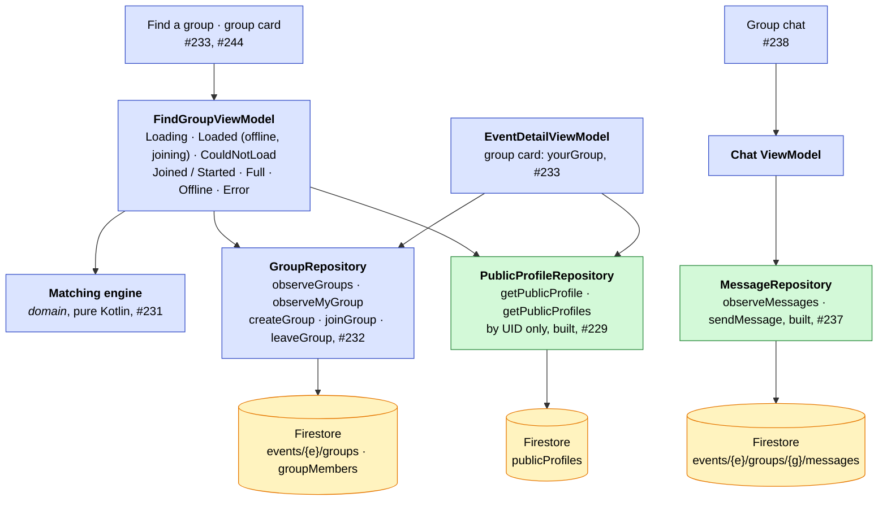

- **Groups live under their event:** `events/{eventId}/groups/{groupId}`, like the registrations (#121), so the rules reuse the event's readability from the path. A group has a fixed `capacity` of **4** (a product decision, not set by the organizer; stored so it can change without a migration), `memberUids` (1 to `capacity` UIDs, the creator first), `createdBy` and a server-set `createdAt`. A student's own groups, across events, are a collection-group query on `memberUids array-contains <their UID>`.
- **Joining and leaving touch only your own UID.** Join adds the student's UID to `memberUids`, leave removes it, and the last member to leave deletes the group. The rules check `memberUids.size() <= capacity`, so the capacity needs no counter, and the client's **transaction** makes sure two students can't take the last place at the same time.
- **One group per student per event:** the marker `events/{eventId}/groupMembers/{uid}` holds the student's `groupId`. It is created and deleted in the same transaction as the `memberUids` change, and the rules tie the two together with `getAfter`. Android transactions can't run queries, so the marker is how the transaction knows the student is already in a group.
- **Who can join:** a student who can read the event. Requiring "I'm going" first is decided (#228) and built by #244, which also decides whether the rules check it. Associations never reach groups, messages or public profiles.
- **Matching starts on the client.** The engine (#231) is a deterministic heuristic in a pure Kotlin module: given the student (section, year, interests) and the event's groups with their members' public profiles, it returns the open groups ranked, full groups left out, ties broken by a stable key. We revisit a Cloud Function only if fairness or cheating becomes a problem; the module would move unchanged.
- **Public profiles (#229):** `publicProfiles/{uid}` holds `displayName`, `section`, `year` and `interests` (codes from #230's fixed list of about ten), never the email. It is written in the same transaction as `users/{uid}`. Public or private visibility of further fields comes later.
- **Chat (#237, #238):** each group has `messages` (`senderId`, `text` of 1 to 1000 characters, server-set `createdAt`). Only members read and send, each sender writes only their own messages, a deleted account can't send, and nobody edits or deletes one yet. Sending is **refused offline** with Try again, like `createEvent`, rather than queued. A one-to-one chat is a two-member group, so there is one chat model and one set of rules.
- **Real-time screens.** Groups, my group and messages are Firestore snapshot listeners exposed as `Flow`, usable from the cache offline.
- **Moderation-ready.** The rules are written per operation and messages carry `senderId` and `createdAt`, so report/block and rate limiting can be added later without a rule rewrite.

### 3.5 At the venue and social features (Product Backlog)

- **Check-in (#22).** A one-off location check against the venue during the event window. A QR code at the entrance is the indoor fallback. Only checked-in members can upload to the album (README).
- **Find my group (#20).** Locations are shared **only with the group and only during the event** (README). Each member's position lives in `events/{eventId}/groups/{groupId}/locations/{uid}`. It is written only during the event window, readable only by group members, and deleted when the event ends. There is no location history.
- **Album.** Photos are compressed and resized on the device, then stored in Cloud Storage. A Firestore document holds each photo's metadata. Storage Security Rules enforce size and type limits and check-in membership. Thumbnails are cached.
- **Reminders (#21, #36).** WorkManager schedules them when the student registers, so they fire offline and survive reboots. The notification permission (Android 13+) is requested at that moment.
- **QR codes (#17, #22).** Scanned with CameraX + ML Kit barcode scanning. Payloads are typed strings, `polysocial://checkin/{eventId}/{token}` and `polysocial://friend/{uid}`, validated by a pure parser. **The parser is built (#337):** `parseQrPayload` and `friendQrPayload` in `model/qr/QrPayload.kt`. It is strict: the scheme and host are exact lowercase, each ID is 1 to 128 of `[A-Za-z0-9_-]` and not one of Firestore's reserved `__…__` IDs, and anything else (a web link, another app's code, a damaged scan) is `Invalid`. Showing a code (#339) and scanning one are planned.

### 3.6 Sprint 2 additions (#103, #106–#123)

This is the design to build against, not a claim that every component is already merged. Implementation status remains on the Scrum Board and the linked PRs.

| Feature | UI / domain | Repository or service boundary | Data and failures |
|---|---|---|---|
| Google sign-in (#106, #107) | Welcome / Log in → their ViewModels; verified EPFL account result | `AuthRepository.signInWithGoogle`, Credential Manager inside the repository | Firebase Auth; cancel is quiet, non-EPFL accounts are signed out immediately, typed network/unexpected failures. Provider choice and console setup must be confirmed before release. |
| Pin and place search (#111) | Create Event → picker ViewModel; confirm coordinates and place name | Geocoding service interface and fake; reuse `LocationService` for optional centering and the isolated Mapbox renderer | Nominatim is the approved search provider: submitted searches only, custom User-Agent, caching and at most 1 request/second. Failed/offline search retains the pin; denied location opens on Lausanne. |
| Event detail (#112) | Shared detail ViewModel, category styles, local date/time and one-off distance | `EventRepository.getEvent(id)` is a live `Flow`, decoded by hand with `eventFromFirestore` | Existing event read rules; deleted or unreadable is not found, network errors offer Retry, cached content remains visible offline. Optional `locationName` describes the chosen event venue, not a location history. |
| Filtering (#114, #115) | `EventFilter` + pure `filterEvents(events, filter, userLocation)`; Events / Map ViewModels | Filter already loaded `getUpcomingPublicEvents` results | No new Firestore query or index. Case/accent-insensitive title search; categories OR, criteria AND; clock-injected date range [start, end); missing location ignores the distance criterion. |
| Attendance (#121, #122) | Detail: register/cancel; pure capacity checks coordinated by its ViewModel; an association's "manage event" shows the "Going" count (#131) | `RegistrationRepository.register(eventId)`, `cancel(eventId)`, `observeMyRegistrations()`, `countAttendees(eventId)` (organizers, a server `count()`); Firestore implementation + fake | `events/{eventId}/attendees/{uid}` (`uid`, `registeredAt`); own registrations through a collection-group query on `uid`. Register and cancel are idempotent; offline writes fail instead of queuing. Refusing full events needs the capacity decision below. |
| Reminder (#120, #123) | Registered student's explicit opt-in; pure start minus 1 hour calculation | `ReminderScheduler` interface + fake; WorkManager only in its implementation | Unique work per event on the device, no new Firestore collection or FCM. No scheduling once the reminder time has passed; denial restores Off. Off/cancel/logout removes work; notification taps open shared detail. |
| Privacy / logout (#103, #108, #109) | Profile entry, dated offline notice and unbuilt-action Snackbar; logout confirmation | Notice requires no new data access; logout uses `AuthRepository.logOut()` | Notice describes only collected data and actual access. Export and attendance-based matching remain unavailable, and in-app deletion until #207 (policy: decision 15). The private manual-deletion contact, also the associations' deletion route, must be confirmed. Cache isolation on any UID change follows #198 (decision 15). |

**Sprint Planning decisions** recorded in [#141](https://github.com/swent-polysocial/PolySocial/pull/141): only the creator is an organizer until Public profiles provides a way to find co-organizers; reminders are opt-in, not automatic; association screens move to Sprint 3; an eventual Cancel event deletes it rather than introducing a cancellation status; every unbuilt action reports its availability. This document records the design without changing Authentication or Security Rules.

### 3.7 Friends (Product Backlog, decided in #338)

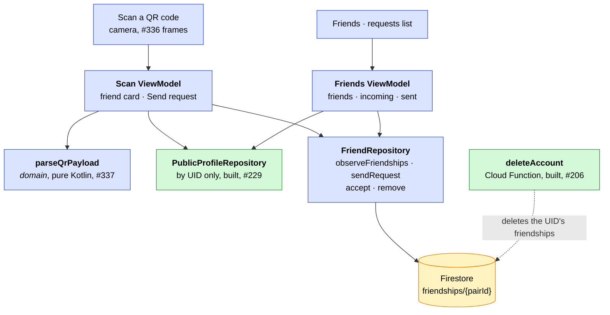

- **One document per pair of students:** `friendships/{pairId}`, where `pairId` is the two UIDs sorted and joined by `~` (`{lowerUid}~{higherUid}`; no UID contains `~`). It holds `uids` (the two UIDs, sorted), `requestedBy` (the sender's UID), `status` (`pending` or `accepted`), server-set `createdAt` and, once accepted, server-set `acceptedAt`. Only UIDs, no names or emails: names come from each student's public profile.
- **The whole lifecycle in that document.** Sending a request creates it as `pending`. Accepting is the recipient's update to `accepted`. Declining (by the recipient), cancelling (by the sender) and removing a friend (by either) all delete it, so the pair can start again later.
- **An action applies only to the request the screen showed.** Accept, decline, cancel and remove each run in a transaction that reads the document again and compares its `status` and `createdAt` with what the screen showed. If the document is gone or either changed, nothing is written and the repository returns `Gone`, so the app says the request changed and shows the current state (#361). A stale Cancel tapped after the recipient accepted can't remove the new friendship, and a stale tap can't act on a request that was cancelled and sent again under the same ID. The rules can't tell a cancel from a removal (a delete has no new data), so this check is the repository's; either student may still remove the friendship on purpose.
- **At most one request between two students, by construction.** A → B and B → A have the same ID, so a second request finds the document already there and the create is refused. When both send at the same time, the second one sees the first request and is offered Accept instead.
- **Adding a friend: by QR code first.** The app scans `polysocial://friend/{uid}` and parses it with #337's `parseQrPayload`. It then reads that student's public profile by UID (#229), shows their card and sends the request on a tap. Scanning your own code shows a message, not a request. A student whose public profile is still missing (saved before #229, see #291) can't be added until they open the app again. The app has **no usernames** (the Figma v2 profile step had one, but it was never built), so finding a student by username is an open question (section 7).
- **One listener per student:** `friendships where uids array-contains <UID>`, split on the device into friends (`accepted`), incoming (`pending`, someone else's `requestedBy`) and sent requests. A student has few friendships, so this needs no composite index. It works from the cache offline. Sending, accepting, declining and removing are **refused offline** with Try again, like chat, rather than queued.
- **Requests are seen in the app.** There are no push notifications (Firebase Cloud Messaging is not in use), so incoming requests show in the friends list.
- **Associations never take part:** they can't send, receive or read a friendship.
- **Public profiles (#229) and the later public/private choice.** The friend card and the lists show only what a public profile already shows (`displayName`, `section`, `year`, `interests`). Nobody can see another student's friends yet. Showing friends on a **public** profile, or to approved connections on a private one (section 5.2), needs its own read rule when that choice is built. So does using common friends in matching: the matching engine runs on the device, and today it can't read other students' friendships (section 7).

## 4. Key flows

Each flow shows who calls whom, top to bottom. "App" is the screen together with its ViewModel.

### 4.1 Sign up (#30)

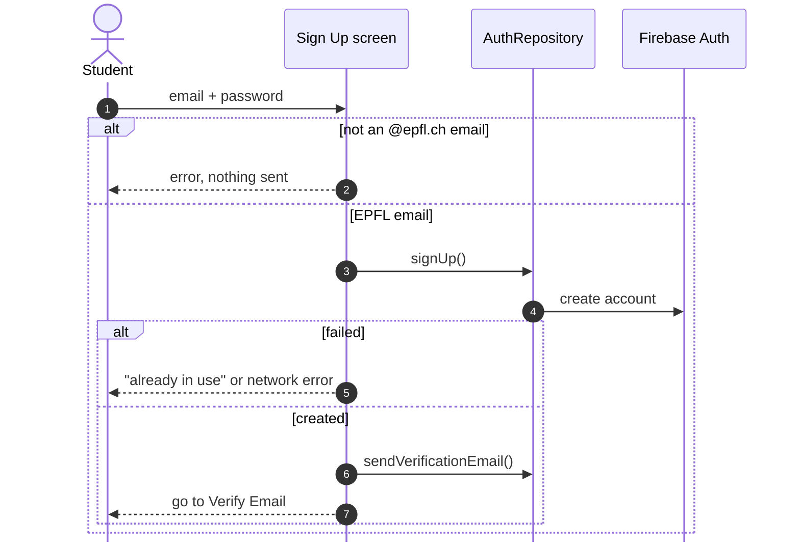

No profile is written yet. The Security Rules only accept writes from verified accounts.

### 4.2 Verify email, then create the profile (#31, #34)

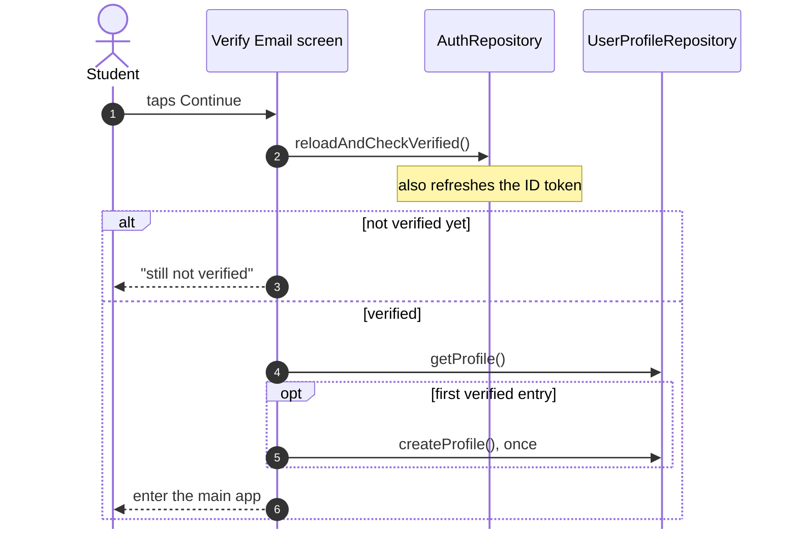

### 4.3 App start routing (#32, #74, #127, #208)

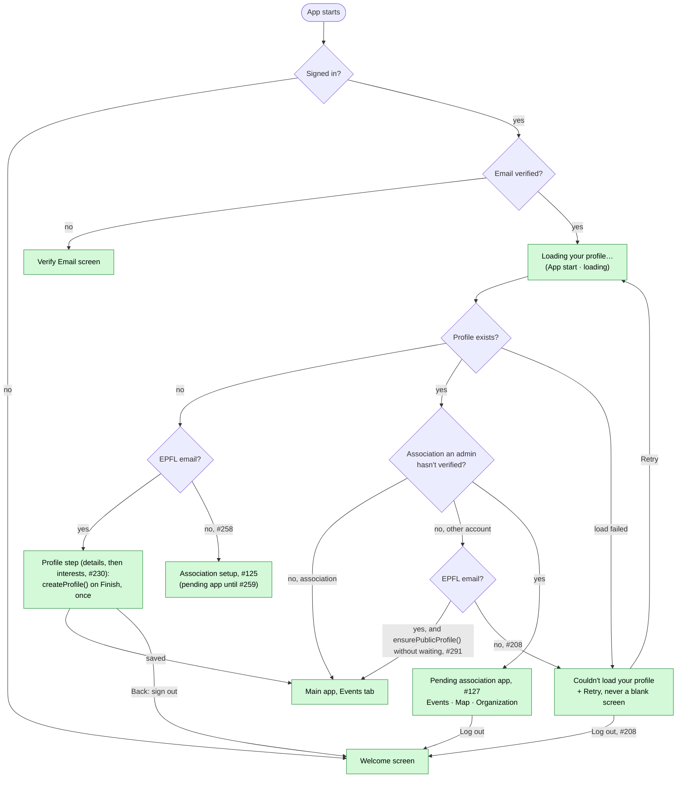

- **Association accounts (#127).** The account type decides, never the email. An association an admin hasn't verified yet opens its own app in the pending state (Figma section 02): the review steps on Events, a closed Map and its details on Organization. A verified association opens the main app (with its own Events tab, #132) until #140 gives it its own tabs in the same `AssociationShell`. The admin's verification (#135) takes effect at the next app start.
- **Edit details (#127).** On the pending app's Organization tab, Edit details (`EditAssociationScreen` → `EditAssociationViewModel`) edits the name, type, about and optional website, starting from the details shown there, checks them with association setup's `associationFormErrors` (#256), and saves them with `AssociationRepository.updateAssociation` (#126's owner-only update rule). A failed save keeps the form and offers Try again, with its own offline message.
- **Association log in (#208).** Log in accepts any email domain, so an association signs in with its own address; its helper line says students use `@epfl.ch` and associations their own email. Routing then decides by account type and fails closed: a session whose email isn't an EPFL one never gets the student profile step or the students' app. Without a profile it resumes association setup (#258); with a student profile it gets the error screen. The Security Rules already deny it student data. Every app-start error offers Retry and a Log out link (Figma 490:26), so such an account, or anyone whose Retry keeps failing, is never stuck. That Log out is the pending association app's: a confirmation, then the cache cleared before the sign-out (#109). A verified association keeps the main app until #140.

### 4.4 Map: public events and distances (#49–#51)

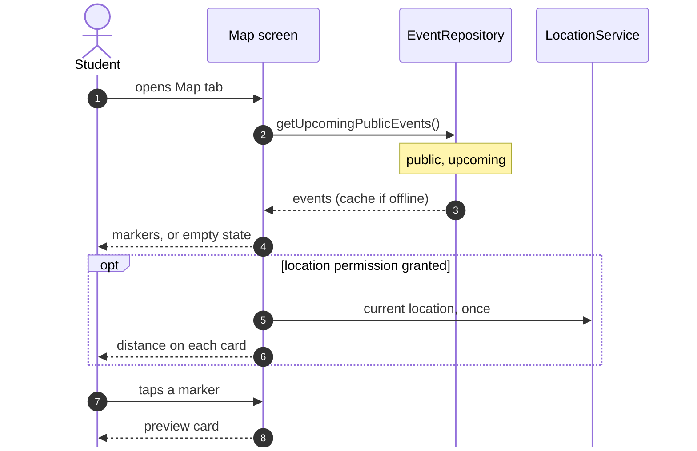

### 4.5 Find a group (#231–#233, decided in #228)

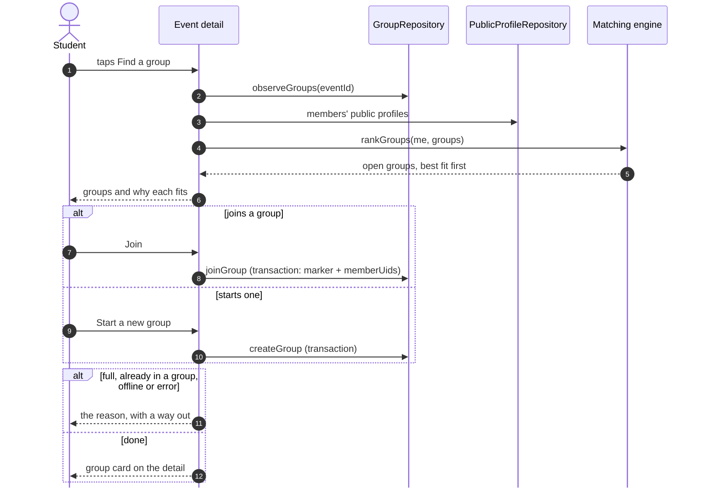

## 5. Data model

### 5.1 How the collections relate

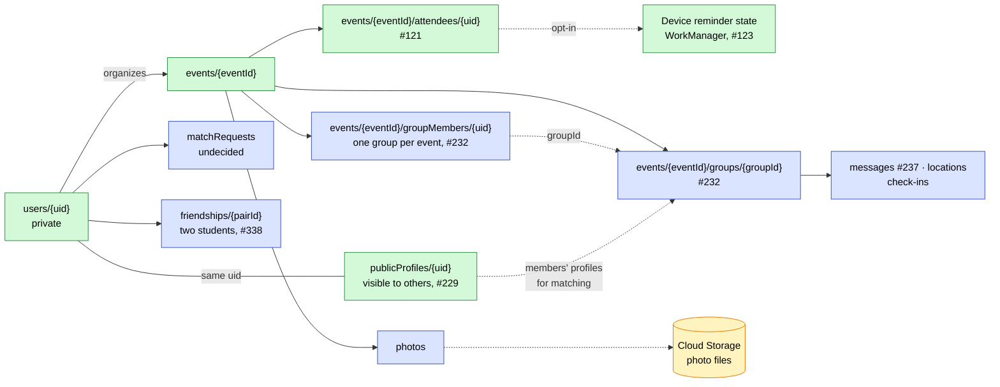

### 5.2 Collections and key fields

| Collection | Key fields | Status |
|---|---|---|
| `users/{uid}` | `uid`, `email`, `displayName` (at most 50, #143), `section`, `year`, `interests` (codes from `INTERESTS` in `ProfileOptions.kt`, each at most once, in that list's order; absent on a profile saved before #230, empty for an association), `createdAt`, `accountType`, `isAssociationVerified` | 🟩 #34, #45, #230 |
| `deletedAccounts/{uid}` | empty: only the deleted account's UID, as document ID. Written by `deleteAccount` with the profile deletion; the rules refuse recreating either profile, or sending a chat message (#237), under it. No app access | 🟩 #229 |
| `events/{eventId}` | `title`, `description`, `category`, `location`, `locationName?` (#112), `startTime`, `endTime?`, `capacity?`, `isPrivate`, `createdBy`, `organizerIds`, `allowedUids`, `isAssociationEvent` | 🟩 #45 |
| `associations/{uid}` | `name` (1–60), `type` (`ASSOCIATION`, `COMMISSION`, `CLUB`, `EPFL_UNIT`), `about` (1–1000), `website?` (`https://`, at most 200), `createdAt`. Document ID = the association account's UID | 🟩 #126 |
| `publicProfiles/{uid}` | `displayName`, `section`, `year`, `interests` (codes from #230's fixed list), always visible; never the email. Written in the same transaction as `users/{uid}`. `section`, `year` and `interests` must be codes from `ProfileOptions.kt`; `interests` copies the private list in the same order (`[]` when the private profile has none). A profile saved before #229 gets it at its next app start (#291, `ensurePublicProfile`). `username`, `visibility` (public or private) and `bio` come later | 🟩 S4 #229, #230 (built) |
| `events/{eventId}/attendees/{uid}` | student UID as document ID; `uid` (same UID, for the collection-group query) and server-set `registeredAt` | 🟩 S2 #121; no separate top-level registrations collection |
| Device reminder state | event ID, title and start time for a local notification; unique work, opt-in | 🟩 S2 #123; no Firestore collection |
| `matchRequests/{id}` | `eventId`, `fromUid`, `toUid`, `status` | ⬜ not used by Find a group, where students join open groups directly (#228); revisit with #26, #27 |
| `events/{eventId}/groups/{groupId}` | `capacity` (4), `memberUids` (1 to `capacity`, creator first), `createdBy`, server-set `createdAt` | 🟦 S4 #232 |
| `events/{eventId}/groupMembers/{uid}` | `groupId`: the student's group for this event, written in the same transaction as `memberUids` | 🟦 S4 #232 |
| `events/{eventId}/groups/{groupId}/messages/{id}` | `senderId`, `text` (1–1000), server-set `createdAt`. A one-to-one chat is a two-member group | 🟩 S5 #237 (built) |
| `events/{eventId}/groups/{groupId}/checkIns/{uid}` | `method` (gps or qr), `checkedInAt` | 🟦 #22 |
| `events/{eventId}/groups/{groupId}/locations/{uid}` | position, `updatedAt`. Only during the event, deleted after | 🟦 #20 |
| `friendships/{pairId}` | `pairId` = `{lowerUid}~{higherUid}`; `uids` (the two UIDs, sorted), `requestedBy` (the sender), `status` (`pending` or `accepted`), server-set `createdAt`, server-set `acceptedAt` once accepted. Deleted on decline, cancel or removal, and with either account | 🟦 PB, decided in #338 |
| `events/{id}/photos/{photoId}` | `storagePath`, `uploaderId`, `createdAt`. The file itself is in Cloud Storage. | 🟦 album |

**Profiles are split, Instagram-style.** `users/{uid}` is private to its owner. `publicProfiles/{uid}` is what other students see. Section, year and interests are always visible because matching needs them. A **public** profile also shows friends, events attended, photos and the full bio to everyone. A **private** profile shows those only to approved connections.

## 6. Security Rules

Rules live in `firebase/firestore/firestore.rules` and are tested against the Firebase Local Emulator Suite. **Main today** allows each account's own `users/{uid}` (#35), an association's own `associations/{uid}` and students' reads of verified ones (#126), plus public/private and own-association event reads (#52). Event writes (#47), attendees (#121), groups with their markers (#232) and group chat messages (#237) have their rules; every other subcollection remains denied until its reviewed rules land. The rows below describe the planned policy as well as the current reads; this documentation does not grant access.

| Collection | Read | Create | Update / delete | Issue | Status |
|---|---|---|---|---|---|
| *every rule* | requires `isEpflUser()`: signed in, `email_verified == true`, email ends with `@epfl.ch` | | | #33 | 🟩 S1 |
| *association branch* | a verified association (`email_verified == true`, `accountType == "association"`, `isAssociationVerified` set by an admin), **only** on its own association, members and events. Added with its first use, after #35 removed the catch-all rule | | | #47 | 🟩 S1 |
| `users/{uid}` | own document only | own document only, not under a `deletedAccounts/{uid}` marker (#229); `displayName`, when present, a string of at most 50 characters on create and update (#143) | own document only; a change to `displayName`, `section` or `year` must update an existing public profile in the same write (#229) | #35, #143, #229 | 🟩 S1, S3, S4 |
| | **Exceptions to *every rule*:** any account with a verified email reaches its own `users/{uid}`, but never sets `isAssociationVerified` (create or update), and can't change `uid` (which must match the document ID) or `accountType` after creation. An association account also reaches its own `associations/{uid}` (next row), pending or verified. That is all an unverified association can reach | | | #35, #126 | 🟩 S1, S3 |
| `associations/{uid}` | its owner (an association account, pending or verified); EPFL students only once an admin has verified it (a denied read looks missing); never another association; no list | owner only, once, exactly the fields above with `createdAt` = server time | owner only; `createdAt` fixed, and `name` and `type` fixed once verified; delete by an admin only | #126 | 🟩 S3 |
| `events/{id}`, public | any EPFL user | any EPFL user or verified association, `createdBy == auth.uid` and in `organizerIds`. `isAssociationEvent` only for a verified association | organizers only | #47, #52 | 🟩 S1 |
| `events/{id}`, private | `auth.uid in allowedUids` (organizers, members, approved match requesters) | as above | organizers only | #52, #23 | 🟩 S1 |
| `events/{eventId}/attendees/{uid}` | own attendance; attendee list only for the event's organizers | verified EPFL student, own UID, readable event that hasn't ended, account not deleted (`deletedAccounts/{uid}`, #275); no association registration | student deletes only own document, even once the event has ended or is gone; no writes to another student's attendance; nobody updates one; a deleted event's attendees are deleted by the `deleteEventRegistrations` trigger (Admin SDK, #275), unless the event is written again under its ID first | #121 | 🟩 in place (capacity not checked yet) |
| `publicProfiles/{uid}` | any student, one document by UID (no list, so no student directory); no association | owner only, only the fields above, no email; `section`, `year` and `interests` from the app's fixed lists | owner only, as an exact copy of their `users/{uid}` after the same write (`getAfter`), never under a `deletedAccounts/{uid}` marker; no delete except with the account (`deleteAccount`) | #229 | 🟩 S4 (built) |
| `events/{eventId}/groups/{groupId}` | a student who can read the event; a member also gets their own group without it, so they can still leave it (#295); a student lists their own groups across events (`memberUids array-contains` their UID) | a student who can read the event, with `memberUids == [own UID]`, `capacity == 4`, `createdBy` = own UID, server `createdAt`, and their `groupMembers` marker in the same write | update: only `memberUids` changes, by adding or removing the caller's own UID, `size() <= capacity`, with the marker created or deleted alongside (`getAfter`); delete: the last member leaving. No association access | #232 | 🟦 S4 |
| `events/{eventId}/groupMembers/{uid}` | own document only | own UID, `groupId` of a group whose `memberUids` contain them after the write | delete own, when leaving that group; no update | #232 | 🟦 S4 |
| `events/{eventId}/groups/{groupId}/messages/{id}` | group members only, from the group's `memberUids` (so, like the group, #295, a member removed from a private event keeps it); no query across groups | members, exactly `senderId` = own UID, `text` 1–1000, server `createdAt`, never under a `deletedAccounts/{uid}` marker; per operation, so rate limiting fits later. No association access | nobody yet (report/block later) | #237 | 🟩 S5 (built) |
| `matchRequests` | sender and recipient | sender | recipient responds | #26, #27 | 🟦 PB |
| `friendships/{pairId}` | the two students only (`isStudent()`, own UID in `uids`, not under a `deletedAccounts/{uid}` marker); a list only with `uids array-contains` the caller's UID, so no listing of other students | the sender only (`requestedBy` = own UID, in `uids`, not under a `deletedAccounts/{uid}` marker): two different UIDs, sorted, the document ID built from them, `status == "pending"`, server `createdAt`, only these fields; the other UID has a `publicProfiles/{uid}`, so associations and deleted accounts can't be added. Per operation, so a rate limit and a blocks check fit later | update: the recipient only (in `uids`, not `requestedBy`), `pending` → `accepted` with server `acceptedAt`, nothing else changes, and neither student under a `deletedAccounts/{uid}` marker; delete: either student (decline, cancel, remove), not under a marker. A deleted account's still-valid token (up to 1 h) can't read or change its friendships while `deleteAccount` cleans them up; the cleanup uses the Admin SDK. No association access | #338 | 🟦 PB |
| Storage `events/{id}/album/**` | event group members | checked-in members, size and type limits | uploader | album | 🟦 PB |

Every PR that changes rules follows the process in `AGENTS.md`: "Changes Security Rules" in the description, allowed and denied emulator tests, and explicit reviewer sign-off.

## 7. Design decisions

- **Google entry (#107):** Welcome and Log in share typed Google outcomes and responsive error UI. Verified users use the existing profile lookup; missing profiles enter the existing form with Google name/email prefilled. Profile-save completion opens the app without a second read; Back is locked during saving. Error Back restores the initiating auth screen. Google relies on Firebase-managed account linking; errors show non-EPFL guidance or a generic recoverable failure.

- **Google sign-in (#106):** both entry buttons use Credential Manager through the auth repository. Invalid domains are rejected before Firebase account creation; Firebase validates the token and verified exact `@epfl.ch` identity before profile access. Firebase manages compatible account linking; the owner confirmed automatic linking for EPFL Google accounts through EPFL SSO. Use Firebase's returned UID without client-side linking or a dedicated collision flow.

Decided by the team on 2026-10-03, with 13 and 14 revised on 2026-10-04 after review, and 5 and 11 revised on 2026-10-06; 15 added on 2026-10-28 (#201); 16 to 18 decided by the Sprint 4 PO on 2026-11-01 (#228); 19 added on 2026-11-11 (#210); 20 decided by the Sprint 5 PO on 2026-11-11 (#338). The issues are being updated to match.

| # | Topic | Decision |
|---|---|---|
| 1 | Profile creation | Exactly once, at the first verified entry (Verify Email "Continue" or app start), because the rules only accept verified accounts |
| 2 | Who creates events | Anyone. The creator becomes the organizer, and an event can have several organizers. Verified associations get a badge |
| 3 | Profiles | Private `users` plus `publicProfiles`, with public or private visibility. Section, year and interests are always visible |
| 4 | Private events | `allowedUids` access list, checked by the rules |
| 5 | Create Event entry | "+" button on the Events and Map tabs. Afterwards, an "Event created" confirmation with *View event* and *Back to map*, as in the Figma (changed on 2026-10-06) |
| 6 | Matching | On the device: a pure module plus a Firestore transaction. Cloud Functions only if fairness or cheating becomes a problem |
| 7 | Find my group | `events/{eventId}/groups/{groupId}/locations/{uid}`, only during the event, members only, deleted afterwards (path from decision 16) |
| 8 | Reminders | Opt-in WorkManager reminder 1 h before the start; Android 13+ permission on first opt-in; Off, cancellation and logout remove unique work (#123) |
| 9 | QR codes | CameraX + ML Kit. Typed `polysocial://checkin/…` and `polysocial://friend/…` payloads, pure parser |
| 10 | Section-exclusive events | Deferred. Later `allowedSections` on events, checked in the rules |
| 11 | Association verification | Associations have no EPFL email and sign up with their own. A PolySocial admin verifies them by hand (`isAssociationVerified` in the Firebase console, documented in the README); no access before that, except their own `users/{uid}` and their own public `associations/{uid}`, which they set up while their review is pending (#126). Once verified, an association only sets up its association, manages its members and their roles, and publishes and manages its own events (no student profiles, groups, chats or matching). In-app admin flow later, not a current priority (changed on 2026-10-06) |
| 12 | One-to-one chat | A two-member group (one chat model) |
| 13 | Dependency injection | **Hilt** (changed after review). It is Android's recommended DI library, scales as repositories grow, and Hilt test modules swap in the fakes cleanly. The cost is some setup and slower builds |
| 14 | Back button | At a non-home tab root, go to the Events tab. At the Events root, exit. This is Android's standard pattern (changed after review) |
| 15 | Account deletion | Self-service for students, unverified accounts included; associations stay admin-assisted and the flow refuses them with the privacy contact. A callable Cloud Function `deleteAccount` (Functions v2, Node 22, `europe-west6`, deployed since 2026-11-05; Firestore is in `eur3`, a mismatch accepted for this rarely used call) requires a sign-in under 5 minutes old, then deletes `users/{uid}` (with `publicProfiles/{uid}` in the same transaction since #229) and the Auth user with the Admin SDK; both steps are idempotent, so Retry completes a partial deletion. Events are kept unchanged (the UID is opaque; a missing public profile isn't proof of a deletion, see #291). No Security Rules change; deployed by hand on Blaze, expected within the free quotas. The client refuses offline, reauthenticates, then clears the cache and verification keys and opens Welcome. `SessionGuard` clears the cache on any UID change (#198); unverified accounts older than 7 days are deleted on a schedule (#149) (added on 2026-10-28, #201) |
| 16 | Groups | `events/{eventId}/groups/{groupId}` with a fixed `capacity` of 4, `memberUids`, `createdBy`, `createdAt`; a `groupMembers/{uid}` marker per event keeps a student in one group. Joining and leaving change only the caller's own UID in one transaction, and the rules check the capacity. Find a group requires "I'm going" (#244). Chat messages under the group, refused offline. Interests from a fixed list. Associations get no access (added on 2026-11-01, #228) |
| 17 | Co-organizers | Sprint 5 (#280): an organizer adds **students** as co-organizers, picked among the event's registered attendees (organizers can already list them), so no student directory is exposed; at most 5 organizers per event, the creator can't be removed, every organizer stays in `allowedUids`. Associations as co-organizers need new rules (an association finding another, reading an event it didn't create), so they are a team decision at Sprint 5 Planning (added on 2026-11-01, #228) |
| 18 | Deploying rules, indexes and functions | Nothing deploys automatically. After a PR changing `firestore.rules`, `firestore.indexes.json` or `firebase/functions` merges, its author deploys it with `--only`, or asks a teammate to (any team member can), and notes it in the PR. #220's rules and #214's index were missing from production until 2026-10-29 (added on 2026-11-01, #228) |
| 19 | Manual association review | Project owners follow the [manual review workflow](Association-Review.md) in the Firebase console, checking representation and duplicates before approval. An account that is declined stays pending and can edit its setup. A future admin interface requires a server-checked reviewer role. (#210) |
| 20 | Friends | One `friendships/{pairId}` document per pair of students (`{lowerUid}~{higherUid}`), `pending` → `accepted`; declining, cancelling and removing delete it, so two students never have more than one request. Added by scanning `polysocial://friend/{uid}` first; no usernames yet (open question). Only the two students read it, students only, and the other must have a public profile; a deleted account loses all access at once. Each action checks, in a transaction, that the request is still the one shown. Writes refused offline. `deleteAccount` deletes the account's friendships (added on 2026-11-11, #338) |

**Sprint 2 decisions:** sign-in is email/password and Google only, not Microsoft, which would need EPFL's admin to whitelist the app, while Google goes through EPFL's SSO (#106, #107, PR #197 review); events store the picked place's name as an optional `locationName` of at most 100 characters (rules #102, app #151; blank for older events); Nominatim remains the approved explicit-search geocoder; one shared detail screen replaces the Map placeholder, using each entry tab's event-ID route; co-organizers wait for Public profiles; associations move to Sprint 3; unbuilt actions show a Snackbar. Sources: #103, #106, #111, #112 and the Sprint Planning record #141.

**Account deletion matrix** (decision 15, #201). What a student's deletion does to each piece of data:

| Data | On delete | Layer |
|---|---|---|
| Firebase Auth user | deleted (step 3) | function (Admin SDK) |
| `users/{uid}`, `publicProfiles/{uid}` | deleted together (step 1) | function (Admin SDK) |
| `deletedAccounts/{uid}` | written empty in the same transaction (step 1) and kept: only the UID, so the deleted user's still-valid ID token can't recreate either profile | function (Admin SDK) |
| `events/*` the user created or organizes | kept unchanged; co-organizers keep managing it, a sole organizer's event can't be edited any more; a missing public profile is a deleted account, an association or a profile saved before #229 whose student hasn't opened the app since (#291), so not shown as "Deleted user" on its own | none |
| `allowedUids` entries on others' private events | kept (opaque UID, no personal data) | none |
| the student's attendees (#121) | deleted after the marker (step 2, #275), with the collection-group query on `uid`; the rules refuse a new one under the marker | function (Admin SDK) |
| reminders (#123) | not built yet; its issue adds cleanup to the function or the reminder worker | — |
| `friendships/*` containing the UID (#338) | deleted, pending or accepted, by a query on `uids array-contains` in the function, **after** the profile transaction: from then on the public profile is gone and the marker exists, so no new request can name the UID, and the marker stops the deleted account's own token from reading or changing a friendship until the cleanup ends; idempotent like the other steps, so Retry finishes it. Added by the friendships storage task, together with its rules | function (Admin SDK) |
| Firestore disk cache | cleared after `Deleted` (`SessionCache.clear()`) | client |
| `verification_timing` keys for the UID | cleared (`VerificationStore.clear(uid)`) | client |
| tab and auth UI state | reset; Welcome shown, Back can't return | client |

How each failure behaves:

| Failure | Behaviour |
|---|---|
| offline at confirm | refused before any call ("You're offline"); nothing changes |
| wrong password | stays on the password step with an error; account unchanged |
| reauthentication network error | recoverable error with Retry |
| function `recent-login-required` | back to the password step |
| function `association` | `NotAllowed` message with the privacy contact; account unchanged |
| function `unavailable` / `internal` | error with Retry; retrying is safe (idempotent) |
| profile deleted, registrations or Auth delete failed | user still signed in; Retry finishes steps 2 and 3 (step 1 is a no-op, and step 2 deletes only what is left); neither the profile nor a registration can be created again meanwhile (`deletedAccounts/{uid}`) |
| both deleted, answer lost | next attempt sees an invalid user, treated as `Deleted`, then local cleanup |
| cache clear fails after deletion | blocking Retry, as for logout; the account is already gone |
| user cancels before the function call (Cancel, or the Google picker dismissed) | nothing changes; the reauthentication step stays open |

**Open questions** (add new ones here and in `CONTEXT.md`), with an owner where one is agreed:
- **Groups of a deleted event or account (owner: Ayoub with #275 for events, Mohamed for `deleteAccount`):** deleting an event must also delete its `groups`, `groupMembers` and messages, and deleting an account must take its UID out of `memberUids` and delete its marker. Client-side deletion of nested messages doesn't scale; a function triggered by the deletion may be needed (possible now that the project is on Blaze). The same holds when the last member leaves (#237): the client deletes the group, but its `messages` stay behind, personal data nobody can read or delete. `deleteAccount` doesn't delete a student's messages either; deleting or anonymizing them is the team's call. Until `deleteAccount` takes the UID out of `memberUids`, a deleted account's ID token, valid up to 1 h, can still read its groups and their chats; the message `create` rule's `isDeletedAccount` already stops it sending (#334 review).
- **"I'm going" in the rules (owner: Ayoub, #244):** whether joining a group also requires an `attendees` document in the rules, or only in the app.
- **Groups of an ended event (#295):** starting or joining a group doesn't check that the event hasn't ended, unlike registering; accepted for now, as #233's screen doesn't offer Find a group on past events. A rule for it would deny after the reads, so it needs its own result first (see `write`'s KDoc in `FirestoreGroupRepository`).
- **Association co-organizers (owner: Sprint 5 PO, at Sprint 5 Planning):** see decision 17.
- **Mapbox production account:** who adds billing, which usage alert applies, and when does a dedicated token replace the signup token? Mapbox bills separately from Google Cloud. Needed before release.
- **Shared privacy notice (#103):** Mapbox receives map requests for the viewed area; Mehdi owns Profile → Privacy & data; the private deletion contact and final wording still need confirmation before release.
- **Association members and event drafts:** Figma has them, but there is no data model yet. How does an association find and add a student as a member, and what can each role do? Drafts are not in the `Event` model.
- **Events without an end time:** `endTime` is optional, but check-in and Find my group only work during the event. Which time window applies when it is not set?
- **Attendance capacity (#121):** the schema is decided (see the attendees row above). Refusing a full event atomically needs a counter on the event that a student may change by exactly ±1 with their own attendee document, which widens the organizer-only event update rule. The team decides whether to allow it before the second #121 PR.
- **Logout/reminders (#109, #123):** confirm account-scoped reminder cancellation on logout and account deletion before another account enters; cache isolation is decided (#198, decision 15).
- **Association account deletion (#201):** associations can't delete their own `users/{uid}` (#161), and the deletion flow refuses them with the privacy contact. Who deletes an association account, its `associations/{uid}` and its events, and how, is not decided.
- **Year field values:** the profile step offers BA1–BA6 and MA1–MA4 under "Year" (as in Figma and #34), but these are EPFL semesters, and there is no option for exchange or PhD students. Rename to "Semester" and/or add options?
- **Usernames (owner: Sprint 5 PO, for the Sprint 6 backlog; #338):** the "Adding friends" story mentions finding a student by username, but the app has none (the Figma v2 profile step had one; it was never built). Adding them means a unique name in the profile step and on the public profile, a `usernames/{name}` → UID lookup that students can `get` but never list (so there is still no student directory, though names can be guessed), rules for claiming and renaming, a name for profiles saved before, and `deleteAccount` releasing it. Until then a friend is added by QR code only.
- **Friends beyond the two students (#338):** showing a student's friends on their public profile (or to approved connections on a private one), and common friends in matching, both need someone other than the two students to read a friendship. Decide the read rule (or a server-side count) when the public/private profile choice and matching by friends are built.
- **Rate limiting and blocking friend requests (#338):** a declined request can be sent again. The create rule is separate, so a per-student limit or a check that neither student blocked the other can be added to it later, with their own issues.

## 8. Backlog traceability

Every Scrum Board item mapped to the components it touches.

Show the table (every Scrum Board item → components)

| Item | Epic | Components | Status |
|---|---|---|---|
| #6 Sign up, #5 | Authentication | Sign Up screen, per-screen auth ViewModels, AuthRepository, email validation | 🟩 via #29, #30, #33 |
| #7 Log in | Authentication | Log In screen, app-start routing, AuthRepository | 🟩 via #29, #32 |
| #8 Log out | Authentication | Profile tab, AuthRepository.logOut | 🟦 (logOut built in #32) |
| #9 Data binding | Authentication | UserProfileRepository, `users/{uid}`, rules | 🟩 via #34, #35 |
| #37 Bottom navigation | App Shell | navigation, app bar | 🟩 via #41 |
| #38 Scroll position kept | App Shell | per-tab back stacks | 🟩 via #42 |
| #39 Back navigation | App Shell | per-tab back stacks | 🟩 via #42 |
| #40 Placeholder state | App Shell | shared Loading / Empty state | 🟩 via #43 |
| #12 Event creation | Event Creation | Create Event screen, CreateEventViewModel, EventRepository.createEvent, rules | 🟩 via #44–#47 |
| #10 Browse events, #11 | Event Discovery | Map tab, MapViewModel, getUpcomingPublicEvents, LocationService, distance | 🟩 via #48–#51 |
| #23 Hide private events | Event Discovery | `isPrivate`, query filter, events read rule | 🟩 via #49, #52 |
| #13 Filter events | Event Discovery | Events / Map filters, `EventFilter`, `filterEvents` | 🟩 S2 #113–#115 |
| #18 List of chosen events | — | My events, `RegistrationRepository`, attendees | 🟩 S2 #121, #122; My events reuse follows its own issue |
| #36 Offline registered events | — | Firestore offline cache, My events | 🟦 |
| #19 Section-exclusive event | — | later: `allowedSections` on events, checked in rules | ⬜ deferred |
| #14 Group for an event | Groups & Matchmaking | Find a group, MatchingViewModel, matching engine, GroupRepository | 🟦 |
| #24 Match students together | Groups & Matchmaking | matching engine (domain) | 🟦 |
| #26 Accept or decline match | Groups & Matchmaking | proposals screen, MatchRepository | 🟦 |
| #27 Match with other students | Groups & Matchmaking | Match button, MatchRepository | 🟦 |
| #28 Real-time list of matches | Groups & Matchmaking | Profile matches list, snapshot listener | 🟦 |
| #15 Ping friends | Groups & Matchmaking | FriendRepository, notifications | ⬜ |
| #25 Chat | Chat | Chats tab, ChatViewModel, ChatRepository, `messages` | 🟦 |
| #16 Adding friends | Groups & Matchmaking | Friends screen, Friends ViewModel, FriendRepository, `friendships/{pairId}`, rules, `deleteAccount` cleanup; usernames an open question | 🟦 decided in #338 |
| #17 Meeting people by QR | Groups & Matchmaking | QrScanner, QR payload parsing (built, #337), show my QR (#339), FriendRepository | 🟦 S5 #336, #337, #339 |
| #22 Automatic check-in | — | check-in policy, LocationService, QR fallback, GroupRepository | 🟦 |
| #20 Find my group | — | group venue map, `events/{e}/groups/{g}/locations` | 🟦 |
| #21 Event notification | — | `ReminderScheduler`, pure reminder time, WorkManager, local notifications | 🟩 S2 #120, #123 |
| #103 Privacy notice | Profile | Privacy & data, full dated notice, unavailable actions | 🟩 S2 |
| #106, #107 Google sign-in | Authentication | `AuthRepository.signInWithGoogle`, Credential Manager, entry ViewModels | 🟩 S2 |
| #108, #109 Logout | Authentication | Profile confirmation, `AuthRepository.logOut`, empty auth stack, cache isolation | 🟩 S2 |
| #110, #111 Location picker | Event Creation | picker ViewModel, Mapbox renderer, geocoding service, place name | 🟩 S2 |
| #112 Event detail | Event Discovery | shared screen / ViewModel, per-tab event-ID routes, `EventRepository.getEvent` | 🟩 S2 |
| #113–#115 Filtering | Event Discovery | filter sheet, `EventFilter`, `filterEvents`, loaded public events | 🟩 S2 |
| #120–#123 Registration / reminders | Attendance | attendees, `RegistrationRepository`, `ReminderScheduler`, notification permission | 🟩 S2 |
| #137–#139 M1 delivery | Tooling / architecture | APK artifact, wiki, M1 snapshot, current architecture | 🟩 S2 |
| #124–#131, #140 Associations | Associations | association repository / Organization tab / event management | 🟦 Sprint 3; no student-flow dependency |
| #1, #53, #55 | — | project setup, PR template, CI. No product architecture impact | — |

