<!-- Contributors: Claude (Opus 5.5, Anthropic) (decision 21's Admin SDK side built, #405). -->
<!-- Contributors: Claude (Opus 5.5, Anthropic) (the Chats tab built, #364). -->
<!-- Contributors: Claude Fable 5.2 (decision 22, who sees a student organizer's name and its accepted limit, and its open question, #281). -->
<!-- Contributors: Claude (Opus 5.5, Anthropic) (the creator's own name recorded in decision 22, and its open question left with private events only, #281's review). -->
<!-- Contributors: OpenAI Codex (group/chat account cleanup, explicit deleted authors and access restrictions, #241). -->
<!-- Contributors: Claude (Opus 5.5, Anthropic) drafted the groups, chat and public profile model, its rules, the co-organizer model and the deploy owner (#228); Franciszek Najda (decided and reviewed). -->
<!-- Contributors: Claude (Opus 5.5, Anthropic) (members get their own group in the rules table, and groups of an ended event as an open question, #295). -->
<!-- Contributors: Claude (Fable 5.2, Anthropic) (the chat list read: a student's groups across events with each latest message, #363); Claude (Opus 5.5, Anthropic) (one listener per chat and the chat list's failures, after review, #363). -->
<!-- Contributors: Claude (Opus 5.5, Anthropic) (co-organizer rules and their open questions, #370). -->
<!-- Contributors: Claude (Opus 5.5, Anthropic) (group chat messages built, refused offline rather than queued, and the messages left behind by a deleted group or account, #237; no messages from a deleted account and the Sprint 5 status, after review). -->
<!-- Contributors: Claude Opus 5.5 (attendees schema, rules and capacity question, #121; the organizers' attendee count and the association's manage event, #131). -->
<!-- Contributors: Claude (Opus 5.5, Anthropic) (deleteAccount deployed, region note, Blaze question closed, 2026-11-05). -->
<!-- Contributors: Claude (public profiles marked as built, #229; the deletion marker and the public copy kept in step, after review, #229; the interests step, #230). -->
<!-- Contributors: Claude (Opus 5.5, Anthropic) drafted the account deletion decision, its deletion/failure matrix and the related open questions (#201); Mohamed Khellaf (reviewed and revised). -->
<!-- Contributors: OpenAI Codex (verified association shell and remaining map handoff, #140; recorded the manual association review workflow, #210; marked the group roster and chat routes as built, #234 and #238). -->
<!-- Contributors: OpenAI Codex (association signup/setup routing and built/planned integration, #125). -->
<!-- Contributors: OpenAI Codex (Google authentication architecture, Firebase-managed linking clarification and review cleanup for #106; preserved contributor acknowledgments during rebase); Claude (the shared UI parts, #251; the confirmation sheet parts, #296; Find a group's ViewModel states and the detail's group card, #233). -->
<!-- Contributors: OpenAI Codex (removed obsolete Google collision UI, #107). -->
<!-- Contributors: OpenAI Codex (Google entry routing for #107). -->
<!-- Contributors: OpenAI Codex (Sprint 2 architecture, navigation, registration/reminder design and open questions, #139; documented Mapbox renderer/setup decisions and production/privacy open questions, #50); Claude (drafted this page and its diagrams from the README, the Scrum Board and the issue descriptions; association accounts without an EPFL email; Create Event design update, #44; ViewModel rule wording; Security Rules state after #35; the profile step's year question, #34; association badge from the profile, #45; synced the place-name and sign-in decisions with `CONTEXT.md`; association profiles and their rules, #126; association names, #128; open questions on shared association code, #125/#127, and their answers; the Create Event organizer row, #134; routing of association accounts and Edit details, #127; the full name's limit, #143; the map's Details open the event detail, #112; association log in, #208). -->
<!-- Contributors: Claude (Opus 5.5, Anthropic) (any team member deploys, row 18, #310). -->
<!-- Contributors: Claude (Opus 5.5, Anthropic) (the missing public profile created at app start, #291). -->
<!-- Contributors: Claude (Opus 5.5, Anthropic) (registrations deleted with their event and account, #275). -->
<!-- Contributors: Claude (Opus 5.5, Anthropic) (the QR payload parser marked as built, #337). -->
<!-- Contributors: Claude (Opus 5.5, Anthropic) drafted the friends data model, its rules design and open questions, and the review fixes for stale actions and deleted accounts (#338); Konstantinos Perdikeas (decided and reviewed). -->
<!-- Contributors: Claude (Opus 5.5, Anthropic) (a verified association's map of its own events, #133, carried over from the wiki copy; association routing marked as built, after review). -->
<!-- Contributors: Claude Opus 5.5 (My friend code and ZXing marked as built, #339); Konstantinos Perdikeas (directed, reviewed and owns it). -->
<!-- Contributors: Claude (Fable 5.2, Anthropic) (the scheduled cleanup of unverified accounts marked as built, #226). -->
<!-- Contributors: Claude (Fable 5.2, Anthropic) (the event capacity decision, its rule sketch with the allowed and denied cases, and what each operation does to the counter, #372). -->
<!-- Contributors: Claude (Opus 5.5, Anthropic) (the event capacity decision's second-review corrections: the refusal's classification, where the rules tests go, the split into three issues and a Figma task, the counter at 1 and stored as a decimal, what only the emulator shows; from the PR review, the listeners' read estimate and the tables' replacement by #373's tests, #372). -->
<!-- Contributors: Claude (Fable 5.2, Anthropic) drafted the one-to-one chat model, its rules design (run against the Firestore emulator first), its account-deletion rows and open questions (#365); Claude (Opus 5.5, Anthropic) recorded the decisions of 2026-11-14 and designed unsending a message and delete for me in one-to-one and group chats, with their rules (run against the Firestore emulator first) and account-deletion step, and recorded the decisions of 2026-11-16: leaving a group deletes its delete-for-me marker, with its rule (run against the Firestore emulator first), and a one-to-one chat deleted for me is back once its students are friends again (#365). -->
<!-- Contributors: Claude Opus 5.5 (the friend repository contract and pair ID marked as built, and the read of a missing pair document, #357; the Firestore repository, rules and account cleanup marked as built, #357); Konstantinos Perdikeas (directed, reviewed and owns it). -->
<!-- Contributors: Claude Opus 5.5 (Scan a friend's code marked as built, #359); Konstantinos Perdikeas (directed, reviewed and owns it). -->
<!-- Contributors: Claude Opus 5.5 (drafted the profile visibility, bio, photo, usernames and friends-on-profile design, #366); Konstantinos Perdikeas (decided the design, reviewed and owns it). -->
<!-- Contributors: Claude Opus 5.5 (3.9 after #445's review: the trigger reads the current friendship, the backfill, both-way username rules, the active-account photo check, the offline count, and the PO's username format and reserved names); Konstantinos Perdikeas (directed, reviewed and owns it). -->
<!-- Contributors: Claude Opus 5.5 (a group member's public profile marked as built, #368); Konstantinos Perdikeas (directed, reviewed and owns it). -->

How PolySocial is built, as we currently envision it. The page follows the [Android App Architecture guide](https://developer.android.com/topic/architecture/intro): a **UI layer** (Compose screens and ViewModels), a **domain layer** of pure Kotlin logic, and a **data layer** of repositories in front of Firebase, the map and geocoding services, and the device sensors.

This diagram is meant to **stay ahead of the code and drive development**. When a sprint task changes the design, update this page in the same PR. The Markdown source is versioned in the repository at `docs/Architecture-Diagram.md`, and this wiki page mirrors it.

## Contents

1. [Architecture overview](#1-architecture-overview)
2. [Navigation map](#2-navigation-map)
3. [Feature slices](#3-feature-slices)
4. [Key flows](#4-key-flows)
5. [Data model](#5-data-model)
6. [Security Rules](#6-security-rules)
7. [Design decisions](#7-design-decisions)
8. [Backlog traceability](#8-backlog-traceability)

## Legend

| Colour | Meaning |
|---|---|
| 🟩 Green | In the **Sprint 2 scope**, including its Sprint 1 foundations. Green means planned for the sprint, not necessarily implemented or merged. Names and contracts come from the linked issues. |
| 🟦 Blue | In the **Product Backlog**. Planned, and the names are proposals until an issue fixes them. |
| ⬜ Grey, dashed | **Later or undecided**. Needs a team decision or its own issue first. |
| 🟨 Yellow | **External service or device API**. |

Arrows read "uses" or "calls". A dashed arrow is a planned or optional dependency.

**Dependency rule.** Screens talk only to their ViewModel. ViewModels talk to repositories and to domain logic. Only repository implementations import Firebase, HTTP or location APIs. The map SDK is a UI component isolated in `MapboxRenderer`, which renders ViewModel state and does not query event data. The domain layer imports nothing from Android or Firebase.

## 1. Architecture overview

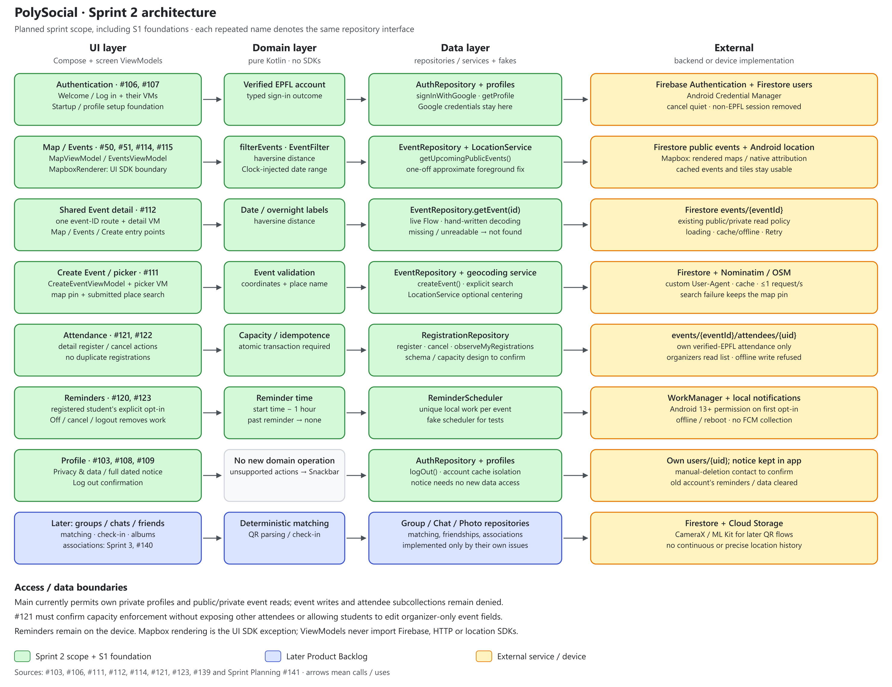

The source is [docs/images/architecture-overview.svg](images/architecture-overview.svg), a plain SVG kept next to the PNG. Both source and export are now versioned in the main repository; the wiki mirrors them. Edit it in any vector editor (or as text), then export the PNG again.

**How to read it.**
- Every screen that holds state has exactly one ViewModel. The app shell (app bar, bottom bar and `NavHost`, #41) has none: its only state is navigation, which the `NavController` owns, and a ViewModel copy of it could get out of sync. The ViewModel exposes a single immutable UI-state `StateFlow` with loading, empty, success and error variants, and receives user actions as function calls.
- Repositories are Kotlin interfaces with a Firebase (or device) implementation and a `Fake…` implementation for tests. ViewModels get them through their constructor, injected by **Hilt** (`@HiltViewModel`). Tests swap in the fakes with Hilt's test modules.
- **Offline:** Firestore offline persistence is the only cache (no Room, no custom sync). Loaded events, registered events and their schedule stay readable offline. Writes the app waits for, such as creating an event, joining a group or sending a chat message, are refused offline with a way to try again, not queued (#45, #228). Reminders are scheduled on the device. The map shows cached events on tiles the Maps SDK already cached, with **no tile prefetching**. Sign-up and log-in need a network and show a clear error without one.
- **Map provider:** Mapbox is approved (#50), replacing Google Maps. Its SDK is a UI component isolated in `MapboxRenderer`; `MapScreen` renders markers from `MapViewModel` state and never queries data itself. The public `pk.` token comes from each checkout's ignored `local.properties` through a generated string resource, with an empty-token setup state. One signup token is approved for initial development; a dedicated token with only `styles:read`/`fonts:read` is required before production. The token value never belongs in architecture documents or tracked resources. Firebase event data flows through a `MapEventSource`: `RepositoryMapEventSource` adapts #49's live public-event repository for students, and `OwnAssociationMapEventSource` #132's own-association query for a verified association (its upcoming events, private ones included, #133), without backend SDK imports in the ViewModel. Cached events remain usable, and cancellation releases the repository listener.

## 2. Navigation map

App-start routing (#32) decides between the authentication flow and the main app. The main app is a four-tab shell (#41). Each tab has its own back stack (#42) and starts in the shared loading or placeholder state (#43).

### 2.1 Signing in

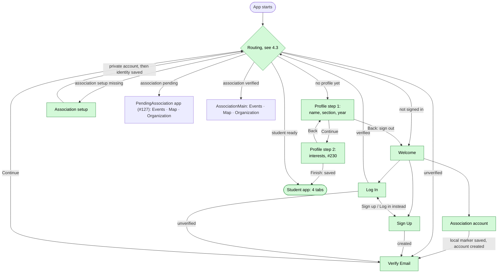

**Association onboarding (#125, implemented):** `SignUpViewModel` persists an association intent in `AssociationSignupStore` before calling `AuthRepository.signUp`. `PreferencesAssociationSignupStore` writes only an email digest and marker, off the main thread; it grants no server permissions. Student signup retains the EPFL restriction, while association signup accepts a valid email on any domain and reuses Verify Email.

`AssociationSetupScreen` forwards actions to `AssociationSetupViewModel`, which validates through the shared framework-free `associationFormErrors` and saves `users/{uid}` with `accountType = association` and an empty `displayName` before creating `associations/{uid}` through the repositories. Only the identity stores the association name. A lost-response retry updates the latest submitted values; failures retain the UID-scoped form. The client never writes the admin verification flag.

`AppStartViewModel` restores `AssociationSetup`, `PendingAssociation` or verified `AssociationMain` from the private account type and identity. Missing non-EPFL profiles resume association setup without a device-local hint; EPFL accounts need the hint to distinguish unfinished student and association setup. Once the private profile records the type, marker cleanup is housekeeping and cannot block entry. Existing profiles remain authoritative.

**Verified shell (#140, implemented):** verified associations reuse the tab graphs with Events, a Map of their own upcoming events (#133, the students' map with `AssociationMapViewModel` and no Find a group), and Organization. Chats is absent. Organization retains its own identity across Privacy navigation and reuses cache-first logout, which clears installed graphs.

**Integration (implemented):** #127's pending app (`PendingAssociationApp`, with Edit details) is wired, so #125's onboarding ends there; #133's Map content uses the owner-constrained query; #208's Log in accepts association accounts; the pending (#247) and verified (#261) apps share one `AssociationShell`. Membership/invite behavior is undecided, so setup keeps review-focused copy; Figma's invitation sentence needs a team update. No new setup/configuration is required.

### 2.2 Main app (one back stack per tab)

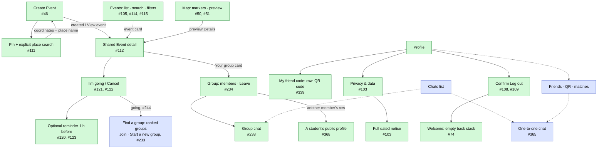

**Integration:** #112 replaces the Map detail placeholder with one shared screen and ViewModel class. Each entry tab registers its own event-ID route (the helper proposed in #157 is `Tab.eventDetailRoute`), so Events, Map and Create Event entry points return to their own tab stack without changing the selected tab. Unbuilt actions (Find a group, download data, attendance-based matching and account deletion) show a not-available Snackbar; they do not open unfinished screens. Account deletion keeps it until #207 connects the agreed flow (decision 15). Privacy's full notice works offline. Logout and account deletion must also cancel the previous account's reminders (#109, #123); #198's `SessionGuard` keeps the cached data away from the next account (decision 15).


Notes:
- **Back behaviour (#39, #42).** Back pops the current tab's stack first. At the root of the Map, Chats or Profile tab it goes to the **Events** (home) tab, and at the Events root it exits the app. This is Android's standard bottom-navigation behaviour. Switching tabs restores each tab's screen and scroll position (#38).
- **Create Event.** A "+" button on the Events and Map tabs opens it. After creating, an "Event created" confirmation offers *View event* (the new event's detail) and *Back to map*, as in the Figma (#44).
- **Event detail.** The map preview's "Details" opens the shared event detail inside the Map tab (#112), like the Events list and "View event"; the placeholder route of #50 is gone.

## 3. Feature slices

Each feature in the Sprint 2 scope, from screen to data source. The Sprint 1 foundation slices remain below; section 3.6 describes the planned Sprint 2 additions. The Product Backlog features are already drawn in the [overview](#1-architecture-overview), so they are described in text only.

- **Shared UI parts (#251).** Form and banner pieces used by several screens live once in `ui/common` (`FormParts.kt`): `FieldLabel`, `OfflineBanner`, `ErrorBanner` and `PrimaryButton` (also the location picker's "Use this location"), next to `LoadingState`, `ErrorState` and `StateButton`. Confirmation bottom sheets use `ConfirmationSheet.kt` (#296): `ConfirmationSheet` (the frame, which can't be dismissed while `locked`), `SheetIcon`, `SheetTitle` and `SheetSecondaryButton`. Reuse them instead of copying them into a screen. `Chips.kt` (#230) adds `choiceChipSurface`, the dark-or-outlined pill every choice chip draws, and the interest labels (`INTEREST_LABELS`, `interestLabel`).

### 3.1 Authentication and profile (Sprint 1)

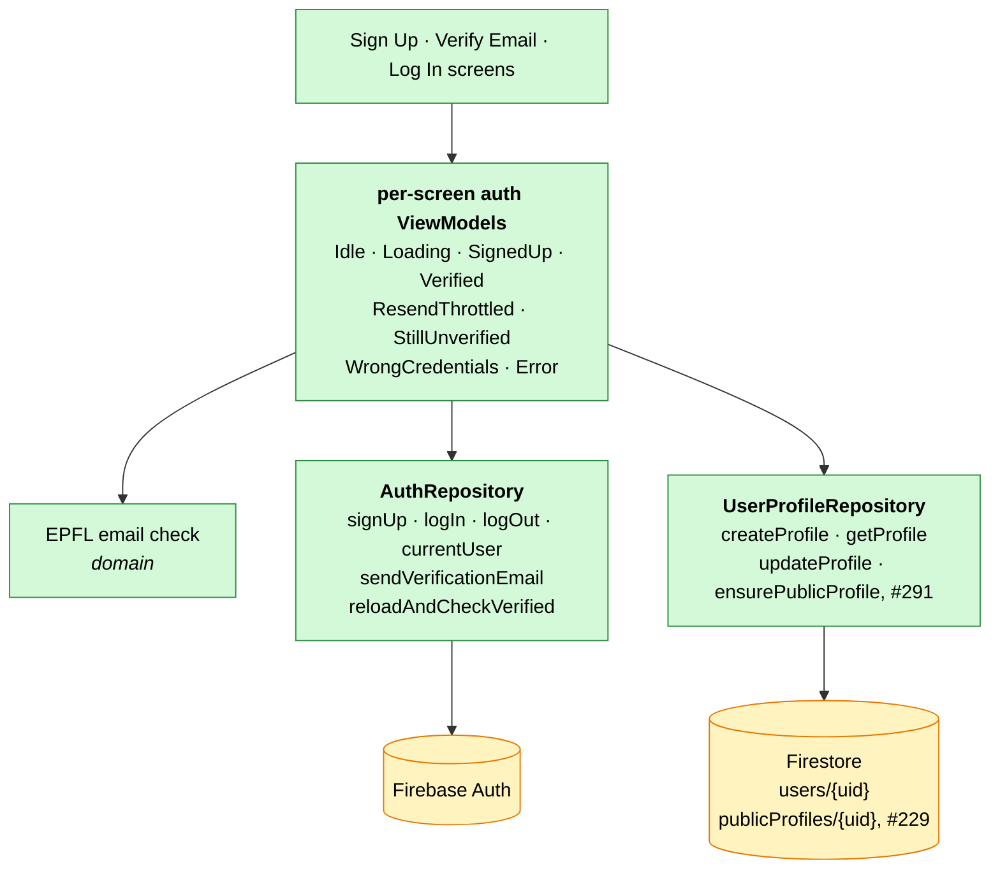

- **Result types (#30–#32).** `signUp` returns success, invalid domain, already in use or network error. `logIn` adds wrong credentials. `sendVerificationEmail` has a distinct *throttled* failure for Firebase's too-many-requests error, which the UI shows differently from a real error.
- **Profile (#34).** `UserProfile` has at least `uid`, `email` and `createdAt`. #45 adds `accountType` (`student` or `association`, default `student`) and `isAssociationVerified` (default `false`). The document ID is always the Auth UID, never a client-generated ID. The profile is created **exactly once, at the first verified entry** (Verify Email "Continue", or app-start routing finding a verified user without a profile), because the Security Rules only allow writes from verified accounts. If account creation fails, no profile is written. If the profile write fails, the user sees an error state. Fields other students may see live in a separate `publicProfiles/{uid}` document (see [5.2](#52-collections-and-key-fields)).
- **Email verification.** Every student account must have a verified `@epfl.ch` email, and the Security Rules check this whatever the sign-in method. **Associations** have no EPFL email, so they sign up with their own verified email, and they get no access beyond their own `users/{uid}` and `associations/{uid}` until a PolySocial admin verifies them (decision 11). Sprint 1 uses email/password, where Firebase marks the email unverified until the student clicks the link we send, hence the Verify Email screen. Google sign-in (#106) delivers already-verified emails, so those users skip that screen. The rules would not change.
- **Public profiles of older profiles (#291).** App start (4.3) starts `ensurePublicProfile(uid)` whenever it opens the students' app, without waiting: in one transaction it creates a missing `publicProfiles/{uid}` from the stored `users/{uid}` of a student, and never overwrites one, writes the private profile or gives an association one. A failure opens the app anyway and is retried at the next start. The rules already accept that copy on its own (no rules change).
- **Log out (#8, #32).** Logging out clears the session, and the next launch routes to Log In.

### 3.2 Map (Sprint 1)

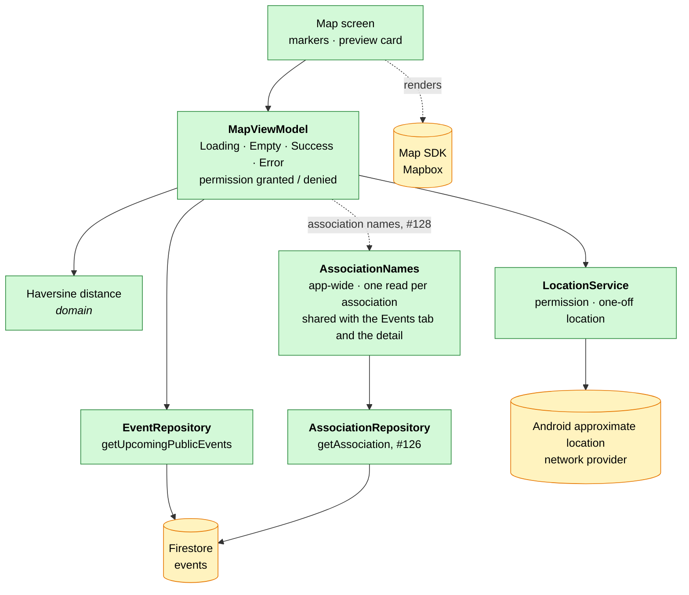

- **Map (#50, #51).** The map is centred on Lausanne. Location permission is requested once, on first entry to the Map tab. If it's denied, the map stays fully usable without distance badges. Distance is labelled *straight-line*, not walking time. Route-based distances are out of scope.
- **Association names (#128).** The map preview, the Events tab's cards and the event detail show the name of an association's event next to its Verified badge. One app-wide `AssociationNames` (`CachedAssociationNames`) reads each association once and shares it; a name that can't be read leaves the badge alone and is tried again later (fresh events from the server, opening the preview or the detail). Names belong to the signed-in account.
- **Upcoming events query (#49).** The query **must** include `isPrivate == false`. Security Rules are not filters, so a query that could return a private event is rejected as a whole. Combining equality on `isPrivate` with a range on `startTime` needs a composite index, which should be versioned in `firestore.indexes.json` next to the rules.

### 3.3 Create Event (Sprint 1)

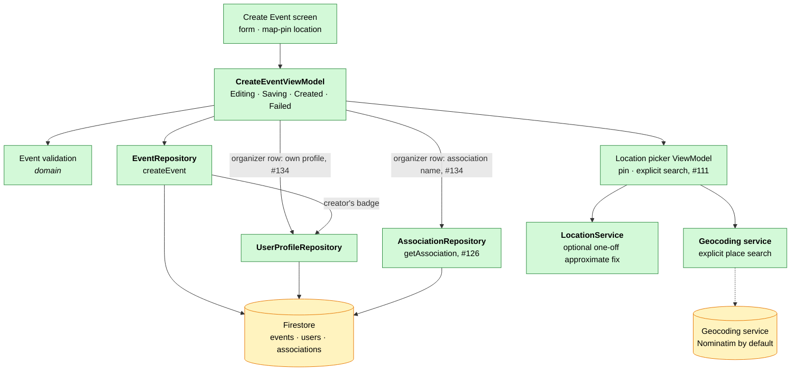

- **Event model (#45).** `id`, `title` (at most 80 characters), `description` (may be blank, at most 5000), `category` (Study, Sports, Culture, Party or Other; an unknown stored category reads as Other), `location` (lat/lng), `startTime`, `endTime` (nullable, after `startTime`), `capacity` (nullable, at least 2), `isPrivate`, `createdBy`, `organizerIds`, `allowedUids` and `isAssociationEvent`. `createdBy` is always the authenticated UID and is always in `organizerIds` and `allowedUids`. At creation the repository makes the creator the only organizer and allowed reader and sets `isAssociationEvent` from the creator's profile, ignoring the form's values. The Security Rules enforce this again (#47). An end time earlier than the start time on the form means the next day.
- **Create Event access (#46).** **Anyone can create an event** and becomes its **organizer**. An event can have one or several student organizers (`organizerIds`). Only a verified association (`accountType == "association"` and `isAssociationVerified`) publishes under its name: its events get `isAssociationEvent` and show a verified badge. An unverified association account can't create events or add members until it's verified, so the form has no access-denied state. Address search appears in the Figma task (#44), but the Sprint 1 build task only requires a map pin (#46), so the pin-and-search picker is in Sprint 2 (#111). Geocoding stays with the approved Nominatim service and its usage policy; choosing Mapbox for map rendering does not add a geocoding API.
- **Create Event screen (#44, #46).** The form follows the Figma (section 04): a date with a start time and an **optional** end time, which tells check-in and "Find my group" when the event is over. An end time earlier than the start time means the next day, shown as "+1 day" under the end field (Figma "Create event · overnight"). Inline errors cover a missing title, a title over 80 characters, a description over 5000, a past date, an end time equal to the start time, a missing location and a capacity below 2, and the *Create* button stays disabled while they remain. Offline, `EventRepository.createEvent` returns `NetworkError` without starting a write (Firestore would queue it and never fail), and the ViewModel shows the error with *Try again*, keeping the form. If location access is denied, the location picker still works with search and the map pin.
- **Organizer row (#134).** The top of the Create Event and Edit event form shows who organizes the event. `CreateEventViewModel` reads it once at opening: the signed-in user's profile (`UserProfileRepository`), then, only for a verified association, its `associations/{uid}` (`AssociationRepository`, #126). A verified association sees its initials, "Organized by <name>" and the Verified badge (Figma "Create event · association"); everyone else, and any failed read, sees "Organized by you", and the form never waits for the row.

### 3.4 Groups, matching and chat (Sprint 4, decided in #228)

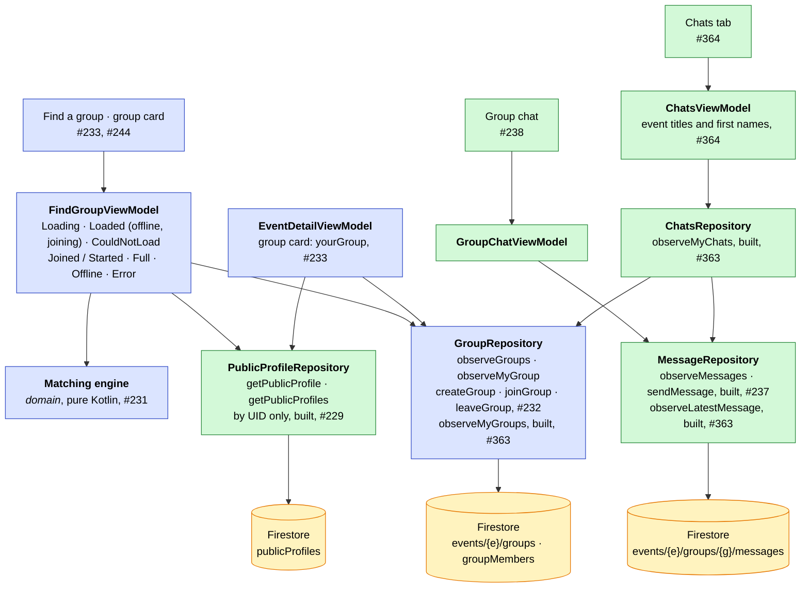

- **Groups live under their event:** `events/{eventId}/groups/{groupId}`, like the registrations (#121), so the rules reuse the event's readability from the path. A group has a fixed `capacity` of **4** (a product decision, not set by the organizer; stored so it can change without a migration), `memberUids` (1 to `capacity` UIDs, the creator first), `createdBy` and a server-set `createdAt`. A student's own groups, across events, are a collection-group query on `memberUids array-contains <their UID>` (`observeMyGroups`, #363).
- **Joining and leaving touch only your own UID.** Join adds the student's UID to `memberUids`, leave removes it, and the last member to leave deletes the group. The rules check `memberUids.size() <= capacity`, so the capacity needs no counter, and the client's **transaction** makes sure two students can't take the last place at the same time.
- **One group per student per event:** the marker `events/{eventId}/groupMembers/{uid}` holds the student's `groupId`. It is created and deleted in the same transaction as the `memberUids` change, and the rules tie the two together with `getAfter`. Android transactions can't run queries, so the marker is how the transaction knows the student is already in a group.
- **Who can join:** a student who can read the event. Requiring "I'm going" first is decided (#228) and built by #244, which also decides whether the rules check it. Associations never reach groups, messages or public profiles.
- **Matching starts on the client.** The engine (#231) is a deterministic heuristic in a pure Kotlin module: given the student (section, year, interests) and the event's groups with their members' public profiles, it returns the open groups ranked, full groups left out, ties broken by a stable key. We revisit a Cloud Function only if fairness or cheating becomes a problem; the module would move unchanged.
- **Public profiles (#229):** `publicProfiles/{uid}` holds `displayName`, `section`, `year` and `interests` (codes from #230's fixed list of about ten), never the email. It is written in the same transaction as `users/{uid}`. Visibility, bio, photo and username are decided in #366 ([3.9](#39-profile-visibility-and-usernames-product-backlog-decided-in-366)).
- **A member's public profile (built, #368):** on Your group, another member's row opens `Tab.studentProfileRoute` (`<tab>/student/{uid}`, in the same tab so Back returns to the group; the friends list will reuse it). `StudentProfileViewModel` reads `publicProfiles/{uid}` by UID only, once, with a 5 s timeout on the server read, then the cached profile if the device has one (a stalled connection takes Firestore about 10 s to notice; only a miss the server confirms is "not found"): Loading, the shared `StudentProfileCard` (also Scan a friend's code's card), Couldn't load with Retry, or Can't find this student (no Retry). Your own row and a "Profile unavailable" row don't open anything. No friend button there yet. No new data or rule: group members already see these fields.
- **Chat (#237, #238):** each group has `messages` (`senderId`, `text` of 1 to 1000 characters, server-set `createdAt`). Only members read and send, each sender writes only their own messages, a deleted account can't send, and nobody edits or deletes one. Decided in #365 for both kinds of chat ([3.8](#38-one-to-one-chat-product-backlog-decided-in-365), not built yet): a sender unsends their own message while still a member (its text emptied, "This message was deleted" for all), and a member deletes the group chat from their own Chats list until a new message arrives or they leave the group. Sending is **refused offline** with Try again, like `createEvent`, rather than queued. A chat between two friends is not a group: it has its own collection, with the same message fields (#365, [3.8](#38-one-to-one-chat-product-backlog-decided-in-365)).
- **Chat list (#363, for the Chats tab, #364):** `ChatsRepository.observeMyChats` lists every group the student is in, across events, each with its latest message, newest activity first (the latest message's time, or the group's creation time without one). It combines `GroupRepository.observeMyGroups` with one `MessageRepository.observeLatestMessage` listener per group, a query on `createdAt` descending with `limit(1)`, so the list reads one message per chat; a group's listener starts when the group is listed and stops when it leaves, so joining a group opens one listener and restarts none. It works without the events: a member lists their groups and reads their chats once the event is deleted or no longer readable. Groups that can't be read, or a latest message that can't reach the server, end it. A denied latest message only leaves its chat out: on reconnection, Firestore reports the chat of a group left on another device as denied before the groups drop that group, so the list fails only if a later result of the groups from the server still lists it. No new rule or index: the cross-event `list` rule and the `groups.memberUids` collection-group index date from #232, the message rules from #237.
- **Real-time screens.** Groups, my group, my chats and messages are Firestore snapshot listeners exposed as `Flow`, usable from the cache offline.
- **Moderation-ready.** The rules are written per operation and messages carry `senderId` and `createdAt`, so report/block and rate limiting can be added later without a rule rewrite.

### 3.5 At the venue and social features (Product Backlog)

- **Check-in (#22).** A one-off location check against the venue during the event window. A QR code at the entrance is the indoor fallback. Only checked-in members can upload to the album (README).
- **Find my group (#20).** Locations are shared **only with the group and only during the event** (README). Each member's position lives in `events/{eventId}/groups/{groupId}/locations/{uid}`. It is written only during the event window, readable only by group members, and deleted when the event ends. There is no location history.
- **Album.** Photos are compressed and resized on the device, then stored in Cloud Storage. A Firestore document holds each photo's metadata. Storage Security Rules enforce size and type limits and check-in membership. Thumbnails are cached.
- **Reminders (#21, #36).** WorkManager schedules them when the student registers, so they fire offline and survive reboots. The notification permission (Android 13+) is requested at that moment.
- **QR codes (#17, #22).** Scanned with CameraX + ML Kit barcode scanning. Payloads are typed strings, `polysocial://checkin/{eventId}/{token}` and `polysocial://friend/{uid}`, validated by a pure parser. **The parser is built (#337):** `parseQrPayload` and `friendQrPayload` in `model/qr/QrPayload.kt`. It is strict: the scheme and host are exact lowercase, each ID is 1 to 128 of `[A-Za-z0-9_-]` and not one of Firestore's reserved `__…__` IDs, and anything else (a web link, another app's code, a damaged scan) is `Invalid`. **Showing a code is built (#339):** ZXing `core` encodes the payload (`encodeQrCode`, `model/qr/QrCode.kt`) and Profile's "My friend code" draws it, offline too. **Scanning one is built (#359):** CameraX with bundled ML Kit behind the `QrScanner` interface (`ui/friend`), so tests use a fake; the camera permission is asked when the scanner opens.

### 3.6 Sprint 2 additions (#103, #106–#123)

This is the design to build against, not a claim that every component is already merged. Implementation status remains on the Scrum Board and the linked PRs.

| Feature | UI / domain | Repository or service boundary | Data and failures |
|---|---|---|---|
| Google sign-in (#106, #107) | Welcome / Log in → their ViewModels; verified EPFL account result | `AuthRepository.signInWithGoogle`, Credential Manager inside the repository | Firebase Auth; cancel is quiet, non-EPFL accounts are signed out immediately, typed network/unexpected failures. Provider choice and console setup must be confirmed before release. |
| Pin and place search (#111) | Create Event → picker ViewModel; confirm coordinates and place name | Geocoding service interface and fake; reuse `LocationService` for optional centering and the isolated Mapbox renderer | Nominatim is the approved search provider: submitted searches only, custom User-Agent, caching and at most 1 request/second. Failed/offline search retains the pin; denied location opens on Lausanne. |
| Event detail (#112) | Shared detail ViewModel, category styles, local date/time and one-off distance | `EventRepository.getEvent(id)` is a live `Flow`, decoded by hand with `eventFromFirestore` | Existing event read rules; deleted or unreadable is not found, network errors offer Retry, cached content remains visible offline. Optional `locationName` describes the chosen event venue, not a location history. |
| Filtering (#114, #115) | `EventFilter` + pure `filterEvents(events, filter, userLocation)`; Events / Map ViewModels | Filter already loaded `getUpcomingPublicEvents` results | No new Firestore query or index. Case/accent-insensitive title search; categories OR, criteria AND; clock-injected date range [start, end); missing location ignores the distance criterion. |
| Attendance (#121, #122) | Detail: register/cancel; pure capacity checks coordinated by its ViewModel; an association's "manage event" shows the "Going" count (#131) | `RegistrationRepository.register(eventId)`, `cancel(eventId)`, `observeMyRegistrations()`, `countAttendees(eventId)` (organizers, a server `count()`); Firestore implementation + fake | `events/{eventId}/attendees/{uid}` (`uid`, `registeredAt`); own registrations through a collection-group query on `uid`. Register and cancel are idempotent; offline writes fail instead of queuing. A full event is refused with the event's `attendeeCount` (decision 21, #372; built by #373, "Event full" by #407 after it). |
| Reminder (#120, #123) | Registered student's explicit opt-in; pure start minus 1 hour calculation | `ReminderScheduler` interface + fake; WorkManager only in its implementation | Unique work per event on the device, no new Firestore collection or FCM. No scheduling once the reminder time has passed; denial restores Off. Off/cancel/logout removes work; notification taps open shared detail. |
| Privacy / logout (#103, #108, #109) | Profile entry, dated offline notice and unbuilt-action Snackbar; logout confirmation | Notice requires no new data access; logout uses `AuthRepository.logOut()` | Notice describes only collected data and actual access. Export and attendance-based matching remain unavailable, and in-app deletion until #207 (policy: decision 15). The private manual-deletion contact, also the associations' deletion route, must be confirmed. Cache isolation on any UID change follows #198 (decision 15). |

**Sprint Planning decisions** recorded in [#141](https://github.com/swent-polysocial/PolySocial/pull/141): only the creator is an organizer until Public profiles provides a way to find co-organizers; reminders are opt-in, not automatic; association screens move to Sprint 3; an eventual Cancel event deletes it rather than introducing a cancellation status; every unbuilt action reports its availability. This document records the design without changing Authentication or Security Rules.

### 3.7 Friends (Product Backlog, decided in #338)

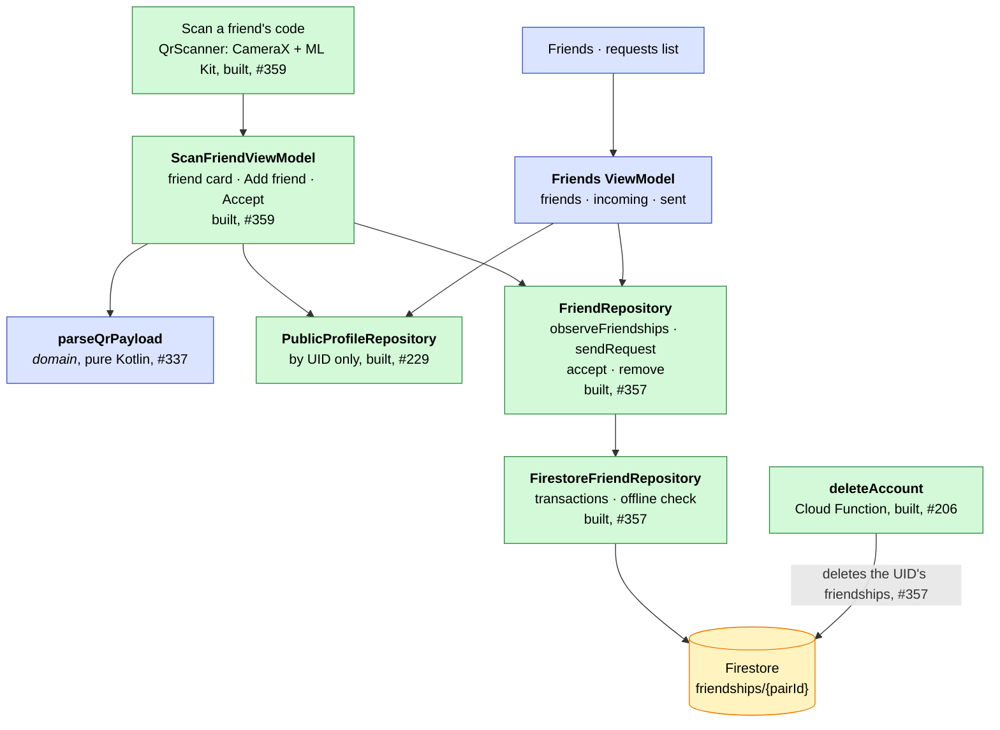

- **One document per pair of students:** `friendships/{pairId}`, where `pairId` is the two UIDs sorted and joined by `~` (`{lowerUid}~{higherUid}`; no UID contains `~`). It holds `uids` (the two UIDs, sorted), `requestedBy` (the sender's UID), `status` (`pending` or `accepted`), server-set `createdAt` and, once accepted, server-set `acceptedAt`. Only UIDs, no names or emails: names come from each student's public profile. **Built (#357):** `friendshipId` (the only place the ID is built; it returns null for the same UID twice or a UID that isn't a valid QR ID, so no `~` or `/` gets in), `isFriendshipIdOf` and `Friendship` in `model/friend/Friendship.kt`; the `FriendRepository` contract, `FirestoreFriendRepository` (bound by Hilt) and `FakeFriendRepository` for tests; the rules; and the `deleteAccount` cleanup. Its transactions keep Firestore's retries, so when two students send each other a request at the same moment, the second one's retry reads the first and returns `AlreadyExists`. The screens are still planned.
- **The whole lifecycle in that document.** Sending a request creates it as `pending`. Accepting is the recipient's update to `accepted`. Declining (by the recipient), cancelling (by the sender) and removing a friend (by either) all delete it, so the pair can start again later.
- **An action applies only to the request the screen showed.** Accept, decline, cancel and remove each run in a transaction that reads the document again and compares its `status` and `createdAt` with what the screen showed. If the document is gone or either changed, nothing is written and the repository returns `Gone`, so the app says the request changed and shows the current state (#361). A stale Cancel tapped after the recipient accepted can't remove the new friendship, and a stale tap can't act on a request that was cancelled and sent again under the same ID. The rules can't tell a cancel from a removal (a delete has no new data), so this check is the repository's; either student may still remove the friendship on purpose.
- **At most one request between two students, by construction.** A → B and B → A have the same ID, so a second request finds the document already there and the create is refused. When both send at the same time, the second one sees the first request and is offered Accept instead.
- **Adding a friend: by QR code first.** The app scans `polysocial://friend/{uid}` and parses it with #337's `parseQrPayload`. It then reads that student's public profile by UID (#229), shows their card and sends the request on a tap. Scanning your own code shows a message, not a request. A student whose public profile is still missing (saved before #229, see #291) can't be added until they open the app again. A student can also be added **by username** once usernames are built ([3.9](#39-profile-visibility-and-usernames-product-backlog-decided-in-366), #366).
- **One listener per student:** `friendships where uids array-contains <UID>`, split on the device into friends (`accepted`), incoming (`pending`, someone else's `requestedBy`) and sent requests. A student has few friendships, so this needs no composite index. It works from the cache offline. Sending, accepting, declining and removing are **refused offline** with Try again, like chat, rather than queued.
- **Requests are seen in the app.** There are no push notifications (Firebase Cloud Messaging is not in use), so incoming requests show in the friends list.
- **Associations never take part:** they can't send, receive or read a friendship.
- **Public profiles (#229) and the public/private choice (#366).** The friend card and the lists show only what a public profile shows. Another student's friends are shown through a friends list that a Cloud Function keeps under their public profile, never by reading their friendships ([3.9](#39-profile-visibility-and-usernames-product-backlog-decided-in-366)). Nothing in the friendship document or its rules changes. Using common friends in matching is still open (section 7).
- **Chatting with a friend (#365, [3.8](#38-one-to-one-chat-product-backlog-decided-in-365))** starts from a friend's row in the friends list, and depends on this document as it is: the chat rules read `friendships/{pairId}` and let the two students send only while its `status` is `accepted`. Nothing in the friendship changes for the chat. The chat rules read only the friendship stored under exactly `{lowerUid}~{higherUid}` and rely on it being the pair's only one, so #357's create rule must compare the document ID with `uids[0] + '~' + uids[1]` (the rules table's "the document ID built from them"): checking only that the ID splits into the two UIDs would also accept `u1~u2~`, a second friendship for the same pair.

### 3.8 One-to-one chat (Product Backlog, decided in #365)

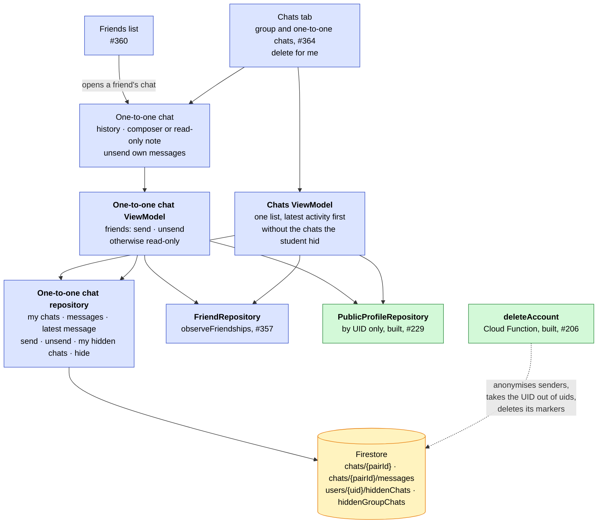

Decided by the Sprint 6 PO on 2026-11-14 and 2026-11-16 (#365), replacing "a one-to-one chat is a two-member group". Nothing here is built yet: the collections, the fields and the rules are decided, and class and route names are proposals until their tasks fix them.

- **A chat between two friends has its own top-level collection.** `chats/{pairId}` has the ID of the pair's friendship (#338: `{lowerUid}~{higherUid}`, built only by #357's pure function, never by a second one) and holds exactly `uids`, the two UIDs in the ID's order. The ID is exactly that string: the rules refuse every other spelling of the pair (a trailing `~`, for example), so a pair has one chat, as it has one friendship (#357's rule must compare its document ID the same way, see 3.7). `chats/{pairId}/messages/{id}` holds the messages, with exactly group chat's fields (#237): `senderId`, `text` (1 to 1000 UTF-16 units, trimmed) and the server's `createdAt`; unsending only empties `text` (below). No name, summary or counter: names come from the public profiles (#229). The friendship stays as #338 specifies; the chat only reads its `status`, in the rules.
- **Accepted friends only.** The two students read the chat. Creating it, sending a message or unsending one also needs `friendships/{pairId}` to exist with `status == "accepted"`. Students only: associations never reach it. Group-mates who aren't friends use their group chat.
- **Started from the friends list.** A friend's row in the friends list (#360) opens the chat with that friend, whether or not it exists yet: a chat that doesn't exist reads as missing, so the screen shows an empty history and the composer. The Chats tab lists only chats that already have a message.
- **Created by whoever sends the first message, in the same transaction.** Sending to a pair runs #237's checks (the trimmed text, the IDs, the signed-in student, then `NetworkMonitor`), then one transaction, tried once:
  1. read `chats/{pairId}` and, when the draft has an ID, the message under it (#238's retry check);
  2. if the chat is missing, set `chats/{pairId}` to `{ uids: [lowerUid, higherUid] }`;
  3. set the message (`senderId`, `text`, server `createdAt`), unless its ID already holds a message: the same sender and text is `Sent`, anything else `UnexpectedError`, as in #237.

  So the app never creates an empty chat, the first message is never stored without its chat (the rules also refuse a message whose chat doesn't exist after the write), and every later message is one write.
- **When both send their first message at once,** both transactions read the chat as missing and try to create it. One commits. The other fails as a whole and stores nothing: on the emulator with `ALREADY_EXISTS` (the transaction's own check that the chat was still missing); a write the rules evaluate first is `PERMISSION_DENIED` instead, since nobody may update a chat (the lost-race trap of #232). A transaction tried once isn't retried by the SDK, so the repository runs it once more itself when an attempt that tried to create the chat fails for any reason but being offline. The second attempt reads the chat as existing and writes only its message, so both messages end up in the one chat, in the server's time order. From then on two students sending at once write two different documents and can't conflict.
- **On the Chats tab (#364),** one-to-one chats sit in the same list as the group chats (#363), ordered together by latest activity. One listener reads the student's chats, `chats where uids array-contains <UID>`: rules aren't filters, so the query must carry this filter, and without an `orderBy` it needs no composite index. As #363 does for each group, one listener per chat reads its latest message (`messages` ordered by `createdAt` descending, `limit(1)`), one more listener reads the student's own delete-for-me markers (`users/{uid}/hiddenChats`, below), and #357's friendships listener (`observeFriendships`, which the chat screen already uses) gives each pair's `acceptedAt`. A one-to-one chat is listed when it has a latest message and, if the student has a marker for it, that message or the pair's accepted friendship is newer than the marker (a pure function, unit-tested). The markers and the friendships are part of the tab's loading state: the first list waits for their first results, from the cache or the server, so a hidden chat never shows for a moment and one that is back never shows late; a failed read of either fails the one-to-one part of the list like a failed read of the chats, with the same typed error and Retry, and never shows it unfiltered. The device sorts the merged list by the latest message's `createdAt`, newest first. A row shows the other student's public-profile name, the latest message (or "This message was deleted") and its time. The other student is the UID in `uids` that isn't the student's own: none means their account was deleted ("Deleted account"), and a profile that can't be read is "Profile unavailable" (#291). **A read-only chat** (a removed friend, a pending request, a deleted account) **is listed like any other.** A chat without a message isn't listed (the app never creates one), and no unread state is stored.
  - **Reads:** when the tab opens on an empty cache, two documents per chat (the chat and its latest message) plus the rules' own lookups (the caller's profile and deletion marker), charged for each listener when it starts, so two more per chat; each row's other student's public profile (#229, read by UID) adds one read and its rule's lookup of the caller's profile, so two more per chat; the markers' listener adds one read per marker and its two lookups, and the friendships' listener one read per friendship and its two lookups. Twenty one-to-one chats with twenty friends, five of the chats hidden, are about 150 reads per cold open (the group chats' are #363's), against a free quota of 50,000 a day. A hidden chat keeps its latest-message listener, since a new message must bring it back. While the tab stays open, a new message costs about three reads: the message, and the two lookups again, since a listener is charged for its rule evaluation each time its results update; an unsend of a latest message, a new marker or a friendship change costs the same. The chat document never changes.
  - **Why no last-message summary on the chat document:** one listener would then replace one per chat, for about a quarter of those reads, but every message would be two writes (writes cost more than reads and have a smaller free quota), both students would keep updating the same document (#232's lost-race trap on every simultaneous send), its update rule would have to prove that the summary equals the message written with it, and account deletion and unsending would have a second copy of a text and a sender to erase. As decided, a chat document is written once and never changes, so its rules are create-only. If a student ever has so many chats that the tab must page by activity, a `lastMessageAt` can be added then.
  - **#364 is unchanged:** it ships the Chats tab with the group chats only, from #362's frames, as planned. The one-to-one rows, the "This message was deleted" preview and delete for me come to the tab in Sprint 7, with their own Figma frames and tasks.
- **The chat screen is #238's, for a pair:** the same history, composer, draft and retry behaviour (one ID per draft, kept on Try again), shared with the group chat rather than copied (`MODULARITY.md`), with the other student's name in the header in place of the event. It observes the messages, the student's chats (the tab's query: is this chat started, and is the other account deleted) and the friendship (`observeFriendships`, #357), which decides whether the composer shows. The other student's UID comes from the chat's `uids`, or from the friendship's while the chat doesn't exist yet. Reading never depends on the friendship, so nothing ends the message listener when a friend is removed: the screen follows the friendship to become read-only at once (as #238 follows the group, see #237's trap). A send or an unsend that races the removal is denied and shows its failure state. **Read-only, a note replaces the composer**, saying why nobody can send (the two aren't friends, or the other account was deleted); it also tells a removed student they were removed, which their friends list already shows.
- **Unsend a message.** A student deletes one of their own messages for both: its text is erased and both see "This message was deleted" in its place.
  - **Stored:** the message document stays, with its ID, `senderId` and `createdAt`, and `text` becomes the empty string. No field is added: an empty text is the unsent marker, as #241's empty `senderId` is the deleted author's, and no create can write it (the text is 1 to 1000), so it can't be forged. The message keeps exactly #237's three fields.
  - **Shared with group chat, which gets the same unsend (below):** `messageFromFirestore` reads an empty text like any other, so `Message` and the reader don't change; a constant `UNSENT_MESSAGE_TEXT = ""` next to `DELETED_MESSAGE_SENDER` and `Message.isUnsent` name it, and the shared message bubble draws "This message was deleted" in place of an unsent text, at its time and on its sender's side, in both kinds of chat. Until group chat's own rule lands, its messages never have an empty text, so its screen and tests don't change with the one-to-one side. `sendMessage`'s retry check compares the stored text with the draft, so a draft whose ID now holds an unsent message (unsent from the sender's other device) is `UnexpectedError`, as for any other text.
  - **Who:** the sender only, their own message, not under a deletion marker, students only, and only while the two are friends (decided on 2026-11-14): a read-only chat doesn't change any more, as nothing can be added to it. A message whose `senderId` is empty (its author's account was deleted) can't be unsent by anyone.
  - **How:** an action on the student's own messages (the Figma task draws it and its confirmation). The repository checks `NetworkMonitor` first (refused offline with Try again, never queued, like sending), then one transaction, tried once: it reads the message; one that is missing or isn't the caller's is `UnexpectedError`; one already empty is `Unsent` without a write (a retry after a lost answer); otherwise it updates only `text` to `""`. If an attempt fails after its read for any reason but being offline (the student's other device unsent the same message in between, so the commit is `FAILED_PRECONDITION`), the repository runs it once more, as #232's group writes do: the rerun reads the empty text and returns `Unsent` without a write.
  - **Live, for both:** the other student's open chat receives the changed document on its message listener and shows the placeholder at once, and the Chats tab's latest-message listener does too when it was the latest message. The row then shows "This message was deleted" at the message's original time: the order doesn't change, and a chat the student hid doesn't come back.
  - **Account deletion:** #241's step finds unsent messages too (it queries `senderId`) and empties their `senderId`; their text stays empty, so the placeholder stays. No change to the step.
  - **What is really removed:** the text, from the stored message. Its sender, time and place in the conversation stay. A copy cached on the other student's device is replaced the next time that device loads the message from the server (its chat or the Chats tab, online); until then it can still show the text offline. What the other student has already read or copied can't be taken back.
- **Delete for me.** A student removes a chat from their own Chats list. The other student sees no change, and the chat comes back when a new message arrives or when the two become friends again after unfriending.
  - **Stored:** `users/{uid}/hiddenChats/{pairId}`, the student's own marker, holding exactly `hiddenUpTo`: the later of two times the student's row showed when they deleted the chat, the `createdAt` of its latest message and, while the two are friends, their friendship's `acceptedAt` (#338, set by the server). The chat is off their list while its latest message and the current friendship's `acceptedAt`, if they are friends, are both no newer than `hiddenUpTo`. A message from either student is stored at a later server time and brings it back, and so does becoming friends again after unfriending, since the new friendship is accepted later; an unsend keeps its message's time and doesn't, nor does a pending request. Deleting the chat again moves the marker forward to the new time, and only forward: the rules refuse an earlier `hiddenUpTo`, which would list the chat again without a new message. The later of the two times, because a chat back after becoming friends again has no newer message: hiding it again with its latest message's time would change nothing. The marker isn't removed when the chat comes back: it stays, for its owner only, until the next deletion moves it or the account is deleted. Times the student saw, not the server's time of the deletion: a message stored between the row's last update and the deletion would be older than the server's time, and would stay hidden without ever being seen.
  - **Why under `users/{uid}`:** it is the student's private data, like their profile, and the other student can read nothing under another student's `users/{uid}`. A denied read is the same whether a marker exists or not, and nothing in the chat or its messages changes, so the other student can't infer it. The tab reads all of a student's markers with one listener on their own collection: no index, no listener per chat. A marker on the chat document would be readable by both, and one under `chats/{pairId}` would need a listener per chat or a collection-group query with its own index.
  - **Rules:** only its owner, a student not under a deletion marker, reads, lists and writes it; a marker names an existing chat whose exact pair ID includes its owner; exactly `hiddenUpTo`, a time no later than the server's, and an update never earlier than the stored one. Nobody deletes a one-to-one marker, its owner included: un-hiding a chat that way would be harmless, but no screen offers it, and the marker goes with the account. Associations get nothing.
  - **How:** an action on a one-to-one row of the Chats tab (the Figma task draws it and its confirmation), for any listed chat, read-only ones included: a chat with a deleted account never gets a new message, so this is how it leaves the list. Refused offline with Try again, like every write here: one transaction, tried once, that reads the stored marker and sets it, unless it already holds that time or a later one, so a second device with an older row never writes an earlier time. If the student's other device moves the marker forward between this read and the commit, the forward-only rule refuses the commit (`PERMISSION_DENIED`); the repository then runs the transaction once more, as for unsend, and the rerun reads the newer time and writes nothing. The row leaves the list when the marker's listener sees the write.
  - **When the chat comes back** (decided on 2026-11-14; once friends again, decided by the Sprint 6 PO on 2026-11-16): with a new message, or as soon as the two are friends again after unfriending, without waiting for a message. It is the same chat, and its screen shows its whole history, the messages from before the deletion included; the marker changes only the list. The chat screen, opened from the friends list while the chat is hidden, shows the history too. Hiding the earlier messages for that student would be a display limit only: the rules can't hide a message from either student of the pair.
- **Unsend and delete for me in group chats** (decided on 2026-11-14). Both features work in a group's chat too (#237, #238), with the same stored form, results and screens; what group chat gains is one rule, a marker collection and the repository methods.
  - **Unsend:** a member empties the `text` of their own message in `events/{eventId}/groups/{groupId}/messages/{id}`, and every member sees "This message was deleted" in its place. The rule is the one-to-one rule with group membership in place of the friendship: the sender, their own message, **while still a member** (the existing `isMember()`, which also refuses a deleted account and associations), only the text, only to `''`. A student who left the group can't unsend while they are out of it, as they can't read it either, which mirrors the read-only one-to-one chat; membership is all the rule checks, so if they rejoin they can unsend their earlier messages again. A member removed from a private event keeps the group (#295), so they keep unsending; once the last member leaves and the group is deleted, nobody can. `MessageRepository` gains `unsendMessage(eventId, groupId, messageId)` with the one-to-one method's checks, results and one rerun; `Message`, the reader, the shared bubble and #363's latest-message preview already handle an empty text. #241's cleanup is unchanged (it empties `senderId` and keeps the empty text), and a message with an empty `senderId` can't be unsent. No rule on the `messages` collection group is added: clients still can't query across groups. **What is really removed** differs from a one-to-one chat for the copies: a member who left, and everyone once the group is deleted, can no longer read the chat, so their listener is revoked without receiving the change, and the app clears its disk cache only on logout, account deletion or a change of account. Copies on other devices, including those of members who have left, may persist until refreshed or cleared (the notice's existing wording for group chat).
  - **Delete for me:** the marker is `users/{uid}/hiddenGroupChats/{eventId}~{groupId}`, in a collection of its own, so its IDs never meet the one-to-one markers'. It holds exactly `hiddenUpTo`: the `createdAt` of the latest message the row showed, or the group's `createdAt` when the group chat has no message yet (#364 lists those too), so its first message brings it back. The rules accept only an ID of exactly two non-empty parts, so a marker names one group (a group whose marker ID can't be built, below, can't be hidden; the app's generated IDs always can), and only for a group the owner is in when writing; like a one-to-one marker, it only moves forward (with the same one rerun of the hide transaction) and only its owner reads, creates or moves it; leaving the group deletes it (below).
  - **On the Chats tab:** #363's `ChatsRepository.observeMyChats()` doesn't change and still lists every group chat. The Chats ViewModel (#364) applies the markers to its rows: one more listener, on `users/{uid}/hiddenGroupChats`; each row's marker found under its `{eventId}~{groupId}`, built by one pure function; and the one-to-one chats' pure function deciding whether the row is hidden (a marker, and a latest message, if any, no newer than `hiddenUpTo`). These markers are part of the tab's loading state too, and a failed read fails the group chats' part of the list like a failed read of the groups. They add one read per marker and two lookups when the listener starts.
  - **Leaving deletes the marker, so a rejoined group's chat is back at once** (decided by the Sprint 6 PO on 2026-11-16): a student who deleted a group chat for themselves, left the group and rejoined it has the chat on their Chats list again at once, without waiting for a new message. #232's leave transaction gains one `delete` of the caller's marker, without reading it, so leaving costs no extra read and works whether or not a marker exists, the last member's leave included. The rules accept that delete only once its owner is out of the group after the write (the group is gone, or its `memberUids` doesn't list them), so no client un-hides a chat it is still in. The group's own rules don't require the delete, so a modified client only affects its own list: it can leave without the delete and keep its marker, or create one in the batch that leaves, since the create rule reads the group as it was before the write; once the leave has committed, the rules refuse a new one. A group deleted with its event leaves its members' markers unused: the rule lets each owner delete theirs, but no flow does, and they go with the account. **No deletion-marker check on this delete**, unlike every other marker rule: it has the gate of the `groupMembers` delete in the same transaction (a student, their own document, out of the group after the write), so a deleted account's still-valid token can still leave, as today: the leave must not fail, and a delete writes no personal data. That delete is all such a token gains.
  - **The marker ID** comes from one pure function, which returns nothing when it can't be built: either ID contains a `~` (the rules refuse it), the joined ID is one Firestore reserves (`__.*__`: the valid IDs `__a` and `b__` give `__a~b__`) or it is over 1,500 bytes. Hide then refuses, writing nothing, and `leaveGroup` skips the delete, which would fail, and the whole leave with it (refused by the rules, or `INVALID_ARGUMENT`). For the same reason, the rule is deployed before an app whose leave deletes the marker.
  - **Account deletion:** the same step deletes `users/{uid}/hiddenGroupChats/*` with the one-to-one markers; #241's message and group-membership steps don't change. `docs/Group-Chat-Deletion.md` changes with the tasks that build this: senders may then empty their own message's text (its "Clients cannot … edit messages" no longer holds), the cleanup keeps an unsent message's text empty, and `deleteAccount` deletes both kinds of markers.
- **Removing a friend keeps the conversation, read-only.** Removing deletes `friendships/{pairId}` as #338 says and writes nothing else. The chat and its messages stay where they are: both students still list and read it, and the rules refuse a new message or an unsend from either. A note replaces the composer. A new request doesn't reopen the chat while it is pending; once it is accepted, both send again in the same chat, after its history.
- **Account deletion keeps the other student's conversation, with the sender anonymised,** like group chat (#241). In `deleteAccount`'s order:
  1. the `deletedAccounts/{uid}` marker (the existing first step) makes every chat rule refuse the deleted account's still-valid token: it reads, lists, sends and unsends nothing, creates no chat, and reads, creates or moves none of its delete-for-me markers (it can still delete a group marker of its own once out of the group, so that leaving keeps working, below);
  2. #241's step replaces `senderId` with an empty string on every message the account sent, keeping the text and the time (an unsent message keeps its empty text). It queries the `messages` collection group, so it **already covers `chats/*/messages` as it stands**, with the same `messages.senderId` collection-group index (checked by running the unchanged handler against the emulator): no change;
  3. #357's step deletes the account's friendships, which makes each of its chats read-only for the other student; from then on no chat can be created for the UID;
  4. **new, after step 3:** for each chat of `chats where uids array-contains <uid>`, one transaction reads the chat and decides:
     - **the other student still has an account** (their UID is in `uids` and has no `deletedAccounts` marker): `uids` is written without the deleted UID. The other student still finds the chat with the same query, and a `uids` without another UID is how the app knows to show "Deleted account" instead of guessing from a missing public profile (#291);
     - **nobody else is left** (the deleted UID is the only one in `uids`, or the other UID has a deletion marker): the transaction writes nothing, so `uids` is left unchanged; then the chat's messages are deleted, then the chat. The UID must stay in `uids` until the chat document itself is gone, because this step's query finds the chat through it: writing an empty `uids` first would hide an interrupted deletion from Retry and leave both texts stored for good.

     Then the account's own delete-for-me markers, `users/{uid}/hiddenChats/*` and `users/{uid}/hiddenGroupChats/*`, are deleted, in batches of 500 until none is left: deleting `users/{uid}` in step 1 doesn't delete them, since a subcollection outlives its parent document. Other students' markers are theirs and stay.

     So no conversation stays stored that nobody can read. A UID under a marker counts as gone because a deletion can stop after its marker and before this step and never be retried: the other student's later deletion would otherwise keep the chat, with both texts, under that UID. Idempotent like the other steps: from step 1 on, the deletion marker refuses the deleted account's own messages and delete-for-me markers, and from step 3 on no new chat can name the UID (between the two, the other student can still start one, see "Allowed" 9, which this step then finds), so Retry's queries find only what is left.

  The document ID still contains the deleted UID and can't be renamed: it stays as an opaque identifier, like `createdBy` on an event or a group. As for group chat, the kept text isn't redacted and copies cached on the other student's device aren't wiped.
- **Offline.** Sending, unsending and delete for me are refused offline with Try again, never queued, as in group chat. The Chats tab's list, the latest messages, the delete-for-me markers and a chat's history come from Firestore's cache (the first list waits for the markers there too), with the offline banner only when `NetworkMonitor` also says offline, and a first read without an answer times out after 10 s with Retry, like #238.
- **Privacy notice.** The notice (#103) describes only what is built, so each part ships with its feature:
  - **with the chat:** a one-to-one chat stores the two students' account identifiers and, for each message, its text, its sender's identifier and the server time; only the two students read it, never an association; removing a friend stops both from sending but keeps the conversation readable by both; deleting the account removes the sender link from its messages and its identifier from the chat's participants, while the text and time of its messages stay in the other student's conversation, labelled as a deleted account, under an internal identifier of the deleted account; the kept text isn't redacted, and copies already cached on the other student's device aren't wiped (the notice says both today, but only for group chat); once both accounts are deleted, the conversation is deleted;
  - **with unsend** (for each kind of chat as it gets the feature): deleting one of your messages erases its text for everyone in the chat, while its sender, time and place in the conversation stay and everyone sees that a message was deleted; in a one-to-one chat, a copy already on the other student's device is replaced when it next loads the conversation online; in a group chat, copies on other devices, including those of members who have left, may persist until refreshed or cleared; what others already read or copied can't be taken back. You can erase a message only while you are friends (one-to-one) or a member of the group (again, if you rejoin): once either of you removes the other or the other account is deleted, or while you are out of the group and once it is deleted, the texts the others still read can't be erased, and deleting your account doesn't erase them either: it only removes the sender link;
  - **with delete for me** (likewise): deleting a chat for yourself stores, for your account only, that chat and the time of its latest message (or of your friendship, if later; of the group's creation, for a group chat without a message), and changes nothing for the others; the chat leaves your list until a new message arrives or, in a one-to-one chat, you become friends again after unfriending, and the record stays after that, until you delete the chat again or delete your account, which removes it; leaving a group removes its record too, so its chat is back on your list if you rejoin.
- **Rejected:** messages under `friendships/{pairId}` (the friendship document is deleted on unfriending and on account deletion, so the conversation couldn't stay listed or readable); a two-member group (groups live under an event, and their join, leave and capacity rules don't fit two friends); also letting group-mates chat privately (a second membership check in the rules, and an unclear lifetime when one leaves the group). For unsend: deleting the message document (the other student would see no placeholder, and the conversation would have a gap); a `deleted` flag or a `deletedAt` time beside an emptied text (a second field saying the same thing, and the time of the deletion stored for nothing). For delete for me: a field on the chat document (both students read it, and the chat document would no longer be create-only); a marker under `chats/{pairId}` (a listener per chat, or a collection-group query and its index); the server's time of the deletion as the marker (see "Stored" above). For a chat back once friends again: deleting the marker when unfriending or accepting (a delete rule, and the student who acts can't delete the other's marker) or a second field in it (a rule change); comparing the marker with the friendship's `acceptedAt` only when listing (a chat back that way couldn't be deleted again until a new message); the friendship's `createdAt` (a pending request would bring the chat back). For group chats: group markers in the one-to-one collection under a prefixed ID (one listener fewer, but one rule telling two ID forms apart); a marker named after the group alone, with its event in a field (a group's ID is only unique under its event); keeping the marker when its owner leaves, so a rejoined group's chat stays off their list until a new message (proposed first, decided against on 2026-11-16); deleting it when they rejoin instead (it would stay stored while it does nothing); letting its owner delete it at any time (the rules allow only what a flow needs, and no flow un-hides a group chat its owner is still in).

**Security Rules for the chats.** These conditions were run against the Firestore emulator before being written down, together with a prototype of #338's `friendships` rules, on 2026-11-14, and again on 2026-11-16 with the group marker's delete rule and the one-to-one cases of a chat back once friends again: 85 cases for the one-to-one chat, 40 for unsend and delete for me in one-to-one chats and 37 for group chats, with the repo's 513 rules tests still passing on the combined rules (none of them changes: none empties a group message, and its leave cases, which don't delete a chat marker, still pass). Each new condition, weakened in turn, made one of these cases fail, except two kept so that a malformed ID is refused by a false condition rather than by an error: `parts.size() == 2` and the group marker's `exists(group())` (see below). The prototype is on the branch `prototype/365-chat-rules`, never merged; its `firebase/firestore/PROTOTYPE-365.md` says what each file is and how to run it. The storage tasks write the rules and turn the two lists below into rules tests, one by one, starting from its cases. `isStudent()` and `isDeletedAccount()` are the functions already in `firestore.rules`; the other functions are new, at the same level.

```
// An ID of exactly two non-empty parts joined by one '~'. split('~') drops trailing empty parts,
// so the ID is also compared with its two parts joined again.
function isTwoPartId(id) {
  let parts = id.split('~');
  return parts.size() == 2
      && parts[0] != ''
      && id == parts[0] + '~' + parts[1];
}

// The pair ID of #338 for member: two different UIDs, sorted, one of them member's.
function isPairIdOf(id, member) {
  let pair = id.split('~');
  return isTwoPartId(id)
      && pair[0] < pair[1]
      && pair.hasAny([member]);
}

// The owner of a delete-for-me marker reads or writes it: a student, not under a deletion marker.
function isMarkerOwner(uid) {
  return isStudent()
      && request.auth.uid == uid
      && !isDeletedAccount(uid);
}

// A delete-for-me marker holds exactly hiddenUpTo, no later than the server's time.
function isMarkerData() {
  return request.resource.data.keys().hasOnly(['hiddenUpTo'])
      && request.resource.data.hiddenUpTo <= request.time;
}

match /chats/{pairId} {
  function isOfThePair() {
    return isStudent()
        && !isDeletedAccount(request.auth.uid)
        && isPairIdOf(pairId, request.auth.uid);
  }

  function areFriends() {
    let friendship = /databases/$(database)/documents/friendships/$(pairId);
    return exists(friendship) && get(friendship).data.get('status', null) == 'accepted';
  }

  allow get: if isOfThePair();
  allow list: if isStudent()
      && !isDeletedAccount(request.auth.uid)
      && resource.data.uids.hasAny([request.auth.uid]);
  allow create: if isOfThePair()
      && areFriends()
      && request.resource.data.keys().hasOnly(['uids'])
      && request.resource.data.uids == pairId.split('~');

  match /messages/{messageId} {
    allow get, list: if isOfThePair();
    allow create: if isOfThePair()
        && areFriends()
        && existsAfter(/databases/$(database)/documents/chats/$(pairId))
        && request.resource.data.keys().hasAll(['senderId', 'text', 'createdAt'])
        && request.resource.data.keys().hasOnly(['senderId', 'text', 'createdAt'])
        && request.resource.data.senderId == request.auth.uid
        && request.resource.data.text is string
        && request.resource.data.text.size() >= 1
        && request.resource.data.text.size() <= 1000
        && request.resource.data.createdAt == request.time;
    // Unsend: the sender empties the text of their own message, and nothing else changes.
    allow update: if isOfThePair()
        && areFriends()
        && resource.data.senderId == request.auth.uid
        && request.resource.data.diff(resource.data).affectedKeys().hasOnly(['text'])
        && request.resource.data.text == '';
  }
}

// Delete for me, one-to-one: a student's own marker on one of their chats.
match /users/{uid}/hiddenChats/{pairId} {
  function isValidMarker() {
    return isMarkerOwner(uid)
        && isPairIdOf(pairId, uid)
        && exists(/databases/$(database)/documents/chats/$(pairId))
        && isMarkerData();
  }

  allow get, list: if isMarkerOwner(uid);
  allow create: if isValidMarker();
  // Only forward: an earlier time would list the chat again without a new message.
  allow update: if isValidMarker()
      && request.resource.data.hiddenUpTo >= resource.data.hiddenUpTo;
}

// Delete for me, group chat: a student's own marker on a group they are in, under the ID
// {eventId}~{groupId}, in a collection of its own.
match /users/{uid}/hiddenGroupChats/{chatId} {
  function group() {
    let ids = chatId.split('~');
    return /databases/$(database)/documents/events/$(ids[0])/groups/$(ids[1]);
  }

  function isValidMarker() {
    return isMarkerOwner(uid)
        && isTwoPartId(chatId)
        && exists(group())
        && get(group()).data.memberUids.hasAny([uid])
        && isMarkerData();
  }

  // Whether the owner is in the group once this write is applied.
  function isInGroupAfter() {
    return existsAfter(group())
        && getAfter(group()).data.memberUids.hasAny([uid]);
  }

  allow get, list: if isMarkerOwner(uid);
  allow create: if isValidMarker();
  // Only forward, as for a one-to-one chat.
  allow update: if isValidMarker()
      && request.resource.data.hiddenUpTo >= resource.data.hiddenUpTo;
  // Only once its owner is out of the group: leaving deletes it, in the leave transaction, so
  // the chat is listed again if they rejoin. Never while they are in it. No deletion-marker
  // check, unlike the rules above: like the groupMembers delete beside it, it must not make a
  // leave fail, and a delete writes no personal data.
  allow delete: if isStudent()
      && request.auth.uid == uid
      && isTwoPartId(chatId)
      && !isInGroupAfter();
}
```

The group chat's messages (#237) gain one `update` rule in their existing `match`, shown whole:

```
match /events/{eventId}/groups/{groupId}/messages/{messageId} {
  function isMember() {
    let group = /databases/$(database)/documents/events/$(eventId)/groups/$(groupId);
    return isStudent()
        && !isDeletedAccount(request.auth.uid)
        && exists(group)
        && get(group).data.memberUids.hasAny([request.auth.uid]);
  }

  allow get, list: if isMember();
  allow create: if isMember()
      && request.resource.data.keys().hasAll(['senderId', 'text', 'createdAt'])
      && request.resource.data.keys().hasOnly(['senderId', 'text', 'createdAt'])
      && request.resource.data.senderId == request.auth.uid
      && request.resource.data.text is string
      && request.resource.data.text.size() >= 1
      && request.resource.data.text.size() <= 1000
      && request.resource.data.createdAt == request.time;
  // Unsend (#365): the sender empties the text of their own message while still a member, and
  // nothing else changes.
  allow update: if isMember()
      && resource.data.senderId == request.auth.uid
      && request.resource.data.diff(resource.data).affectedKeys().hasOnly(['text'])
      && request.resource.data.text == '';
}
```

- **The pair comes from the document ID for a single chat and its messages,** not from the document. A chat that doesn't exist yet must read as missing for the two students (the first-message transaction reads it), and `resource.data.uids` on a missing document is a rule error, so a denial (`CONTEXT.md`, Traps). It also saves a `get()` on every read. `create` forces `uids` to be exactly the ID's two UIDs, so both always name the same students. A query has no single document ID to check, so `list` checks `uids`: that is what the field is for.
- **The ID must be exactly its two UIDs joined by `~`** (`isTwoPartId`, which `isPairIdOf` and the group markers share). In the rules, `split('~')` drops trailing empty parts, so `u1~u2~` and `u1~u2~~~` split into the same two UIDs as `u1~u2`. Without the comparison of the ID with `pair[0] + '~' + pair[1]`, such an ID would be a second chat of the same pair (reachable with a friendship stored under it), which both students' Chats tab would list. The comparison refuses it whatever #357's rules accept. It also refuses an ID of three or more parts, so `parts.size() == 2` is there for a one-part ID, which would otherwise be refused only by the error of reading `parts[1]`.
- **A student can read, as missing or empty, a chat with any other UID** (`chats/{ownUid}~{anything}`, in sorted order). That shows nothing, whether that UID exists or not: nothing can be stored there without an accepted friendship under the same ID.
- **`areFriends()` uses `exists()` and `data.get('status', null)`,** so a missing friendship, or one without a status, is "not friends" rather than a rule error, and the function stays safe to combine with other conditions later.
- **Unsend is the only update of a message, in both kinds of chat, and only one change.** A group chat's gate is `isMember()`, where a one-to-one chat's is `areFriends()`: `affectedKeys().hasOnly(['text'])` keeps `senderId` and `createdAt` as they are and adds no field, and the text can only become `''`, so it can't be edited into something else or restored. Writing `''` again over an unsent message changes nothing and is allowed (a blind retry). No rule deletes a chat, a message or a one-to-one marker, and nobody updates a chat.
- **A group marker's ID is `{eventId}~{groupId}`** (`isTwoPartId`), so it names one group, and the group must list the owner when they create or move it. `exists(group())` keeps the check readable: without it, `get()` on a missing group is an error, so a denial anyway. The two marker collections share `isMarkerOwner()` and `isMarkerData()`, and each reads an ID on its own terms: a chat of the owner's pair, or an event and its group. No rule constrains event or group IDs, so one string can be valid in both (an event `u1` with a group `u2` makes `u1~u2` one), with no effect, since each collection checks its own target; the app's generated IDs never coincide with a pair ID.
- **A marker's `hiddenUpTo <= request.time`** refuses a future time, which would hide the chat until then, and anything that isn't a timestamp (comparing other types is an error, so a denial). **An update must be `>=` the stored time**, so a marker only moves forward: an earlier one, even 1970, would list the chat again without a new message. The same time again is a harmless retry.
- **A group marker's delete reads the group as it is after the write** (`existsAfter`, `getAfter`), so it passes in the leave transaction, where the group no longer lists the owner or is deleted, and is refused alone while they are still in it. It reads only the ID, never the stored marker, so deleting a missing marker passes: that is what lets the leave skip reading it. Here `existsAfter(group())` is needed, unlike `exists(group())` in `isValidMarker()`: a deleted group is a case to allow, and `getAfter()` on it is an error. `isTwoPartId` refuses an ID that would otherwise name a group the owner isn't in (`e1~g2~` reads as `e1~g2`, and `~g2`, an empty event ID, as a missing group); a well-formed ID of a group they aren't in passes, and deleting their own marker there changes nothing. Firestore allows 10 document access calls per operation and 20 per transaction, and may cache some (which ones isn't documented). Uncached, the leave transaction's commit makes 16 on 5 documents (the caller's profile and deletion marker, the event, and the group and the caller's `groupMembers` marker as they are after the write): 8 for the group's update on a private event (6 on a public one), 4 for the `groupMembers` delete and 4 for the marker's; the last member's leave makes 9 (3 each). The emulator enforces both limits; it counts repeated identical calls on one document once, and `exists()` and `get()` on the same document separately.
- **Room for report/block (#376) and rate limiting:** each operation has its own rule, and no read depends on the friendship. A block check or a per-sender limit is one more condition on a `create` or `update` rule, which use at most 6 of the 10 document access calls a rule may make, on 4 documents (the caller's profile and deletion marker, the friendship, the chat); a group message's rules make 5, on 3 (the profile, the deletion marker, the group). A message's path never changes, so a report can point to `chats/{pairId}/messages/{id}`, but an unsend erases its text: a report must keep what it needs when it is made. A block that deletes the friendship already stops the chat, and unsending, through `areFriends()`. #376 decides.

**Allowed:**
1. Either student of an accepted friendship creates `chats/{pairId}` with `uids` = the ID's two UIDs in its order, together with their first message, in one transaction; also in one batch, and the chat document alone (the rules can't require a message; the app always writes both).
2. Either student gets the chat document, and reads it as missing before it exists; its messages then read as an empty list.
3. A student lists their chats with `uids array-contains` their own UID and gets exactly theirs; so does a query that can only return their own chats (`uids ==` their pair, or their chat's document ID).
4. Either student gets a message, lists the messages ordered by `createdAt`, and reads the latest one (`createdAt` descending, `limit(1)`).
5. A friend sends in an existing chat: exactly `senderId` = their UID, `text` of 1 to 1000 units (1, 1000 and 500 emoji pass) and `createdAt` = the server's time. A retry under the same message ID reads the stored message and writes nothing.
6. After the friendship is deleted, both students still get the chat, list it and read its messages.
7. After a new request is accepted, both send and unsend again in the same chat, and its earlier messages are still there.
8. After the other account's deletion (`uids` holds only the remaining UID, the deleted account's messages have an empty `senderId`), the remaining student still lists and gets the chat and reads its messages.
9. Another student's deletion marker changes nothing for two friends. Between the marker and `deleteAccount`'s friendships step, the other student of a deleted account can still send (the friendship is still stored); the deleted account reads none of it.
10. While friends, the sender unsends their own message in a transaction that reads it first: only `text` becomes `""`, with `senderId` and `createdAt` unchanged. Both students then read it in place with its empty text, also as the latest message. A retry reads it already empty and writes nothing; writing `""` again is allowed and changes nothing.
11. A student writes their own marker `users/{uid}/hiddenChats/{pairId}` for an existing chat of theirs, read-only ones and one with a deleted account included: exactly `hiddenUpTo`, a timestamp no later than the server's time (the server's time itself passes, and so does the friendship's `acceptedAt` when it is later than the latest message). They move it forward later (the same time again passes too), get it and list their own markers. The hide transaction reads the stored marker and writes nothing when it already holds that time or a later one (a second device with an older row); if the other device moved it forward between the read and the commit, the commit is refused and the repository's one rerun writes nothing.
12. While a student's marker hides a chat, the other student's chat, messages and list are unchanged and they still send; a message from either student is then newer than `hiddenUpTo`, while an unsend keeps its message's time. After unfriending and a new request, the accepted friendship's `acceptedAt` is newer than `hiddenUpTo`, with no new message.
13. A group member unsends their own group message while in the group, also after being removed from a private event (#295): only `text` becomes `""`; every member reads it in place, also as the latest message. A retry reads it already empty and writes nothing.
14. A group member creates their own marker `users/{uid}/hiddenGroupChats/{eventId}~{groupId}` for a group they are in: exactly `hiddenUpTo`, the latest message's time or, for a group chat without a message, the group's `createdAt`; they move it forward (a second device with an older row writes nothing, after one rerun if the two raced), get it and list their own. Another member's message brings the chat back; an unsend doesn't.
15. Leaving a group deletes the leaver's group marker in #232's leave transaction, without reading it: while others stay, when the last member deletes the group, without a marker (deleting a missing one passes), for a member removed from a private event (#295), and under a deletion marker. Rejoining then lists the chat at once, with its whole history and no new message. The owner, under a deletion marker too, also deletes their marker of a group they left without deleting it, or of a group deleted with its event. A leave without the delete still passes, and so does creating a marker in the batch that leaves (the create rule reads the group before the write).

**Denied:**
1. A third student, even a friend of both: getting the chat (existing or not), listing it, reading its messages, creating it, sending to it as themselves or as a participant.
2. A UID that only resembles a participant's (a prefix, another letter case, the whole pair ID).
3. Creating a chat under an ID that isn't `{lowerUid}~{higherUid}`: the two UIDs unsorted, one UID, three, the same UID twice, an empty UID, another separator, a trailing or doubled separator (`u1~u2~`, `u1~u2~~~`, `u1~~u2`), even with a friendship document stored at that ID. Nothing is readable under such an ID either, and sending or unsending in a chat stored there without the rules is denied.
4. Creating a chat whose `uids` isn't exactly the ID's two UIDs in order: the other order, only the caller, another pair, a third UID, a map, a string, no `uids`, or any other field (a `createdAt`, a summary).
5. Creating a chat or sending without a friendship document; with a `pending` one, for the sender and the recipient alike; with a friendship whose `status` is missing, null or anything but `"accepted"`; with a friendship with someone else.
6. Sending or unsending after unfriending, for both students; while a new request is still pending.
7. Sending as the other student (`senderId` isn't the caller), or with the deleted-author marker (an empty `senderId`).
8. A message with an empty text, 1001 units, 501 emoji, a text that isn't a string, a null or missing text, no `senderId`, a `createdAt` the client chose or none, or another field.
9. A message whose chat document doesn't exist and isn't created in the same write.
10. Deleting a message, by anyone, its sender included; any other update than the sender's unsend; writing an existing message ID again.
11. Updating or deleting a chat document, by anyone, even rewriting the same content; a batch that does so with a message is denied as a whole.
12. Listing chats without the filter on the caller's own UID: the whole collection (even when every stored chat is the caller's), with a `limit`, `array-contains` another UID, `array-contains-any`, `uids ==` another pair, another chat's document ID, a range or `in` on document IDs, an `orderBy`.
13. Collection-group queries on `messages`, `chats`, `hiddenChats` or `hiddenGroupChats`.
14. A caller under a `deletedAccounts/{uid}` marker: getting or listing chats, reading messages, sending, unsending, creating a chat with a friend whose friendship is still stored, reading, creating or moving their own markers (deleting their own group marker once out of the group stays allowed, see Allowed 15). The other student keeps reading.
15. An association, unverified or verified, with or without an `@epfl.ch` email, even named in a chat and a friendship stored without the rules: nothing, no unsend and no marker either.
16. An unverified `@epfl.ch` account, a token without `email_verified`, a verified non-EPFL account with a student's profile, a signed-out user: nothing, no unsend and no marker either.
17. Any other subcollection of a chat or of a marker: a `get`, a write, an unfiltered list. The only reads the rules allow there come from the existing collection-group list rules, `{path=**}/groups` with `memberUids array-contains` the caller and `{path=**}/attendees` with `uid ==` the caller, which match any path; such a list under a chat or a marker is allowed and always empty, since nothing can be written there.
18. The loser of a first-message race: its transaction fails as a whole (`ALREADY_EXISTS` on the emulator) and stores nothing; run again, it adds only its message.
19. Unsending another student's message (by the other participant or a third student), or a message whose `senderId` is empty (its author's account was deleted), by anyone.
20. An unsend that changes more than the text, or the text into anything but `""`: another text, a blank one (`" "`, a line break), `null`, a number, a boolean, a list, the field removed; the text of an unsent message restored or replaced; `senderId` emptied or changed, `createdAt` changed, removed or set to the server's time again; a field added (`deletedAt`, a flag).
21. A group chat message changed in any other way than its sender's unsend, or deleted, by anyone (see 24).
22. Reading another student's markers, by `get` or list, whether or not they exist; writing, overwriting or deleting them; deleting one's own one-to-one marker; moving one's own marker back to an earlier `hiddenUpTo`, even 1970, by `update` or `set`.
23. A marker for a chat that doesn't exist, for another pair's chat, or under an ID that isn't the exact pair ID (unsorted, a trailing `~`, one UID), even with a chat stored there; a marker with another field, no `hiddenUpTo`, a future time, or a value that isn't a timestamp (a string, a number, `null`).
24. Unsending a group message by another member, a member of another group or an outsider; a message whose `senderId` is empty; by the sender while they are out of the group (rejoining gives it back), or once the group is deleted; under a deletion marker; by an association listed as a member, an unverified account or a signed-out user; anything but the text to `""` (another text, a blank one, `null`, the field removed, `senderId` or `createdAt` changed, a field added, the text restored); deleting the message. Test these with separate requests: the rules read the group as it was before the request, so leaving and unsending in one batch is allowed, and rejoining and unsending in one batch is denied.
25. A group marker for a group its owner isn't in (another group of the event, a missing group, the same group ID under another event, after leaving), or under an ID that isn't exactly `{eventId}~{groupId}` (a trailing `~`, three parts, one part, an empty event ID, the parts swapped, a pair ID); a group's ID in `hiddenChats`; the content refused in 23; moving it back; deleting it while its owner is in the group (an existing marker or a missing one), by another student even once its owner is out, or under an ID that isn't exactly two non-empty parts (`e1~g2~`, `~g2`), even naming a group the owner isn't in; reading or writing another student's; under a deletion marker, anything but deleting one's own once out of the group; for an association or an account that isn't a verified student. A leave whose delete names a reserved ID (`__a~b__`) fails with `INVALID_ARGUMENT`, which is why the app skips it.

### 3.9 Profile visibility and usernames (Product Backlog, decided in #366)

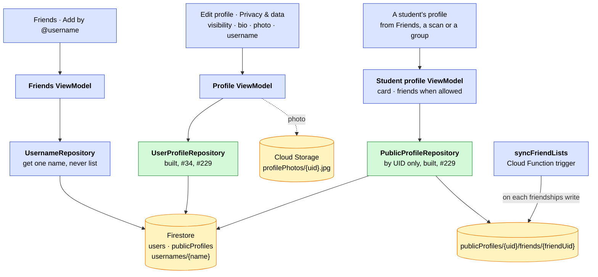

- **What a profile shows, in two parts.**
  - **Always visible** to every verified EPFL student, public or private: `displayName`, `section`, `year`, `interests` (matching needs them, #229), and, when the student has them, `username`, `bio` and a photo. This is how Instagram works: a private account still shows its name, photo and bio.
  - **Public only: the friends list and its count.** On a public profile any student sees it; on a private profile only the student's accepted friends do. Group members see only the always-visible fields (Figma: "Members see only public profile fields"). The student always sees their own.
- **Private by default** (nLPD art. 7, privacy by default): `profileVisibility` is `"public"` or `"private"`, and a profile without it, including every profile saved before, is private. Going public is the student's own choice, a switch in Privacy & data.
- **Stored like the other public fields.** `profileVisibility`, `bio` and `photoUpdatedAt` live in `users/{uid}` and are copied to `publicProfiles/{uid}` in the same write, which the rules already compare with `getAfter` (#229). `bio` is optional plain text of 1 to 150 characters, no links rendered. Because the bio and photo stay visible on a private profile, Edit profile says so next to those fields (#449, #453), not only the privacy notice (Sprint 6 PO).
- **Photo (optional, its own task).** One file per student, `profilePhotos/{uid}.jpg` in Cloud Storage: resized on the device to at most 512 × 512 px, JPEG, at most 500 KB, which the Storage rules enforce with the content type. Only the owner writes or deletes it, and a **write also needs an active student account**: the caller's `publicProfiles/{uid}` exists and no `deletedAccounts/{uid}` marker does (`firestore.exists`). Comparing the UID with the path alone isn't enough: a deleted account's token stays valid for up to an hour, and an upload after `deleteAccount` removed the photo would leave a file nobody deletes (#445 review). `deleteAccount` deletes the photo after the profile transaction, so any upload that passed the check before is deleted with it. Rules test (#453): a fresh upload with the deleted account's still-valid token is denied; any verified EPFL student, never an association, reads it. `photoUpdatedAt` (server time) tells other devices to fetch the new photo, and the app caches it; without a photo the initials show, as today. Reporting a photo fits #376's reporting work later.
- **Another student's friends: a list a Cloud Function keeps.** The rules can't let Carol list "the friendships that contain Alice": a list rule can't read the UID in a query, so it can't check whether Alice is public. Instead, the trigger `syncFriendLists` (on every write to `friendships/{pairId}`, `retry: true`, like `deleteEventRegistrations`) keeps `publicProfiles/{uid}/friends/{friendUid}` with only `acceptedAt`.
  - **It follows the friendship as it is now, never the event's snapshot.** Firestore can deliver events late, twice or out of order: an "accepted" event can arrive after the friendship was removed, and a handler that copied it would put a removed friend back on both lists (#445 review). So the handler ignores the event's data, keeps only the pair ID, and in one transaction reads `friendships/{pairId}` and sets both entries to match it: accepted → both entries with its `acceptedAt`; pending or missing → both deleted. Any order and any number of runs end in the same state, the friendship's current one.
  - **Tests (#447):** a removal followed by a late delivery of the old acceptance event leaves no entry; the same event twice changes nothing; accept, remove, request and accept again ends with the new `acceptedAt`.
  - **Friendships accepted before the trigger is deployed** (#419 lets students accept from a scanned card, possibly before #447 ships) get their entries from a **one-off backfill script** (`firebase/functions/scripts/`, run by a person with their own `gcloud` sign-in like `seedDemo.js`, never by CI or an agent): for each accepted friendship it runs the same transaction. It is idempotent, so running it after the trigger is live is safe; it runs once right after the deploy, before #450 shows the lists.
  - **Reading:** because the owner's UID is in the path, the read rule can check it. The app never writes these entries, so nobody can fake a friend, and #357's repository and rules stay as they are. The list can lag the friendship by about a second. Names and photos come from each friend's public profile, read by UID.
  - **The count is the list's size, not a `count()` query.** The profile reads the whole list anyway to show it (a student's friends number in the tens or hundreds, no paging), and Firestore's `count()` needs the server, so it would leave the count empty offline (#445 review). Offline, a list read before shows from the cache with its size; a list never read shows no count ("–") and "You're offline" until the device reconnects, never a wrong total.
- **Accepted trade-off (as on Instagram):** if Bob is private and friends with public Alice, any student sees Bob in Alice's list. Bob's own list stays hidden. The privacy notice says so.
- **Usernames.**
  - **Format (approved by the Sprint 6 PO, #445):** lowercase only, so `@Alice` and `@alice` are never two people: the field lowercases what is typed. A letter, then `a–z`, `0–9`, `_` and `.`, 3 to 20 characters in all, typed with or without `@`. Reserved: `polysocial`, `admin`, `support`, `epfl`, `agepoly`, `staff`, `moderator`, `official` and `help`. Always visible on the profile, as `@name`.
  - **Lookup:** `usernames/{name}` holds only `uid`. Students may **get** one name they typed, **never list** the collection, so there is still no student directory. Anyone can test whether a name exists, the same exposure as reading a profile by UID today.
  - **No duplicates:** the name is the document ID, so a second student's create is refused.
  - **Claiming and renaming:** one transaction writes `users/{uid}.username` (copied to the public profile), creates the new `usernames/{name}` and, on a rename, deletes the old one. The rules tie them both ways, as groups do with their markers (#232), so no write can keep two names (#445 review):
    - a `usernames/{name}` create needs `users/{uid}.username == name` after the write, and its delete needs the profile to no longer name it after the write (`getAfter`, or the profile deleted);
    - a `users/{uid}` update that sets a new `username` needs `usernames/{new}` to belong to the student after the write, and one that changes or removes a username needs the old `usernames/{old}` gone after the write (`!existsAfter`), so a client can't claim `@alice2` while keeping `@alice` reserved;
    - a client deleting `users/{uid}` directly, which the current rules allow and the app never does, must delete its `usernames/{name}` in the same write (`!existsAfter`), so a deleted profile can't leave a name reserved.
  - **Freeing a deleted account's name at once** (approved by the Sprint 6 PO): someone else can then take it, so adding by username always shows the student's card (name, section, year, photo) before the request is sent, like the QR flow (#452).
  - **Older profiles and associations:** a student without a username picks one in Edit profile when they want to; nothing is forced and QR codes still work. Associations get none.
  - **Never by email:** nobody is looked up by email, which the public profile never holds.
- **Account deletion** (decision 15): `deleteAccount` deletes the `usernames/{name}` document, so the name is free at once, and the photo file, both after the profile transaction. Deleting the friendships (#338) fires the trigger, which removes the student from each friend's list and empties their own.
- **Offline:** a profile and its friends list show from the cache; changing the visibility, bio, photo or username is refused offline with Try again, like the friends actions.

## 4. Key flows

Each flow shows who calls whom, top to bottom. "App" is the screen together with its ViewModel.

### 4.1 Sign up (#30)

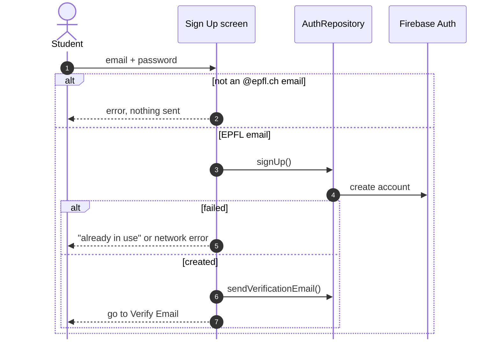

No profile is written yet. The Security Rules only accept writes from verified accounts.

### 4.2 Verify email, then create the profile (#31, #34)

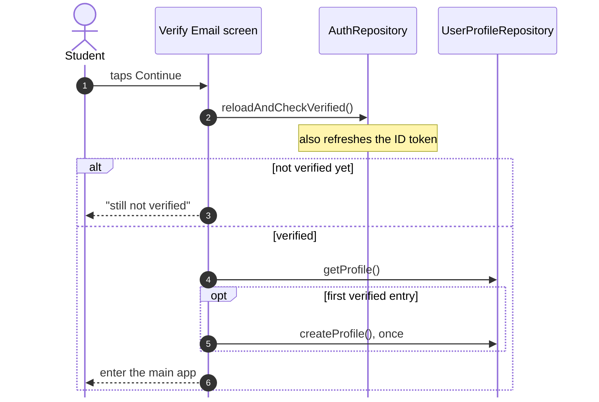

### 4.3 App start routing (#32, #74, #127, #208)

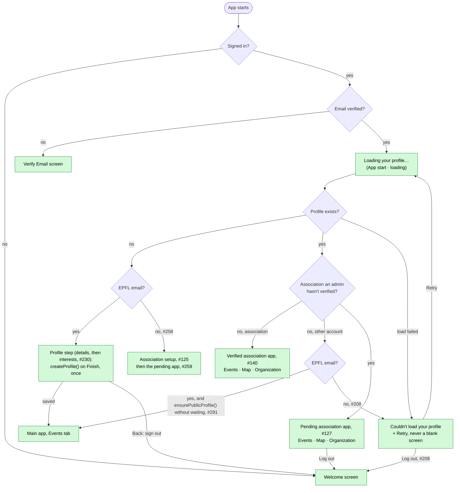

- **Association accounts (#127).** The account type decides, never the email. An association an admin hasn't verified yet opens its own app in the pending state (Figma section 02): the review steps on Events, a closed Map and its details on Organization. A verified association opens its own tabs in the same `AssociationShell` (#140): Events (#132), Map (its own events, #133) and Organization. The admin's verification (#135) takes effect at the next app start.
- **Edit details (#127).** On the pending app's Organization tab, Edit details (`EditAssociationScreen` → `EditAssociationViewModel`) edits the name, type, about and optional website, starting from the details shown there, checks them with association setup's `associationFormErrors` (#256), and saves them with `AssociationRepository.updateAssociation` (#126's owner-only update rule). A failed save keeps the form and offers Try again, with its own offline message.
- **Association log in (#208).** Log in accepts any email domain, so an association signs in with its own address; its helper line says students use `@epfl.ch` and associations their own email. Routing then decides by account type and fails closed: a session whose email isn't an EPFL one never gets the student profile step or the students' app. Without a profile it resumes association setup (#258); with a student profile it gets the error screen. The Security Rules already deny it student data. Every app-start error offers Retry and a Log out link (Figma 490:26), so such an account, or anyone whose Retry keeps failing, is never stuck. That Log out is the pending association app's: a confirmation, then the cache cleared before the sign-out (#109). A verified association keeps the main app until #140.

### 4.4 Map: public events and distances (#49–#51)

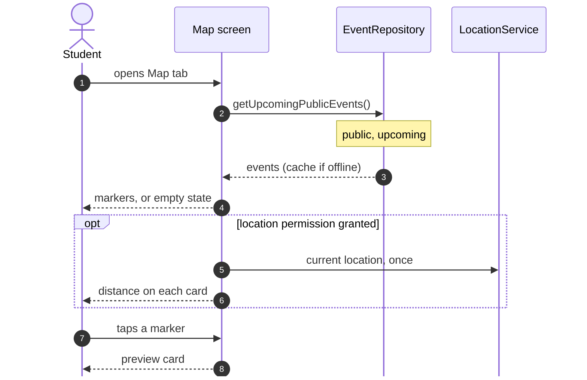

### 4.5 Find a group (#231–#233, decided in #228)

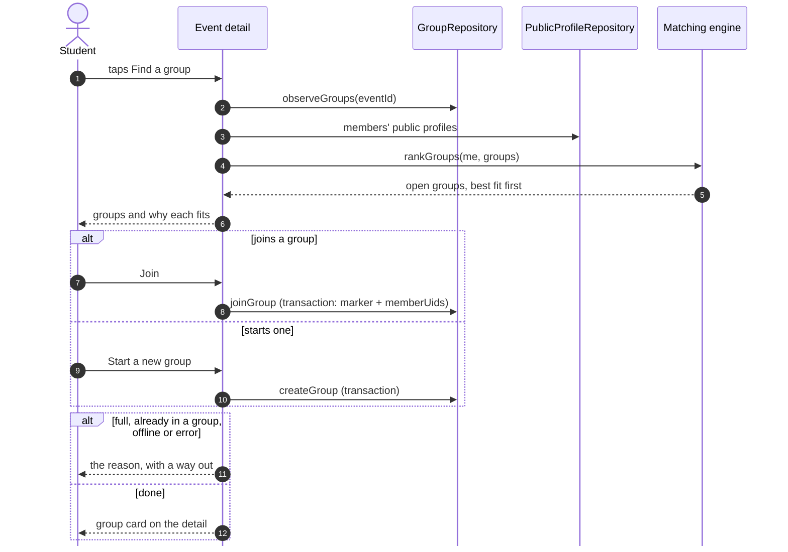

## 5. Data model

### 5.1 How the collections relate

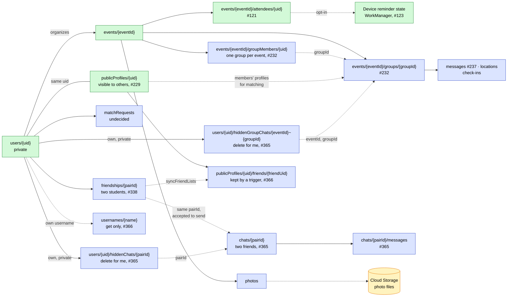

### 5.2 Collections and key fields

| Collection | Key fields | Status |
|---|---|---|
| `users/{uid}` | `uid`, `email`, `displayName` (at most 50, #143), `section`, `year`, `interests` (codes from `INTERESTS` in `ProfileOptions.kt`, each at most once, in that list's order; absent on a profile saved before #230, empty for an association), `createdAt`, `accountType`, `isAssociationVerified`. Planned (#366): `profileVisibility` (`public` or `private`, absent = private), `bio?` (1–150), `photoUpdatedAt?` (server time), `username?` | 🟩 #34, #45, #230; #366 fields 🟦 decided |
| `deletedAccounts/{uid}` | empty: only the deleted account's UID, as document ID. Written by `deleteAccount` with the profile deletion; the rules refuse recreating either profile, starting/joining groups, recreating markers or reading/sending chat messages (#241), under it. No app access | 🟩 #229 |
| `events/{eventId}` | `title`, `description`, `category`, `location`, `locationName?` (#112), `startTime`, `endTime?`, `capacity?`, `isPrivate`, `createdBy`, `organizerIds`, `allowedUids`, `isAssociationEvent`; `attendeeCount` (#372): the number of registered students, a whole number changed only together with a registration, absent on an event written before it (read as 0) | 🟩 #45; `attendeeCount` 🟦 decided in #372, built by #373 |
| `associations/{uid}` | `name` (1–60), `type` (`ASSOCIATION`, `COMMISSION`, `CLUB`, `EPFL_UNIT`), `about` (1–1000), `website?` (`https://`, at most 200), `createdAt`. Document ID = the association account's UID | 🟩 #126 |
| `publicProfiles/{uid}` | `displayName`, `section`, `year`, `interests` (codes from #230's fixed list), always visible; never the email. Written in the same transaction as `users/{uid}`. `section`, `year` and `interests` must be codes from `ProfileOptions.kt`; `interests` copies the private list in the same order (`[]` when the private profile has none). A profile saved before #229 gets it at its next app start (#291, `ensurePublicProfile`). Planned (#366): copies of `profileVisibility`, `bio`, `photoUpdatedAt` and `username`, all always visible ([3.9](#39-profile-visibility-and-usernames-product-backlog-decided-in-366)) | 🟩 S4 #229, #230 (built); #366 fields 🟦 decided |
| `events/{eventId}/attendees/{uid}` | student UID as document ID; `uid` (same UID, for the collection-group query) and server-set `registeredAt`. Counted in the event's `attendeeCount` (#372) | 🟩 S2 #121; no separate top-level registrations collection |
| Device reminder state | event ID, title and start time for a local notification; unique work, opt-in | 🟩 S2 #123; no Firestore collection |
| `matchRequests/{id}` | `eventId`, `fromUid`, `toUid`, `status` | ⬜ not used by Find a group, where students join open groups directly (#228); revisit with #26, #27 |
| `events/{eventId}/groups/{groupId}` | `capacity` (4), `memberUids` (1 to `capacity`, creator first), `createdBy`, server-set `createdAt` | 🟦 S4 #232 |
| `events/{eventId}/groupMembers/{uid}` | `groupId`: the student's group for this event, written in the same transaction as `memberUids` | 🟦 S4 #232 |
| `events/{eventId}/groups/{groupId}/messages/{id}` | `senderId` (empty after account deletion, displayed as Deleted account), `text` (1–1000; empty once its sender unsends it, decided in #365), server-set `createdAt` | 🟩 S5 #237 (built); unsend 🟦 decided in #365 |
| `events/{eventId}/groups/{groupId}/checkIns/{uid}` | `method` (gps or qr), `checkedInAt` | 🟦 #22 |
| `events/{eventId}/groups/{groupId}/locations/{uid}` | position, `updatedAt`. Only during the event, deleted after | 🟦 #20 |
| `friendships/{pairId}` | `pairId` = `{lowerUid}~{higherUid}`; `uids` (the two UIDs, sorted), `requestedBy` (the sender), `status` (`pending` or `accepted`), server-set `createdAt`, server-set `acceptedAt` once accepted. Deleted on decline, cancel or removal, and with either account | 🟦 PB, decided in #338 |
| `publicProfiles/{uid}/friends/{friendUid}` | the friend's UID as document ID; `acceptedAt`. Written and deleted only by the `syncFriendLists` trigger, from `friendships` ([3.9](#39-profile-visibility-and-usernames-product-backlog-decided-in-366)) | 🟦 decided in #366 |
| `usernames/{name}` | the username as document ID (lowercase, a letter then `[a-z0-9_.]`, 3–20); `uid`. Claimed, renamed and released with `users/{uid}.username` ([3.9](#39-profile-visibility-and-usernames-product-backlog-decided-in-366)) | 🟦 decided in #366 |
| Storage `profilePhotos/{uid}.jpg` | one JPEG per student, at most 512 × 512 px and 500 KB; `photoUpdatedAt` in the profile says when it changed ([3.9](#39-profile-visibility-and-usernames-product-backlog-decided-in-366)) | 🟦 decided in #366 |
| `chats/{pairId}` | `pairId` = the pair's friendship ID (`{lowerUid}~{higherUid}`, #338); exactly `uids` (the two UIDs, in the ID's order). Created with the first message; no client updates or deletes it. `deleteAccount` takes a deleted account's UID out of `uids` while the other student still has an account; once nobody else is left, it leaves `uids` unchanged and deletes the messages, then the chat | 🟦 PB, decided in #365 |
| `chats/{pairId}/messages/{id}` | group chat's fields (#237): `senderId` (empty after account deletion, displayed as Deleted account), `text` (1–1000; empty once its sender unsends it, displayed as "This message was deleted"), server-set `createdAt` | 🟦 PB, decided in #365 |
| `users/{uid}/hiddenChats/{pairId}` | delete for me: exactly `hiddenUpTo`, the later of the `createdAt` of the latest message the student saw when they deleted the chat and, if they were friends, the friendship's `acceptedAt`; the chat is off their Chats list while neither its latest message nor a current friendship's `acceptedAt` is newer. Only its owner reads and writes it, and only moves it forward; no client deletes it, so it stays until the account is deleted. `deleteAccount` deletes the account's markers (deleting `users/{uid}` doesn't) | 🟦 PB, decided in #365 |
| `users/{uid}/hiddenGroupChats/{eventId}~{groupId}` | delete for me in a group chat: exactly `hiddenUpTo`, as above, or the group's `createdAt` for a group chat without a message. Only its owner reads, creates or moves it, for a group they are in, and only forward; leaving the group deletes it (#232's leave transaction), so a rejoined group's chat is listed again. `deleteAccount` deletes them with the one-to-one markers | 🟦 PB, decided in #365 |
| `events/{id}/photos/{photoId}` | `storagePath`, `uploaderId`, `createdAt`. The file itself is in Cloud Storage. | 🟦 album |

**Profiles are split, Instagram-style.** `users/{uid}` is private to its owner. `publicProfiles/{uid}` is what other students see. Section, year and interests are always visible because matching needs them. A **public** profile also shows friends, events attended, photos and the full bio to everyone. A **private** profile shows those only to approved connections.

## 6. Security Rules

Rules live in `firebase/firestore/firestore.rules` and are tested against the Firebase Local Emulator Suite. **Main today** allows each account's own `users/{uid}` (#35), an association's own `associations/{uid}` and students' reads of verified ones (#126), plus public/private and own-association event reads (#52). Event writes (#47), attendees (#121), groups with their markers (#232) and group chat messages (#237) have their rules; every other subcollection remains denied until its reviewed rules land. The rows below describe the planned policy as well as the current reads; this documentation does not grant access.

| Collection | Read | Create | Update / delete | Issue | Status |
|---|---|---|---|---|---|
| *every rule* | requires `isEpflUser()`: signed in, `email_verified == true`, email ends with `@epfl.ch` | | | #33 | 🟩 S1 |
| *association branch* | a verified association (`email_verified == true`, `accountType == "association"`, `isAssociationVerified` set by an admin), **only** on its own association, members and events. Added with its first use, after #35 removed the catch-all rule | | | #47 | 🟩 S1 |
| `users/{uid}` | own document only | own document only, not under a `deletedAccounts/{uid}` marker (#229); `displayName`, when present, a string of at most 50 characters on create and update (#143) | own document only; a change to `displayName`, `section` or `year` must update an existing public profile in the same write (#229) | #35, #143, #229 | 🟩 S1, S3, S4 |
| | **Exceptions to *every rule*:** any account with a verified email reaches its own `users/{uid}`, but never sets `isAssociationVerified` (create or update), and can't change `uid` (which must match the document ID) or `accountType` after creation. An association account also reaches its own `associations/{uid}` (next row), pending or verified. That is all an unverified association can reach | | | #35, #126 | 🟩 S1, S3 |
| `associations/{uid}` | its owner (an association account, pending or verified); EPFL students only once an admin has verified it (a denied read looks missing); never another association; no list | owner only, once, exactly the fields above with `createdAt` = server time | owner only; `createdAt` fixed, and `name` and `type` fixed once verified; delete by an admin only | #126 | 🟩 S3 |
| `events/{id}`, public | any EPFL user | any EPFL user or verified association, `createdBy == auth.uid` and `organizerIds == [auth.uid]`. `isAssociationEvent` only for a verified association. Planned (#372): `attendeeCount` 0 or absent | organizers only; a change to `organizerIds` keeps at most 5, each once, adds only students registered for the event, and never touches an association event's (#370). Planned (#372): organizers can't change `attendeeCount`; a student who can read the event changes only that field, by exactly ±1, with their own registration created or deleted in the same write (rule sketch below) | #47, #52, #370, #372 | 🟩 S1, S6; `attendeeCount` 🟦 built by #373 |
| `events/{id}`, private | `auth.uid in allowedUids` (organizers, members, approved match requesters) | as above | organizers only, and as above for `attendeeCount`: only a student in `allowedUids` | #52, #23, #372 | 🟩 S1; `attendeeCount` 🟦 built by #373 |
| `events/{eventId}/attendees/{uid}` | own attendance; attendee list only for the event's organizers | verified EPFL student, own UID, readable event that hasn't ended, account not deleted (`deletedAccounts/{uid}`, #275); no association registration. Planned (#372): only in the same write as the event's `attendeeCount` + 1, which the event rule accepts only within the capacity | student deletes only own document, even once the event has ended or is gone; no writes to another student's attendance; nobody updates one; a deleted event's attendees are deleted by the `deleteEventRegistrations` trigger (Admin SDK, #275), unless the event is written again under its ID first. Planned (#372): the delete lowers the event's `attendeeCount` in the same write, unless the event is gone or no longer readable, or its counter is 0 or absent | #121, #372 | 🟩 in place; the capacity check 🟦 decided in #372, built by #373 |
| `publicProfiles/{uid}` | any student, one document by UID (no list, so no student directory); no association | owner only, only the fields above, no email; `section`, `year` and `interests` from the app's fixed lists | owner only, as an exact copy of their `users/{uid}` after the same write (`getAfter`), never under a `deletedAccounts/{uid}` marker; no delete except with the account (`deleteAccount`). Planned (#366): the copy also holds `profileVisibility` (`public` or `private`), `bio` (a string of 1 to 150) and `photoUpdatedAt`, and `username` must match the caller's own `usernames/{name}` after the write | #229, #366 | 🟩 S4 (built); #366 🟦 decided |
| `events/{eventId}/groups/{groupId}` | a student who can read the event; a member also gets their own group without it, so they can still leave it (#295); a student lists their own groups across events (`memberUids array-contains` their UID) | a student who can read the event, not under a deletion marker, with `memberUids == [own UID]`, `capacity == 4`, `createdBy` = own UID, server `createdAt`, and their `groupMembers` marker in the same write | update: only `memberUids` changes, by adding (no deletion marker) or removing the caller's own UID, `size() <= capacity`, with the marker created or deleted alongside (`getAfter`); delete: the last member leaving. No association access | #232 | 🟦 S4 |
| `events/{eventId}/groupMembers/{uid}` | own document only | own UID, not under a deletion marker, `groupId` of a group whose `memberUids` contain them after the write | delete own, when leaving that group; no update | #232 | 🟦 S4 |
| `events/{eventId}/groups/{groupId}/messages/{id}` | active student group members only (no deletion marker), from the group's `memberUids` (so, like the group, #295, a member removed from a private event keeps it); no query across groups | members, exactly `senderId` = own UID, `text` 1–1000, server `createdAt`, never under a `deletedAccounts/{uid}` marker; per operation, so rate limiting fits later. No association access | no client edits/deletes; account cleanup replaces `senderId` with an empty string, preserving text/time, including former/orphaned chats. Decided in #365, not built: the sender's unsend while still a member (`text` becomes `''`, nothing else changes); still no other edit and no delete | #237, #241, #365 | 🟩 S5 (built); unsend 🟦 |
| `matchRequests` | sender and recipient | sender | recipient responds | #26, #27 | 🟦 PB |
| `friendships/{pairId}` | the two students only (`isStudent()`, own UID in `uids`, not under a `deletedAccounts/{uid}` marker); a list only with `uids array-contains` the caller's UID, so no listing of other students. A `get` of a **missing** document is allowed only when `isPairIdOf(pairId, request.auth.uid)` holds (#357), still for a student not under a marker: the same check as the chat rules prototype (#365), whose `isTwoPartId` requires exactly two non-empty parts joined back into the ID (`split` alone drops trailing empty parts), then sorted, different UIDs, one of them the caller's. Whichever of #357 and #365 merges first adds the two functions, and the other reuses them: the repository's transactions read the document before sending, accepting or removing, and a missing document has no `uids` to check. A third student is refused whether or not the document exists, so nobody can probe who is friends | the sender only (`requestedBy` = own UID, in `uids`, not under a `deletedAccounts/{uid}` marker): two different UIDs, sorted, the document ID built from them, `status == "pending"`, server `createdAt`, only these fields; the other UID has a `publicProfiles/{uid}` and its `users/{uid}` isn't an association's, and the sender's own `users/{uid}` isn't one after the write (`getAfter`, so not in the batch that creates an association profile), so associations and deleted accounts can't be added (#416 review). Per operation, so a rate limit and a blocks check fit later | update: the recipient only (in `uids`, not `requestedBy`), `pending` → `accepted` with server `acceptedAt`, nothing else changes, and neither student under a `deletedAccounts/{uid}` marker; delete: either student (decline, cancel, remove), not under a marker. A deleted account's still-valid token (up to 1 h) can't read or change its friendships while `deleteAccount` cleans them up; the cleanup uses the Admin SDK. No association access | #338, #357 | 🟦 S6 #357 |
| `chats/{pairId}` | the two students the document ID names, an ID that is exactly `{lowerUid}~{higherUid}` (`isStudent()`, not under a `deletedAccounts/{uid}` marker), also before it exists (read as missing); a list only with `uids array-contains` the caller's UID, so no listing of other students' chats | one of the two, while `friendships/{pairId}` exists with `status == "accepted"`: the ID is exactly two different, non-empty UIDs in sorted order joined by one `~` (no other spelling of the pair, such as a trailing `~`), and `uids` is exactly those two in that order. Per operation, so a blocks check and a rate limit fit later | none by a client, not even rewriting the same content; `deleteAccount` (Admin SDK) takes a deleted account's UID out of `uids` while the other student still has an account, and otherwise deletes the messages, then the chat, with `uids` unchanged until then. No association access | #365 | 🟦 PB |
| `chats/{pairId}/messages/{id}` | the two students the document ID names, friends or not (the conversation stays readable after unfriending), not under a deletion marker; no query across chats | one of the two, while friends (`accepted`), with the chat document existing after the write: exactly `senderId` = own UID, `text` 1–1000, server `createdAt`. Per operation, so rate limiting fits later. No association access | update: only unsend, by the sender of their own message, while friends, not under a deletion marker: `text` becomes `''` and nothing else changes; no other edit and no delete. Account cleanup replaces `senderId` with an empty string, preserving text/time (#241's collection-group query already covers it) | #365 | 🟦 PB |
| `users/{uid}/hiddenChats/{pairId}` | its owner only (`isStudent()`, own UID, not under a `deletedAccounts/{uid}` marker), one marker or a list of their own; nobody else, whether a marker exists or not; no collection-group query | its owner, for an existing chat whose ID is exactly the pair ID with their UID (`isPairIdOf`): exactly `hiddenUpTo`, a timestamp no later than the server's time | update: as create, and never to an earlier `hiddenUpTo` than the stored one (deleting the chat again); no client delete; `deleteAccount` (Admin SDK) deletes the account's markers. No association access | #365 | 🟦 PB |
| `users/{uid}/hiddenGroupChats/{chatId}` | as `hiddenChats` | its owner, under an ID that is exactly two non-empty parts, `{eventId}~{groupId}` (`isTwoPartId`), for a group that exists and lists them in `memberUids`: exactly `hiddenUpTo`, a timestamp no later than the server's time | update: as `hiddenChats`, forward only; delete: its owner (a student, their own UID, also under a deletion marker), under a two-part ID, only once they are out of the group after the write (`existsAfter`/`getAfter`): in #232's leave transaction, or for a group they left or that was deleted; deleted with the account. No association access | #365 | 🟦 PB |
| `publicProfiles/{uid}/friends/{friendUid}` | an active student (not under a marker): the owner, anyone when `publicProfiles/{uid}.profileVisibility == 'public'`, or the owner's accepted friend (`friendships/{pair}` exists with `status == 'accepted'`, the pair ID built from the two UIDs). The owner's UID is in the path, so a list rule can check it. No association | nobody: the `syncFriendLists` trigger writes it (Admin SDK) | nobody (the trigger) | #366 | 🟦 decided |
| `usernames/{name}` | `get` by an active student; **no list**, so no student directory | an active student, the ID matches `^[a-z][a-z0-9_.]{2,19}$` and isn't reserved (`polysocial`, `admin`, `support`, `epfl`, `agepoly`, `staff`, `moderator`, `official`, `help`), exactly `{uid: <own UID>}`, with `users/{uid}.username == name` after the write (`getAfter`) | no update; delete by its owner, only when `users/{uid}` no longer names it after the write (rename, removal, or the profile deleted); `deleteAccount` releases it (Admin SDK). In turn, a `users/{uid}` update that changes or removes `username`, or a client delete of a profile that has one, must delete the old `usernames/{name}` in the same write (`!existsAfter`) | #366 | 🟦 decided |
| Storage `profilePhotos/{uid}.jpg` | a verified EPFL student, not an association (`firestore.get` of the caller's profile) | the owner only, an active student (`publicProfiles/{uid}` exists and no `deletedAccounts/{uid}` marker, `firestore.exists`), `image/jpeg`, at most 500 KB | the owner replaces or deletes it; `deleteAccount` deletes it | #366 | 🟦 decided |
| Storage `events/{id}/album/**` | event group members | checked-in members, size and type limits | uploader | album | 🟦 PB |

**Event capacity rule** (decision 21, #372; built by #373). The sketch below replaces the `allow create` and `allow update` of `match /events/{eventId}` and the `allow create` and `allow delete` of its `match /attendees/{uid}`; nothing else in the rules changes. It keeps #370's co-organizer checks: the creator is a new event's only organizer, and `keepsValidOrganizers()` checks an organizer's change to `organizerIds`. The two documents are tied in both directions: the event accepts a counter change only with the caller's own registration (`exists` / `existsAfter`), and a registration is accepted only with the counter change (`getAfter`), as groups tie `memberUids` to the `groupMembers` marker (#232). A student therefore changes the counter only by their own one place, and no client can skip or fake the count. The rule checks the capacity itself, against the counter as it is stored when the write commits, so the app's write doesn't have to read the event first: it sends `FieldValue.increment(±1)` (decision 21, "The app's transactions").

```
// In match /events/{eventId}: replaces allow create and allow update.

// A new event has no registration yet: attendeeCount is the whole number 0, or absent (an
// event written before the counter existed counts as 0 everywhere). Numbers compare by
// value, so `is int` is what refuses 0.0.
allow create: if canWriteEvents()
    && request.resource.data.createdBy == request.auth.uid
    && request.resource.data.organizerIds == [request.auth.uid]
    && isValidEvent(request.resource.data)
    && request.resource.data.isAssociationEvent == isVerifiedAssociation()
    && request.resource.data.get('attendeeCount', 0) is int
    && request.resource.data.get('attendeeCount', 0) == 0;

// The caller's own registration for this event.
function ownRegistration() {
  return /databases/$(database)/documents/events/$(eventId)/attendees/$(request.auth.uid);
}

// The student branch of the event's read rule, on the stored event.
function studentCanReadThisEvent() {
  return resource.data.isPrivate == false
      || (resource.data.isPrivate == true
          && resource.data.allowedUids.hasAny([request.auth.uid]));
}

// Registering: the counter goes up by exactly one, stays within the capacity when it is a
// number (null, missing or anything else is no limit), and the caller's registration,
// missing before, exists after the same write. That document's own create rule checks the
// rest (own UID, readable event that hasn't ended, account not deleted).
function isRegistering() {
  let capacity = resource.data.get('capacity', null);
  let before = resource.data.get('attendeeCount', 0);
  let after = request.resource.data.attendeeCount;
  return after is int
      && after == before + 1
      && (!(capacity is number) || after <= capacity)
      && !exists(ownRegistration())
      && existsAfter(ownRegistration());
}

// Cancelling: the counter goes down by exactly one, never below 0, and the caller's
// registration, there before, is deleted by the same write.
function isCancelling() {
  let before = resource.data.get('attendeeCount', 0);
  let after = request.resource.data.attendeeCount;
  return after is int
      && after >= 0
      && after == before - 1
      && exists(ownRegistration())
      && !existsAfter(ownRegistration());
}

// The only change a non-organizer may make to an event (#372): a student who can read it
// changes attendeeCount, and nothing else, with their own registration.
function countsOwnRegistration() {
  return isStudent()
      && studentCanReadThisEvent()
      && request.resource.data.diff(resource.data).affectedKeys().hasOnly(['attendeeCount'])
      && (isRegistering() || isCancelling());
}

// Any organizer manages the event. The creator, the badge and the counter are fixed for
// them: attendeeCount only changes through countsOwnRegistration. An equal number of another
// type (3.0 for 3) isn't a change for affectedKeys, so `is int` keeps the counter whole.
allow update: if (canWriteEvents()
        && isOrganizer()
        && isValidEvent(request.resource.data)
        && keepsValidOrganizers()
        && !request.resource.data.diff(resource.data).affectedKeys()
            .hasAny(['createdBy', 'isAssociationEvent', 'attendeeCount'])
        && request.resource.data.get('attendeeCount', 0) is int)
    || countsOwnRegistration();

// In match /attendees/{uid}: replaces allow create and allow delete.

// The event's attendeeCount before this write, and once the whole write (batch or
// transaction) is applied. Missing counts as 0.
function countBefore() {
  return get(event()).data.get('attendeeCount', 0);
}

function countAfter() {
  return getAfter(event()).data.get('attendeeCount', 0);
}

// A registration is counted: the same write raises the event's attendeeCount by one,
// which the event's update rule accepts only within the capacity.
allow create: if isSelf()
    && !isDeletedAccount(uid)
    && canReadEvent()
    && hasNotEnded()
    && request.resource.data.keys().hasOnly(['uid', 'registeredAt'])
    && request.resource.data.uid == uid
    && request.resource.data.registeredAt == request.time
    && countAfter() == countBefore() + 1;

// Cancelling lowers the counter in the same write, so nobody frees or keeps a place they
// don't hold. It is still always possible: nothing is counted for a registration that
// doesn't exist, an event that is gone or no longer readable, or a counter already at 0.
allow delete: if isSelf()
    && (resource == null
        || !canReadEvent()
        || countBefore() == 0
        || countAfter() == countBefore() - 1);
```

**Number types.** The rules compare numbers by value: `3 == 3.0`, and `affectedKeys()` doesn't see 3 rewritten as 3.0 as a change. So every place that accepts the counter also asks for `is int`: create (C5), the organizer branch (O10) and both student branches (R24), which keeps `attendeeCount` a whole number whatever a client sends. `capacity` isn't constrained that way: a counted registration may send the stored capacity back as a decimal (10.0 for 10). That changes nothing, since the rule takes any number as the capacity and the app reads `capacity` as a `Number`.

What the sketch allows and denies, one rules test per row. A **counted registration** is the caller's own `attendees/{uid}` created and the event's `attendeeCount` raised by one in the same write (a batch or a transaction); a **counted cancellation** is the caller's registration deleted and the counter lowered by one in the same write. The app sends the change as `increment(1)` or `increment(-1)`, and the rows do too unless they say otherwise. Unless a row says otherwise, the caller is a student who can read the event, which hasn't ended. **Every row goes into `firebase/firestore/firestore.rules.test.js`**, the REST rows included: CI's "Security Rules tests" step and the README run only that file, and running another one would change the workflow, which needs team approval. Once written, those tests are the source of truth: #373 replaces these tables with a pointer to them, keeping the row numbers in the test names.

Creating an event:

| # | Write | Result |
|---|---|---|
| C1 | an event with `attendeeCount: 0` | allowed |
| C2 | an event without `attendeeCount` (an app from before the counter) | allowed; reads as 0 |
| C3 | an event with `attendeeCount` 1, −1, `null`, `"0"`, 0.5 or a list | denied |
| C4 | a verified association's event with `attendeeCount` 0, then 3 | 0 allowed, 3 denied |
| C5 | an event with `attendeeCount` 0.0, a decimal | denied |

An organizer's edits:

| # | Write | Result |
|---|---|---|
| O1 | other fields (`title`, `capacity`) without sending `attendeeCount` | allowed; the counter is kept |
| O2 | `attendeeCount` set, raised by one (also with `increment(1)`), lowered by one or removed, alone or with another field | denied |
| O3 | `attendeeCount` (0 or any value) added to an event that has none | denied |
| O4 | the whole event overwritten (`set`) without `attendeeCount`; with the stored value | denied; allowed |
| O5 | `capacity` lowered below the count | allowed; registering is then denied and cancelling allowed, until the count is below it |
| O6 | a verified association on its own event: `attendeeCount` ±1; another field | denied; allowed |
| O7 | an organizer who is a student: a counted registration for their own event; then the counter lowered as an organizer | allowed; denied |
| O8 | an organizer's counted registration that also changes another field | denied |
| O9 | an event with registrations deleted | allowed; the counter goes with it |
| O10 | the whole event overwritten with the stored count as a decimal (3.0 for 3) | denied |

Registering:

| # | Write | Result |
|---|---|---|
| R1 | a counted registration as the app sends it: a transaction with no read, the registration and `increment(1)`; a place left | allowed |
| R2 | a counted registration on an event without `attendeeCount` (absent → 1), also one without `organizerIds` | allowed |
| R3 | a counted registration at `capacity − 1`; at `capacity` | allowed (reaches the capacity); denied |
| R4 | `capacity` `null` or absent, whatever the count | allowed, and still counted |
| R5 | `capacity` a string, a list or a boolean | allowed: not a number is no limit |
| R6 | `capacity` a decimal (2.5): the second place; the third | allowed; denied |
| R7 | `capacity` 0, negative or 1 (the form asks for at least 2) | registering denied; cancelling still allowed |
| R8 | a registration with the counter raised by 2 (also `increment(2)`), unchanged, lowered, set to a string or removed | denied |
| R9 | a counted registration that also changes `title`, `capacity`, `allowedUids` or `organizerIds` | denied |
| R10 | the counter raised by one without the caller's registration: alone, or with another student's registration in the write | denied |
| R11 | a non-organizer writing the counter back unchanged, changing any other field, or deleting the event | denied |
| R12 | a registration without the counter (an app from before the counter), on an event with or without `attendeeCount` | denied |
| R13 | already registered, also on a full event: a second counted registration; the counter raised alone | denied; nothing changes |
| R14 | two students at once for the last place; a count read before the other registered (that count plus one, now stale) | one allowed, the other denied; denied |
| R15 | two students at once with places left; a stale count | both allowed; denied |
| R16 | a counted registration that writes the stored count plus one instead of `increment(1)` | allowed |
| R17 | a private event: a student in `allowedUids`; another student, with or without a registration | allowed; denied |
| R18 | an event that has ended | denied |
| R19 | under a `deletedAccounts/{uid}` marker | denied |
| R20 | a verified association, an unverified one, an `@epfl.ch` association, an unverified `@epfl.ch` user, a verified non-EPFL user and a signed-out user: the counter ±1, with or without a registration under their UID | denied |
| R21 | an event that doesn't exist | denied |
| R22 | the registration under one event and the counter of another | denied |
| R23 | a student registered before the counter existed, registering again | denied; nothing changes, the registration is already there |
| R24 | a counted registration or cancellation whose counter is a decimal (4.0, or `increment(1.0)`) | denied |
| R25 | the caller's own registration and another student's in one write, on one counted place | denied |
| R26 | a counted registration with an extra field | denied |
| R27 | a counted registration with a `registeredAt` the client chose, or without one | denied |
| R28 | a counted registration whose `uid` names another student, or without `uid` | denied |

Cancelling:

| # | Write | Result |
|---|---|---|
| X1 | a counted cancellation as the app sends it: a transaction with no read, the delete and `increment(-1)`; also one that writes the stored count minus one | allowed; the place can be taken again |
| X2 | a counted cancellation once the event has ended | allowed |
| X3 | the registration deleted without lowering the counter, on a readable event whose counter is above 0, also at 1 with the caller's registration the only one | denied |
| X4 | a cancellation with the counter lowered by 2 (also `increment(-2)`), raised or removed, or with another field changed | denied |
| X5 | the counter lowered without deleting the caller's registration: a registered student keeping it; a student who isn't registered | denied |
| X6 | counter 0 or absent, a registration from before the counter: a counted cancellation; the registration deleted with the counter set to any other value; the registration deleted alone | denied (never below 0); denied; allowed |
| X7 | the event is deleted: a counted cancellation; the registration deleted alone | denied; allowed |
| X8 | the event is no longer readable: a counted cancellation; the registration deleted alone | denied; allowed. The counter stays |
| X9 | no registration, on a counted event: a counted cancellation; the delete alone | denied; allowed, and nothing is counted |
| X10 | a counted cancellation under a `deletedAccounts/{uid}` marker | allowed |
| X11 | another student's registration cancelled, alone or counted, even by an organizer | denied |
| X12 | two students cancelling at once; a stale count | both allowed; denied |
| X13 | the own registration deleted and created again in one write while the counter is lowered | denied |

Reads, unchanged:

| # | Read | Result |
|---|---|---|
| L1 | an organizer lists and `count()`s the attendees; another student | allowed; denied |
| L2 | a student who can read the event reads its `attendeeCount` | allowed |

**The existing suite.** A bare registration is now denied whatever else the rule says, so an existing test that still sends one passes for the wrong reason. #373 therefore moves **every** existing test that writes a registration to the counted write, the denied ones as much as the six that fail, and counts the registrations it seeds in the seeded event. Only then does a test fail when the registration rule loses a check of its own.

**Prototype** (2026-11-14, Firestore emulator, the README's rules-test command; on the branch `prototype/372-attendee-count`, never merged, where the rows are still in files of their own). With this sketch:
- every row above passes (98 tests; C5, O10 and R24 through the emulator's REST API, since the JS SDK always sends a whole number as an integer), with the repository's answers of decision 21 (18 more tests);
- the existing suite passes (513 tests) once every test that writes a registration uses the counted write;
- each condition of the sketch was removed in turn (31 variants of the rules, two of them the registration's create rule without its own checks): 28 fail at least one row. The other 3 are conditions the other document's rule checks as well, so removing one alone changes nothing: the event branch's `isStudent()` (the registration's rules ask for a student), its `after == before + 1` when registering (the registration's create asks for the same raise), and the registration's `canReadEvent()` (the event branch asks for a readable event). Removed together with their twin, they fail too (R20, R8, R17). The create rule without its own checks fails R25 to R28, and 10 and 5 tests of the converted existing suite. The delete rule's `countBefore() == 0` widened to `<= 1` passed every row until X3 gained the counter at 1, and now fails X3.

A registration's write stays well within the 20 document reads the rules may make for a batched write.

Every PR that changes rules follows the process in `AGENTS.md`: "Changes Security Rules" in the description, allowed and denied emulator tests, and explicit reviewer sign-off.

## 7. Design decisions

- **Google entry (#107):** Welcome and Log in share typed Google outcomes and responsive error UI. Verified users use the existing profile lookup; missing profiles enter the existing form with Google name/email prefilled. Profile-save completion opens the app without a second read; Back is locked during saving. Error Back restores the initiating auth screen. Google relies on Firebase-managed account linking; errors show non-EPFL guidance or a generic recoverable failure.

- **Google sign-in (#106):** both entry buttons use Credential Manager through the auth repository. Invalid domains are rejected before Firebase account creation; Firebase validates the token and verified exact `@epfl.ch` identity before profile access. Firebase manages compatible account linking; the owner confirmed automatic linking for EPFL Google accounts through EPFL SSO. Use Firebase's returned UID without client-side linking or a dedicated collision flow.

Decided by the team on 2026-10-03, with 13 and 14 revised on 2026-10-04 after review, and 5 and 11 revised on 2026-10-06; 15 added on 2026-10-28 (#201); 16 to 18 decided by the Sprint 4 PO on 2026-11-01 (#228); 19 added on 2026-11-11 (#210); 20 decided by the Sprint 5 PO on 2026-11-11 (#338); 21 decided by the Sprint 6 PO on 2026-11-14 (#372); 22 decided by the Sprint 6 PO on 2026-11-14 (#281); 12 revised by the Sprint 6 PO on 2026-11-14 and 2026-11-16 (#365). The issues are being updated to match.

| # | Topic | Decision |
|---|---|---|
| 1 | Profile creation | Exactly once, at the first verified entry (Verify Email "Continue" or app start), because the rules only accept verified accounts |
| 2 | Who creates events | Anyone. The creator becomes the organizer, and an event can have several organizers. Verified associations get a badge |
| 3 | Profiles | Private `users` plus `publicProfiles`, with public or private visibility. Section, year and interests are always visible; what private hides is decision 23 |
| 4 | Private events | `allowedUids` access list, checked by the rules |
| 5 | Create Event entry | "+" button on the Events and Map tabs. Afterwards, an "Event created" confirmation with *View event* and *Back to map*, as in the Figma (changed on 2026-10-06) |
| 6 | Matching | On the device: a pure module plus a Firestore transaction. Cloud Functions only if fairness or cheating becomes a problem |
| 7 | Find my group | `events/{eventId}/groups/{groupId}/locations/{uid}`, only during the event, members only, deleted afterwards (path from decision 16) |
| 8 | Reminders | Opt-in WorkManager reminder 1 h before the start; Android 13+ permission on first opt-in; Off, cancellation and logout remove unique work (#123) |
| 9 | QR codes | CameraX + ML Kit to read; ZXing `core` to draw (#339, ML Kit can't). Typed `polysocial://checkin/…` and `polysocial://friend/…` payloads, pure parser |
| 10 | Section-exclusive events | Deferred. Later `allowedSections` on events, checked in the rules |
| 11 | Association verification | Associations have no EPFL email and sign up with their own. A PolySocial admin verifies them by hand (`isAssociationVerified` in the Firebase console, documented in the README); no access before that, except their own `users/{uid}` and their own public `associations/{uid}`, which they set up while their review is pending (#126). Once verified, an association only sets up its association, manages its members and their roles, and publishes and manages its own events (no student profiles, groups, chats or matching). In-app admin flow later, not a current priority (changed on 2026-10-06) |
| 12 | One-to-one chat | Its own collection, `chats/{pairId}` with the friendship's pair ID (#338) and `uids`, and its `messages` with group chat's fields (#237), created with the first message; not a two-member group. Accepted friends only: the two students read it, and send only while `friendships/{pairId}` is `accepted`; removing a friend keeps it, read-only for both. Account deletion keeps it for the other student with the sender anonymised, like group chat (#241). Starting a chat, the Chats tab, unsend and delete for me (in one-to-one and group chats; leaving a group deletes its marker) and the rest: section 3.8 (changed on 2026-11-14 and 2026-11-16, #365) |
| 13 | Dependency injection | **Hilt** (changed after review). It is Android's recommended DI library, scales as repositories grow, and Hilt test modules swap in the fakes cleanly. The cost is some setup and slower builds |
| 14 | Back button | At a non-home tab root, go to the Events tab. At the Events root, exit. This is Android's standard pattern (changed after review) |
| 15 | Account deletion | Self-service for students, unverified accounts included; associations stay admin-assisted and the flow refuses them with the privacy contact. A callable Cloud Function `deleteAccount` (Functions v2, Node 22, `europe-west6`, deployed since 2026-11-05; Firestore is in `eur3`, a mismatch accepted for this rarely used call) requires a sign-in under 5 minutes old, then deletes `users/{uid}` (with `publicProfiles/{uid}` in the same transaction since #229) then event registrations, message sender links and group memberships/markers, and finally the Auth user with the Admin SDK; all steps are idempotent, so Retry completes a partial deletion. Events are kept unchanged (the UID is opaque; a missing public profile isn't proof of a deletion, see #291). Restrictive rules deny deleted-token group joins and chat access (#241); deployed by hand on Blaze, expected within the free quotas. The client refuses offline, reauthenticates, then clears the cache and verification keys and opens Welcome. `SessionGuard` clears the cache on any UID change (#198); email/password sign-ups still unverified more than 7 days after sign-up are deleted by the scheduled function `deleteUnverifiedAccounts` (#149, built by #226; see below the matrix) (added on 2026-10-28, #201) |
| 16 | Groups | `events/{eventId}/groups/{groupId}` with a fixed `capacity` of 4, `memberUids`, `createdBy`, `createdAt`; a `groupMembers/{uid}` marker per event keeps a student in one group. Joining and leaving change only the caller's own UID in one transaction, and the rules check the capacity. Find a group requires "I'm going" (#244). Chat messages under the group, refused offline. Interests from a fixed list. Associations get no access (added on 2026-11-01, #228) |
| 17 | Co-organizers | Sprint 5 (#280): an organizer adds **students** as co-organizers, picked among the event's registered attendees (organizers can already list them), so no student directory is exposed; at most 5 organizers per event, the creator can't be removed, every organizer stays in `allowedUids`. Associations as co-organizers need new rules (an association finding another, reading an event it didn't create), so they are a team decision at Sprint 5 Planning (added on 2026-11-01, #228). Any organizer adds or removes co-organizers, never the creator, and a co-organizer who cancels their registration stays one until removed (Sprint 6 PO, 2026-11-16, #400) |
| 18 | Deploying rules, indexes and functions | Nothing deploys automatically. After a PR changing `firestore.rules`, `firestore.indexes.json` or `firebase/functions` merges, its author deploys it with `--only`, or asks a teammate to (any team member can), and notes it in the PR. #220's rules and #214's index were missing from production until 2026-10-29 (added on 2026-11-01, #228) |
| 19 | Manual association review | Project owners follow the [manual review workflow](Association-Review.md) in the Firebase console, checking representation and duplicates before approval. An account that is declined stays pending and can edit its setup. A future admin interface requires a server-checked reviewer role. (#210) |
| 20 | Friends | One `friendships/{pairId}` document per pair of students (`{lowerUid}~{higherUid}`), `pending` → `accepted`; declining, cancelling and removing delete it, so two students never have more than one request. Added by scanning `polysocial://friend/{uid}` first; no usernames yet (open question). Only the two students read it, students only, and the other must have a public profile; a deleted account loses all access at once. Each action checks, in a transaction, that the request is still the one shown. Writes refused offline. `deleteAccount` deletes the account's friendships (added on 2026-11-11, #338) |
| 21 | Event capacity | A counter on the event, kept in the registration transaction. Every `events/{id}` has `attendeeCount`: registering creates the student's `attendees/{uid}` and raises it by one in the same transaction, which the rules accept only while it is below `capacity`; cancelling deletes the registration and lowers it by one. The event update rule gains one narrow student branch: only `attendeeCount` changes, by exactly ±1, with the caller's own registration created or deleted in the same write; everything else about the event stays organizer-only. `deleteAccount` lowers the counter for each registration it removes, and a deleted event takes its counter along. An organizer may lower the capacity below the number going, with a warning in Edit event. Rejected: a counter in its own document, a Cloud Function that registers, and no capacity check. Details below and in section 6; built by #373 (the rules and the repository), #405 (the Admin SDK side) before it and #407 (the screens) after it (added on 2026-11-14, #372) |
| 22 | Student organizer's name | A student's public event shows its organizer's name ("by <name>", from the creator's public profile) only to the students registered for it and to its organizers (its creator sees both "Organized by you" and "by <their own name>"). It is hidden in the app's UI only: the organizer's UID stays in the public event document (`createdBy`, `organizerIds`, `allowedUids`), so any verified EPFL student could still resolve it with a modified client. That limitation is accepted; the data model and the Security Rules don't change (#281) |
| 23 | Profile visibility and usernames | Private by default (nLPD art. 7). Name, section, year, interests and the optional username, bio (1–150) and photo are always visible, as on Instagram; only the friends list and its count are public only (on a private profile, the student's friends see them). Another student's friends come from `publicProfiles/{uid}/friends`, kept by the `syncFriendLists` trigger, because a list rule can't check a UID in a query; a private student shows in a public friend's list. The trigger sets both entries from the friendship as it is now, so events out of order can't restore a removed friend; a backfill covers friendships accepted before it. Usernames are unique, lowercase `usernames/{name}` documents starting with a letter, get only, never listed, tied to the profile both ways so no write keeps two, released at once on account deletion. Rejected: hiding the photo and bio on private profiles, per-field choices, the app writing the friends list in #357's transactions, a friend count only, and looking students up by email (#366) |

**Sprint 2 decisions:** sign-in is email/password and Google only, not Microsoft, which would need EPFL's admin to whitelist the app, while Google goes through EPFL's SSO (#106, #107, PR #197 review); events store the picked place's name as an optional `locationName` of at most 100 characters (rules #102, app #151; blank for older events); Nominatim remains the approved explicit-search geocoder; one shared detail screen replaces the Map placeholder, using each entry tab's event-ID route; co-organizers wait for Public profiles; associations move to Sprint 3; unbuilt actions show a Snackbar. Sources: #103, #106, #111, #112 and the Sprint Planning record #141.

**Account deletion matrix** (decision 15, #201). What a student's deletion does to each piece of data:

| Data | On delete | Layer |
|---|---|---|
| Firebase Auth user | deleted (step 3) | function (Admin SDK) |
| `users/{uid}`, `publicProfiles/{uid}` | deleted together (step 1) | function (Admin SDK) |
| `deletedAccounts/{uid}` | written empty in the same transaction (step 1) and kept: only the UID, so the deleted user's still-valid ID token can't recreate either profile | function (Admin SDK) |
| `events/*` the user created or organizes | kept unchanged; co-organizers keep managing it, a sole organizer's event can't be edited any more; a missing public profile is a deleted account, an association or a profile saved before #229 whose student hasn't opened the app since (#291), so not shown as "Deleted user" on its own | none |
| `allowedUids` entries on others' private events | kept (opaque UID, no personal data) | none |
| the student's attendees (#121) | deleted after the marker (step 2, #275), with the collection-group query on `uid`; the rules refuse a new one under the marker. Each deletion also lowers its event's `attendeeCount` (decision 21, built by #405) | function (Admin SDK) |
| reminders (#123) | not built yet; its issue adds cleanup to the function or the reminder worker | — |
| `friendships/*` containing the UID (#338; built, #357, the `delete-friendships` step) | deleted, pending or accepted, by a query on `uids array-contains` in the function, **after** the profile transaction: from then on the public profile is gone and the marker exists, so no new request can name the UID, and the marker stops the deleted account's own token from reading or changing a friendship until the cleanup ends; idempotent like the other steps, so Retry finishes it. Added by the friendships storage task, together with its rules | function (Admin SDK) |
| `publicProfiles/*/friends/*` entries for the UID (#366) | each friendship deleted above fires `syncFriendLists`, which finds it missing and deletes the entry on both sides, so the student leaves every friend's list and their own list empties | trigger (Admin SDK) |
| `usernames/{name}` (#366) | deleted with the profile, so the name is free at once | function (Admin SDK) |
| Storage `profilePhotos/{uid}.jpg` (#366) | deleted; a missing file is not an error | function (Admin SDK) |
| `chats/*/messages` the UID sent (#365) | `senderId` replaced by an empty string, text and time kept, so the other student's conversation stays with a "Deleted account" author: #241's step (the collection-group query on `messages.senderId`, with the same index) already covers one-to-one chats, with no change. A message the student unsent keeps its empty text | function (Admin SDK) |
| `chats/*` containing the UID (#365) | from the marker on, the rules refuse the deleted account's token every read and send. **After** the friendships are deleted (no chat can be created for the UID any more), a query on `uids array-contains` finds its chats and a transaction per chat decides. While the other student still has an account, the UID is taken out of `uids`: they keep the chat, read-only, shown as "Deleted account". When nobody else is left (no other UID, or one under a deletion marker), `uids` is left unchanged, the messages are deleted, then the chat, so Retry's query still finds a deletion that was interrupted. The document ID keeps the UID (opaque, like `createdBy` on an event). Idempotent. Added by the one-to-one chat's account-deletion task | function (Admin SDK) |
| `users/{uid}/hiddenChats/*` and `users/{uid}/hiddenGroupChats/*`, the student's delete-for-me markers (#365) | deleted in the same step, after the chats, in batches of 500 until none is left. Deleting `users/{uid}` in step 1 doesn't delete them (a subcollection outlives its parent document), and from the marker on the rules refuse the deleted account's token every marker read, create and update (it can still delete a group marker of its own once out of the group, so that leaving keeps working; that removes data), so Retry's query finds only what is left. Other students' markers are theirs and stay. Added by the one-to-one chat's account-deletion task, for both collections | function (Admin SDK) |
| Firestore disk cache | cleared after `Deleted` (`SessionCache.clear()`) | client |
| `verification_timing` keys for the UID | cleared (`VerificationStore.clear(uid)`) | client |
| tab and auth UI state | reset; Welcome shown, Back can't return | client |

How each failure behaves:

| Failure | Behaviour |
|---|---|
| offline at confirm | refused before any call ("You're offline"); nothing changes |
| wrong password | stays on the password step with an error; account unchanged |
| reauthentication network error | recoverable error with Retry |
| function `recent-login-required` | back to the password step |
| function `association` | `NotAllowed` message with the privacy contact; account unchanged |
| function `unavailable` / `internal` | error with Retry; retrying is safe (idempotent) |
| profile deleted, registrations or Auth delete failed | user still signed in; Retry finishes steps 2 and 3 (step 1 is a no-op, and step 2 deletes only what is left); neither the profile nor a registration can be created again meanwhile (`deletedAccounts/{uid}`) |
| both deleted, answer lost | next attempt sees an invalid user, treated as `Deleted`, then local cleanup |
| cache clear fails after deletion | blocking Retry, as for logout; the account is already gone |
| user cancels before the function call (Cancel, or the Google picker dismissed) | nothing changes; the reauthentication step stays open |

**Unverified accounts** (#226). The scheduled function `deleteUnverifiedAccounts` (daily, in `deleteAccount`'s region) deletes the email/password sign-ups (an email and the `password` provider) whose email is still unverified more than 7 days after their creation, which frees the address of an abandoned or mistyped sign-up. Every rule requires a verified email, so such an account has written nothing and its ID token is refused, which is why so little is cleaned:

| Data | On the 7-day cleanup |
|---|---|
| Firebase Auth user | deleted last (`deleteUsers`), which frees the address; a new sign-up gets a new UID |
| `users/{uid}` | deleted first, if one exists anyway, so that a failure keeps both for the next run |
| `publicProfiles/{uid}`, attendees, groups, messages, `associations/{uid}` | none can exist: nothing to do |
| `deletedAccounts/{uid}` | not written: there is no still-valid verified token to stop |
| Accounts without an email or without the `password` provider (Google, phone, anonymous, made by hand without a password, a provider added later) | never selected, even unverified: the Admin SDK reports an account without an email as unverified too |

How it runs and fails is in the README's Cloud Functions section; the constraint it puts on later features (a verified account must not become unverified again) is in `CONTEXT.md`, "7-day cleanup".

**Event capacity** (decision 21, #372; built by #373, with #405 for the Admin SDK side and #407 for the screens). The counter is on the document every screen already reads, so "Event full" shows live from the event's own listener with no extra read, and registering stays one client transaction, covered by the rules tests and the instrumented emulator tests CI runs. The price is one narrow student branch in the organizer-only event update rule (rule sketch and its cases in section 6). The alternatives:

| Rejected | Why |
|---|---|
| A counter in its own document | It keeps the event update rule organizer-only, but costs an extra read wherever "Full" is shown, and a list of events can't show it cheaply |
| A Cloud Function that registers server-side | A cold-start delay on "I'm going", a manual deploy to keep in step with the app and the rules, and no CI coverage for registration, since CI doesn't run the Functions emulator |
| No capacity check | It leaves the organizer's story unmet: an event takes more students than the venue can hold |

The field:
- **`events/{id}.attendeeCount`** is the number of the event's registrations (its `attendees` documents), a whole number from 0 up. A new event starts at 0: the app writes 0, and the rules also accept an event without the field. An absent field reads as 0 in the rules and in the app; the rules read it with `get('attendeeCount', 0)`, because a missing field makes a rule fail rather than compare false.
- **Kept for every event, with or without a `capacity`.** An organizer can add a capacity later and the count must already be right, and the app and the rules keep a single path.
- **The limit applies when `capacity` is a number.** `null` or absent is no limit. The rules don't validate `capacity` (the form does: at least 2), so a value that isn't a number is no limit, and a number at or below the count means full.
- **Everyone who can read the event reads how many students are going.** Before, only its organizers could count them, so #407 updates the privacy notice. Who is going stays visible to the organizers only.

What each operation does:

| Operation | The student's `attendees/{uid}` | `attendeeCount` |
|---|---|---|
| Create an event | none yet | 0 |
| An organizer edits the event, `capacity` included | untouched | unchanged: the app's `update` never sends it, and the rules refuse an organizer's change |
| Register, a place left or no capacity | created | +1 in the same transaction |
| Register, event full | not created (`Full`) | unchanged |
| Register again | untouched (`Registered`) | unchanged |
| Cancel, event readable, also once it has ended | deleted | −1 in the same transaction |
| Cancel, counter 0 or absent (a registration from before the counter, until the recount) | deleted | unchanged: never below 0 |
| Cancel, event deleted | deleted | none: it went with the event |
| Cancel, event no longer readable (made private, or the student removed from `allowedUids`) | deleted | unchanged, so **one too high** until a recount |
| Cancel again, or without a registration | nothing to delete | unchanged |
| Account deletion (`deleteAccount`) | deleted, one transaction per registration | −1 in that transaction if the event exists and its counter is above 0; a retry finds the registration gone, so never twice |
| Event deletion (`deleteEvent`, then the `deleteEventRegistrations` trigger) | deleted by the trigger, as today | deleted with the event; the trigger doesn't change |
| An event written again under the same ID (the demo seed) | the seed's | the seed's: `demoData.js` writes the number of registrations it seeds |
| An organizer lowers `capacity` below the count | kept | unchanged: the event is full until enough students cancel, and Edit event warns the organizer |
| The recount script | untouched | set to the number of registrations |

Once the recount has run, the counter is never below the number of registrations: every registration raises it, and it is only lowered together with the deletion of a counted registration. So drift can't let an event take more students than its capacity. (The one exception is an event created again under a deleted event's ID before the trigger removed the old registrations: it starts at 0 beside them. The app never reuses an ID, and the demo seed deletes everything under its events first.) The counter can only end up too high, by one for each student who cancels after losing read access to the event (today: an organizer making it private in Edit event; nothing removes a student from `allowedUids` yet). Such an event looks fuller than it is. The organizers' "Going" stays exact, and running the recount again repairs the counter.

**A capacity lowered below the number going** (decided 2026-11-14) is allowed: the rules don't refuse it and nobody is removed, the event is just full until enough students cancel. Edit event warns the organizer when the capacity entered is below the `attendeeCount` the form read when it opened; saving stays possible. The warning's frame is a separate Figma task (#406, about 1 h); #407 depends on it and builds the warning from that frame.

The app's transactions (#373). Every registration writes the event, so a transaction that reads the event first is overtaken by every other registration of that moment. With such a transaction, even rerun 3 times, 3 of 5 students who registered at once got through on the emulator, and 3 of 30, and one client registering and cancelling in a loop stopped every other registration. So `register` and `cancel` **don't read the event**: each is one write-only transaction that sends `FieldValue.increment(±1)`, and the rules, which see the counter as it is when the write commits, do the checking. It is a transaction, not a batch: a batch is queued while offline, a transaction only runs against the server (#121). Both keep today's first checks (the ID, a signed-in user, the connection).

- **`register(eventId)`**
  1. One transaction with no read: `set` the registration (`uid`, server `registeredAt`) and `update` the event with `attendeeCount` = `FieldValue.increment(1)`. Committed: `Registered`.
  2. It fails with `UNAVAILABLE` or `DEADLINE_EXCEEDED`: `NetworkError`, and nothing else is tried.
  3. Any other failure is a refusal to classify: `PERMISSION_DENIED` for everything the rules refuse, or an `ABORTED` or `FAILED_PRECONDITION` the SDK's own attempts didn't get past. **One read-only transaction, tried once (`SINGLE_ATTEMPT`)**, says why. It reads, in this order:
     1. the student's own `attendees/{uid}`: if it exists, `Registered` (a second tap, another device, a registration from before the counter, or a first answer that was lost). It comes first, so a registered student is never answered `Full` or `NotFound`;
     2. `events/{id}`: a denied read, a missing or a malformed document is `NotFound`, as in `getEvent`; an event at its capacity is the new `RegisterResult.Full`; anything else is `UnexpectedError` (an event that has ended, a deleted account, rules not deployed yet).

     It is today's `register` transaction without its write, so it fits the existing code and keeps its failure handling: `UNAVAILABLE` is `NetworkError`, a read denied after the registration's read is the event's (`NotFound`), any other failure is `UnexpectedError`. Not `get(Source.SERVER)`: that is a snapshot listener, which can stay silent about 10 s, or for good if the connection dies silently (see `CONTEXT.md`'s traps, #194), while a transaction's reads are requests that fail with `UNAVAILABLE`. Its commit only verifies the two documents it read, so a change to the event between its read and its commit fails it (`UnexpectedError`, prototype). The transaction sees the event a moment after the refusal: if a place was freed in between, the answer is `UnexpectedError` as well, and the student's Retry registers.
- **`cancel(eventId)`**
  1. One transaction with no read: `delete` the registration and `update` the event with `attendeeCount` = `FieldValue.increment(-1)`. Committed: `Cancelled`.
  2. It fails with `UNAVAILABLE` or `DEADLINE_EXCEEDED`: `NetworkError`.
  3. Any other failure: a second transaction that only deletes the registration, which is today's `cancel`. The rules accept it exactly when there is nothing to count (no registration, an event that is gone or no longer readable, a counter at 0 or absent), so the repository needs no read to choose, and the fallback can't leave a counted registration uncounted. It reads nothing, so there is no read to wait for. Committed: `Cancelled`; a network failure: `NetworkError`; refused as well: `UnexpectedError`.
- **Transaction options: the SDK's default attempts, not `SINGLE_ATTEMPT`,** for the two writes (the classification is tried once, so that a network failure answers at once). The SDK then retries `ABORTED`, `FAILED_PRECONDITION` and transient errors itself, and never a `PERMISSION_DENIED`; the repository reruns nothing. `ABORTED` is how Firestore answers contention on a document, and the event is now the document every registration writes, so a commit that has a place must not fail on it. On the emulator it shows when an event fills up: of 12 students registering at once for 4 places, each transaction tried once, 6 of the 8 refused got `ABORTED: Transaction lock timeout` instead of the refusal, in two runs (none in the two runs after the classification became a transaction). The classification still answered all 8 `Full`, since it doesn't depend on the code, and no student with a place left was turned away with either setting. The price of the default attempts: an offline failure the connection check missed surfaces only after the SDK's attempts (about 8 s, as for the profile's transactions, #119).

What the repository answers, each checked in the prototype:

| # | Call | What happens | Result |
|---|---|---|---|
| P1 | `register`, a place left | one write | `Registered` |
| P2 | `register`, already registered: a second tap, on a full event, or a registration from before the counter | the write is refused; the registration is read back | `Registered`, nothing changed |
| P3 | `register`, event full: at capacity, a capacity lowered below the count, a decimal capacity, a capacity of 0 | refused; no registration; the event is read back at its capacity | `Full` |
| P4 | `register`, event missing or unreadable | refused; no registration; the event's read is denied | `NotFound` |
| P5 | `register`, event that has ended, or a deleted account | refused; no registration; the event has a place left | `UnexpectedError` |
| P6 | `cancel`, a counted registration | one write | `Cancelled` |
| P7 | `cancel`: no registration, event deleted, event no longer readable, counter at 0, counter absent | the counted cancellation is refused; the registration-only delete is accepted | `Cancelled`; the counter is untouched |
| P8 | `cancel` by an account the rules refuse altogether | both writes are refused | `UnexpectedError`, nothing changed |
| P9 | two students at once for the last place | one write commits, the other is refused and classified | one `Registered`, one `Full` |

Bursts, on the emulator with the JS SDK: 5, 10 and 30 students registering at once all register, and so do 10 at once on an event without a counter; of 12 at once for 4 places, 30 for 4 and 30 for 29, exactly 4, 4 and 29 register and the others are answered `Full`; 30 students cancelling at once all cancel; 15 registering while 15 others cancel all succeed. Each time the counter ends equal to the number of registrations.

- **Checked with the JS SDK only.** The prototype models the repository with the JS SDK. #373 confirms on Android, with emulator tests: that a transaction with no read and `FieldValue.increment` commits, and is refused with the codes above; a burst of students at once, with places for all and for the last places; and that, offline (airplane mode, #119), the write transactions still fail instead of being queued and the classification answers `NetworkError` instead of waiting. Burst tests stay small or get generous timeouts: 30 students at once for 4 places took up to 10–12 s for the refused ones on the emulator.
- **Model.** `Event.attendeeCount` is read by `eventFromFirestore` as a `Number`, like `capacity` (never `as? Long`: the rules keep it a whole number, the Admin SDK and the console needn't), 0 when absent, and never written by `toFirestoreMap()`: `updateEvent` sends that map with `update`, so the stored counter survives an edit, and the rules would refuse it otherwise. `createEvent` adds `attendeeCount = 0` itself. Every Admin SDK writer (`deleteAccount`, the demo seed, the recount) writes the counter as a whole number, which a JavaScript whole number always is, and nobody edits it by hand in the console: a counter stored as a decimal locks the event (Known limits). "Full" is the pure check `capacity != null && attendeeCount >= capacity` (with `capacity` read through `toInt()`, it agrees with the rule for a decimal capacity too), shown only to a student who isn't going; a going student keeps "✓ Going" and can cancel. The fakes follow the same results.
- **Organizers' "Going"** stays `countAttendees` (#131), the server `count()` under the organizers' `list` rule. It counts the registrations themselves, so it stays exact if the counter drifts, and organizers keep `get` and `list` on attendees, which co-organizers (decision 17) also rely on. Reading the counter there instead, and then dropping `list`, is not part of this decision.

Outside the app, the Admin SDK bypasses the rules, so each of its writers keeps the counter itself (#405, split from #373; **built**):

- **`deleteAccount`** (`deleteUserRegistrations`, each registration through `deleteCountedRegistration` in `registrations.js`): for each registration the collection-group query returns, one transaction reads the registration and its event; if the registration still exists, it deletes it and, when the event exists with a whole `attendeeCount` above 0, writes that count minus one. The count is lowered only by the transaction that deletes the registration, so a retry, the student's own cancellation or the trigger getting there first leaves nothing to count twice.
- **`deleteEventRegistrations`** doesn't change: the counter was a field of the deleted event. If the event exists again, the trigger stops as today, and the new document carries its own counter.
- **`demoData.js`** gives each demo event the `attendeeCount` of the registrations it seeds, derived from the same list, with a test that the two match: a wrong value fails silently (a demo event that fills too early or too late).
- **A recount script** (`firebase/functions/scripts/recountAttendees.js`, README "Recounting attendees"; its `--project`/`--yes` checks are shared with the seed through `projectArgs.js`; run by a person with their own `gcloud` sign-in like `seedDemo.js`, never by CI or an agent): for each event, one transaction reads the event and the `count()` of its `attendees`, and always writes `attendeeCount`, even when the stored value reads equal: Node reads a counter stored as 3.0 as 3, and only the write stores it as a whole number again. It reports the events whose count was different. Events that had registrations before the counter existed get their first correct value this way. Running it again changes nothing, or repairs a drifted counter.

`deleteAccount`'s step, the unchanged trigger next to it and the recount were prototyped with the Admin SDK against the emulator (9 cases: a retry after a failure midway, a deleted event, an event without a counter, the student's own cancellation in between, the trigger running at the same time, an event written again, the recount run twice, and the recount on a counter stored as 3.0). #405 turned them into the emulator tests `attendeeCount.emulator.test.js` and `scripts/recountAttendees.emulator.test.js`, next to unit tests with fakes.

Rollout. Nothing deploys automatically (decision 18). The work is three issues, each one PR (#405, #373, #407), and a Figma task (#406), and the order matters:

1. **#405, the Admin SDK side, first (built).** It needs nothing from #373. After its merge, deploy `deleteAccount`: it works with either version of the rules, since without a counter it lowers nothing. The recount script and the demo data's counter come with it.
2. **#373, the rules and the repository**, once `deleteAccount` is deployed. Right after its merge, deploy the rules, then run the recount script once. From the rules deploy on, a registration is accepted only with the counter, so an app from before #373 can no longer register, or cancel a counted registration, until it is updated (it shows its usual error with Retry). Until the recount runs, an event that already had registrations counts from 0 and can take more students than its capacity. CI publishes the new APK at the merge, and until the rules are deployed its "I'm going" is refused (the old rules deny its write to the event): so the deploy and the recount follow the merge at once, and then students update the app. Until #407 lands, `Full` shows the existing failure Snackbar.
3. **#407, the screens** ("Event full", the organizer's warning and the privacy notice), after #373 and the Figma task (#406) that draws the warning's frame (which can be done at any time before). It deploys nothing.

Known limits:

- **Listeners.** Each registration or cancellation now rewrites `events/{id}`, so every snapshot listener that holds the event receives it again: the upcoming public events of every student online (Events tab and map), the detail's `getEvent`, My events' per-event listeners and an association's own events. That is one billed document read per listener per registration, where a registration reached no events listener before, and whatever reacts to an events snapshot runs once more. It is also what shows "Event full" live. **Reads per day ≈ registrations and cancellations × the listeners holding the event when each lands**, and a running app can hold three on a public event starting within 14 days: the Events tab and the map each keep their own query while the app runs (each built with its own start time, so the SDK can't share them), and the detail or My events add one document listener (the SDK shares identical ones). For example, 300 registrations and cancellations in a day while 50 students have the app running with both tabs opened is 300 × 100 = 30,000 reads, 60% of the 50,000 free reads a day, on top of today's reads. If usage gets close, the fallback is the counter in its own document (rejected above): a registration would then rewrite only that document, which only the detail would listen to, at the price of one more listener and read per detail opened, no "Full" in lists and a rules change, so it needs a team decision first.
- **Transactions that still read the event** are overtaken by a registration that commits between their read and their commit, and fail with `FAILED_PRECONDITION` or `ABORTED`:
  - `writeAsOrganizer` (`updateEvent` and `deleteEvent`, behind Edit event's Save and Cancel event) runs with `SINGLE_ATTEMPT` today, so one registration is enough to fail it. **#373 gives it the SDK's default attempts**, with which the same save and one registration both go through. It never writes a wrong counter either way, since a save doesn't send `attendeeCount`.
  - `createGroup` reads the event too. It already runs with the default attempts: `FirestoreGroupRepository.write` leaves `ABORTED` and `FAILED_PRECONDITION` to the SDK and itself reruns only a `PERMISSION_DENIED` that came after its first read. One registration that overtakes it doesn't fail it (prototype); nothing to change.
  - `register`'s classification reads the event in a transaction tried once, on purpose: a change in between is `UnexpectedError`, with Retry (step 3).
  - `joinGroup`, `leaveGroup` and `sendMessage` don't read the event in their transaction.
- **One client registering and cancelling in a loop.** In the prototype, with one client registering and cancelling about 9 times a second, every other student's registration and cancellation still went through (15 of 15 and 5 of 5), but none of 6 organizer saves and none of 6 `createGroup` calls did, even with the default attempts (their read and their commit were 200 ms apart). At 2 changes a second, all 6 saves and all 6 `createGroup` calls went through with the default attempts, against 3 or 4 of 6 saves tried once. A student can change the counter only by their own one place, so nobody can fill or empty an event, but each change rewrites the event (see Listeners) and competes with the transactions above. That is what a rate limit would bound: the registration's `create` and `delete` stay separate rules and the student branch is its own function, so a per-student limit or a block check fits on `create` later without touching the organizer branch. Not built; it needs its own issue.
- **A counter stored as a decimal.** Only a hand edit in the console or an Admin client that writes 3.0 (not a JavaScript one) can store it. The event is then locked until the recount writes it as a whole number again: the organizers' saves, registering and cancelling are all refused with the usual error and Retry, since each rule that keeps the counter asks for `is int` (3.0 − 1 is 2.0) and the registration-only fallback is refused while the counter is above 0.
- **Emulator and production.** The codes above are the emulator's. Production may answer a contended commit with another retryable code, which is why the classification only tells a network failure from everything else. More importantly, "never over capacity" rests on the server checking the rules, and applying the increment, against the state committed when a write-only transaction commits. Firebase's documentation doesn't say so: only the emulator shows it, and #373's Android tests run on the emulator too. After the first production deploy, compare a few busy events' `attendeeCount` with the organizers' "Going" (`count()`) and with their `capacity`, and run the recount again after the first busy week: it reports the events whose count was different. A counter above the registrations is the known drift; registrations above the capacity, or a counter below the number of registrations, mean production doesn't behave like the emulator, and the design must be revisited.
- **Offline.** Registering and cancelling already refuse offline (#121) and still do. "Event full" comes from the cached event and can be out of date until the connection returns.

**Open questions** (add new ones here and in `CONTEXT.md`), with an owner where one is agreed:
- **Groups of a deleted event or account (owner: Ayoub with #275 for events, Mohamed for `deleteAccount`):** deleting an event must also delete its `groups`, `groupMembers` and messages, and deleting an account must take its UID out of `memberUids` and delete its marker. Client-side deletion of nested messages doesn't scale; a function triggered by the deletion may be needed (possible now that the project is on Blaze). The same holds when the last member leaves (#237): the client deletes the group, but its `messages` stay behind, personal data nobody can read or delete. `deleteAccount` doesn't delete a student's messages either; deleting or anonymizing them is the team's call. Until `deleteAccount` takes the UID out of `memberUids`, a deleted account's ID token, valid up to 1 h, can still read its groups and their chats; the message `create` rule's `isDeletedAccount` already stops it sending (#334 review).
- **"I'm going" in the rules (owner: Ayoub, #244):** whether joining a group also requires an `attendees` document in the rules, or only in the app.
- **Groups of an ended event (#295):** starting or joining a group doesn't check that the event hasn't ended, unlike registering; accepted for now, as #233's screen doesn't offer Find a group on past events. A rule for it would deny after the reads, so it needs its own result first (see `write`'s KDoc in `FirestoreGroupRepository`).
- **Association co-organizers (owner: Sprint 5 PO, at Sprint 5 Planning):** see decision 17.
- **Mapbox production account:** who adds billing, which usage alert applies, and when does a dedicated token replace the signup token? Mapbox bills separately from Google Cloud. Needed before release.
- **Shared privacy notice (#103):** Mapbox receives map requests for the viewed area; Mehdi owns Profile → Privacy & data; the private deletion contact and final wording still need confirmation before release.
- **Association members and event drafts:** Figma has them, but there is no data model yet. How does an association find and add a student as a member, and what can each role do? Drafts are not in the `Event` model.
- **Events without an end time:** `endTime` is optional, but check-in and Find my group only work during the event. Which time window applies when it is not set?
- **Logout/reminders (#109, #123):** confirm account-scoped reminder cancellation on logout and account deletion before another account enters; cache isolation is decided (#198, decision 15).
- **Association account deletion (#201):** associations can't delete their own `users/{uid}` (#161), and the deletion flow refuses them with the privacy contact. Who deletes an association account, its `associations/{uid}` and its events, and how, is not decided.
- **Year field values:** the profile step offers BA1–BA6 and MA1–MA4 under "Year" (as in Figma and #34), but these are EPFL semesters, and there is no option for exchange or PhD students. Rename to "Semester" and/or add options?
- **Common friends in matching (#338, #366):** the friends lists from #366 let the device read a public student's friends, and a private student's only when the caller is their friend. Whether matching uses them, and how it treats private students, is decided with matching by friends.
- **Rate limiting and blocking friend requests (#338):** a declined request can be sent again. The create rule is separate, so a per-student limit or a check that neither student blocked the other can be added to it later, with their own issues.
- **Organizer's name beyond #281:** decision 22 covers a student's public event only. Not decided: whether a private event's readers (or only its registered students) see its organizer's name.

## 8. Backlog traceability

Every Scrum Board item mapped to the components it touches.

<details>
<summary>Show the table (every Scrum Board item → components)</summary>

| Item | Epic | Components | Status |
|---|---|---|---|
| #6 Sign up, #5 | Authentication | Sign Up screen, per-screen auth ViewModels, AuthRepository, email validation | 🟩 via #29, #30, #33 |
| #7 Log in | Authentication | Log In screen, app-start routing, AuthRepository | 🟩 via #29, #32 |
| #8 Log out | Authentication | Profile tab, AuthRepository.logOut | 🟦 (logOut built in #32) |
| #9 Data binding | Authentication | UserProfileRepository, `users/{uid}`, rules | 🟩 via #34, #35 |
| #37 Bottom navigation | App Shell | navigation, app bar | 🟩 via #41 |
| #38 Scroll position kept | App Shell | per-tab back stacks | 🟩 via #42 |
| #39 Back navigation | App Shell | per-tab back stacks | 🟩 via #42 |
| #40 Placeholder state | App Shell | shared Loading / Empty state | 🟩 via #43 |
| #12 Event creation | Event Creation | Create Event screen, CreateEventViewModel, EventRepository.createEvent, rules | 🟩 via #44–#47 |
| #10 Browse events, #11 | Event Discovery | Map tab, MapViewModel, getUpcomingPublicEvents, LocationService, distance | 🟩 via #48–#51 |
| #23 Hide private events | Event Discovery | `isPrivate`, query filter, events read rule | 🟩 via #49, #52 |
| #13 Filter events | Event Discovery | Events / Map filters, `EventFilter`, `filterEvents` | 🟩 S2 #113–#115 |
| #18 List of chosen events | — | My events, `RegistrationRepository`, attendees | 🟩 S2 #121, #122; My events reuse follows its own issue |
| #36 Offline registered events | — | Firestore offline cache, My events | 🟦 |
| #19 Section-exclusive event | — | later: `allowedSections` on events, checked in rules | ⬜ deferred |
| #14 Group for an event | Groups & Matchmaking | Find a group, MatchingViewModel, matching engine, GroupRepository | 🟦 |
| #24 Match students together | Groups & Matchmaking | matching engine (domain) | 🟦 |
| #26 Accept or decline match | Groups & Matchmaking | proposals screen, MatchRepository | 🟦 |
| #27 Match with other students | Groups & Matchmaking | Match button, MatchRepository | 🟦 |
| #28 Real-time list of matches | Groups & Matchmaking | Profile matches list, snapshot listener | 🟦 |
| #15 Ping friends | Groups & Matchmaking | FriendRepository, notifications | ⬜ |
| #25 Chat | Chat | Chats tab with `ChatsViewModel` (built, #364), `ChatsRepository` (built, #363), group chat with `GroupChatViewModel` and `MessageRepository` (built, #237, #238; `messages` under the group), one-to-one chat (`chats/{pairId}`, decided in #365) | 🟦 |
| #16 Adding friends | Groups & Matchmaking | Friends screen, Friends ViewModel, FriendRepository, `friendships/{pairId}`, rules and `deleteAccount` cleanup (built, #357); Add by @username (`usernames/{name}`, #366) | 🟦 decided in #338 |
| Public profiles and profile visibility | Groups & Matchmaking | Privacy & data visibility switch, Edit profile (bio, photo, username), a student's profile with their friends, `syncFriendLists`, `usernames/{name}`, Storage `profilePhotos` | 🟦 decided in #366 |
| #17 Meeting people by QR | Groups & Matchmaking | QrScanner and Scan a friend's code (built, #359), QR payload parsing (built, #337), My friend code (built, #339), FriendRepository (built, #357) | 🟦 S5 #336, #337, #339 |
| #22 Automatic check-in | — | check-in policy, LocationService, QR fallback, GroupRepository | 🟦 |
| #20 Find my group | — | group venue map, `events/{e}/groups/{g}/locations` | 🟦 |
| #21 Event notification | — | `ReminderScheduler`, pure reminder time, WorkManager, local notifications | 🟩 S2 #120, #123 |
| #103 Privacy notice | Profile | Privacy & data, full dated notice, unavailable actions | 🟩 S2 |
| #106, #107 Google sign-in | Authentication | `AuthRepository.signInWithGoogle`, Credential Manager, entry ViewModels | 🟩 S2 |
| #108, #109 Logout | Authentication | Profile confirmation, `AuthRepository.logOut`, empty auth stack, cache isolation | 🟩 S2 |
| #110, #111 Location picker | Event Creation | picker ViewModel, Mapbox renderer, geocoding service, place name | 🟩 S2 |
| #112 Event detail | Event Discovery | shared screen / ViewModel, per-tab event-ID routes, `EventRepository.getEvent` | 🟩 S2 |
| #113–#115 Filtering | Event Discovery | filter sheet, `EventFilter`, `filterEvents`, loaded public events | 🟩 S2 |
| #120–#123 Registration / reminders | Attendance | attendees, `RegistrationRepository`, `ReminderScheduler`, notification permission | 🟩 S2 |
| #137–#139 M1 delivery | Tooling / architecture | APK artifact, wiki, M1 snapshot, current architecture | 🟩 S2 |
| #124–#131, #140 Associations | Associations | association repository / Organization tab / event management | 🟦 Sprint 3; no student-flow dependency |
| #372, #373 Event capacity | Event Creation | `events/{id}.attendeeCount`, `RegistrationRepository` (`Full`), the event and attendees rules (#373); `deleteAccount`, a recount script and the demo data (#405); "Event full" on the detail, the capacity warning in Edit event and the privacy notice (#407, with the warning's Figma task, #406) | 🟦 decided in #372, built by #373, #405 and #407 |
| #1, #53, #55 | — | project setup, PR template, CI. No product architecture impact | — |

</details>
