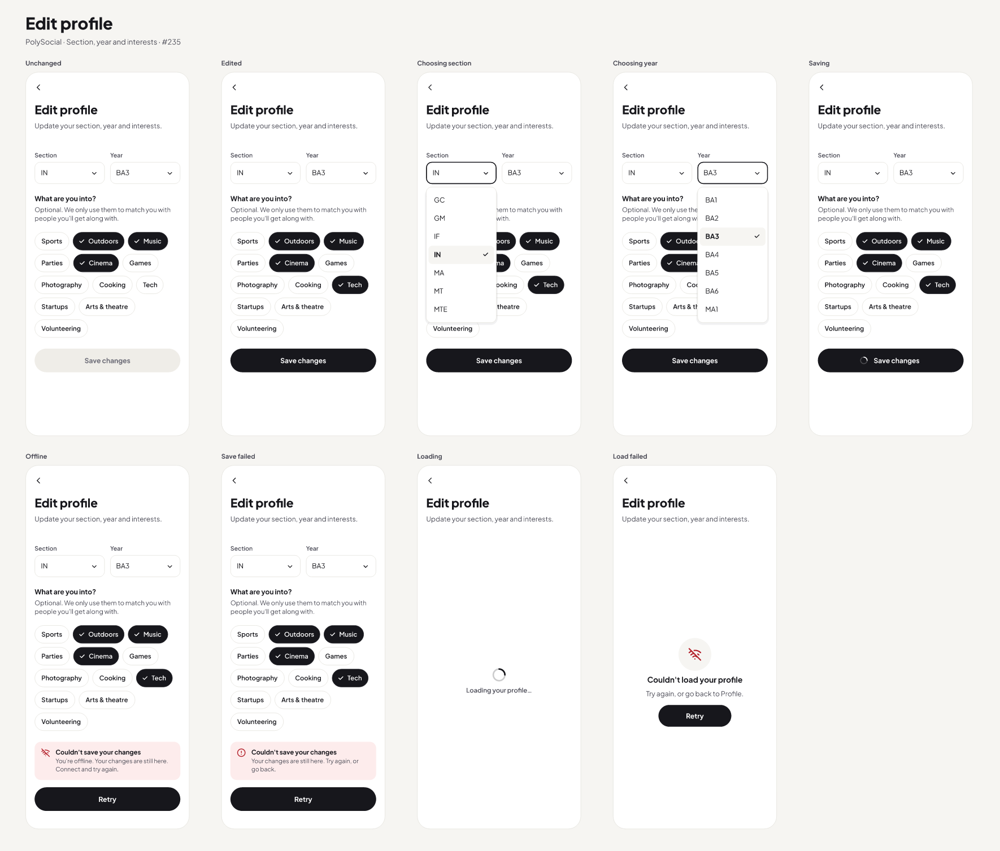

<!-- Contributors: Mehdi (@mehdifddl), human author; OpenAI Codex (prepared the mockup and documented the Figma publication and initial blocker, #235). -->

# Edit profile proposal (#235)

Draft for [PR #476](https://github.com/swent-polysocial/PolySocial/pull/476), prepared on behalf of Mehdi (@mehdifddl), with OpenAI Codex assistance. The screenshots below are mockups, not device-test results. No teammate approval is claimed.

The native Figma frames are published. The SVG preserves the draft created while editing was blocked and uses editable text in the existing product font, Plus Jakarta Sans. [Native editable Figma frames](https://www.figma.com/design/7Gt7tmy1ikpNyNBh1P6QdY/App-Mockup?node-id=1471-658) · [Editable SVG snapshot](edit-profile.svg)

The nine states cover unchanged and edited values, section and year menus, saving, offline failure, failed save, loading and failed loading. Offline and save failures preserve the form and offer Retry. Scope is section, year and interests; username and bio belong to later issues.

## Figma publication — 19 November 2026

Figma initially displayed “Ce fichier fait partie d'une équipe verrouillée” and rejected edits in read-only mode. A later retry that day published all nine states with editable layers and the existing product font. PR #476 and issue #235 link to the native frames. Teammate design review is pending.
