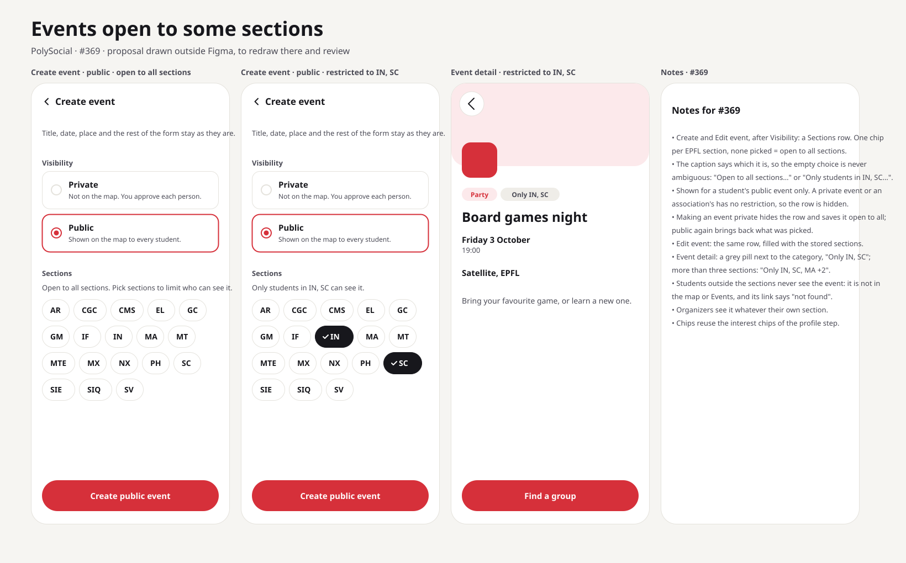

<!-- Contributors: Claude (Sonnet 5.5, Anthropic) (drew the proposal and wrote this note for Ayoub Fechtane, who reviews and owns it, #369). -->

# Events open to some sections (#369)

> **Superseded:** the frames are now drawn in the Figma file, section 03 · Discover events (Create event open to all and restricted, Edit event with its saved sections, and the detail pill). This SVG stays only as the history of the proposal.

A proposal for the Figma part of #369, drawn outside Figma because the account that prepared it has a view-only seat on the PolySocial team (every write is refused). It follows the existing Create event frames (Figma section 04, Visibility as in section 10) and the profile step's interest chips. It is **not** a Figma frame: someone with an editing seat has to redraw it in the file, and a teammate has to review it before the interface part of the PR is merged, as the issue asks.

States drawn:

1. **Create event · public · open to all sections**: a "Sections" row after Visibility, one chip per EPFL section, none picked. The caption says "Open to all sections. Pick sections to limit who can see it."
2. **Create event · public · restricted**: the same row with IN and SC picked. The caption says "Only students in IN, SC can see it."
3. **Event detail · restricted**: a grey pill next to the category, "Only IN, SC". With more than three sections it counts the rest ("Only AR, IN, MA +2").
4. **Edit event**: the same row, filled in with the stored sections (not drawn again).

Decisions to confirm:

- **No choice means every section.** There is no "all" chip: the caption states which case it is, so an empty selection is never ambiguous.
- **Only a student's public event has the row.** A private event is only for the people allowed in, and an association's events stay open to everyone, so the row is hidden for both. Making an event private hides the row and saves it open to every section; making it public again brings back what was picked.
- **An organizer can pick sections that exclude their own.** They still read the event, but it won't show in their Events list unless it is open to their section. The form says nothing about it for now.
- **A student outside the sections never sees the event**: not on the map, not in Events, and its link says "not found" (the same as a deleted event), so nothing says it exists.

The texts are proposals (`create_event_sections_*` and `event_detail_sections_only` in `strings_event_sections.xml`).
